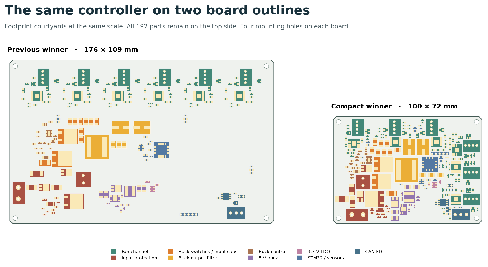
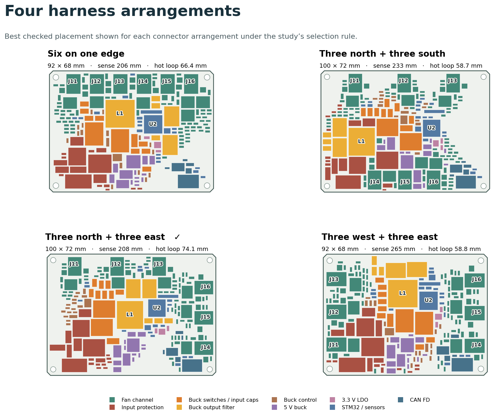

# Earlier independent-footprint placement study

The [local-circuit study](compact-study.md) supersedes this comparison. C41 and C42 obstructed the previous clock guide.

Open [the selected 100 × 72 mm board](independent-compact.fg) or [the 92 × 68 mm density alternative](compact-density.fg) in PCB Layout. Both use the [same schematic](six-amp-schematic.fg) as the [176 × 109 mm baseline](six-amp.fg). The 48 V input supplies a 12 V, 6 A combined fan and auxiliary load. The 5 V buck and 3.3 V LDO supply the STM32 and CAN FD circuitry. All six headers retain their individual eFuses, current sensing, PWM, tach and ESD parts.



## What moved

All 192 footprint origins moved, and 120 packages rotated on the selected board. Headers J11–J13 sit on the north edge and J14–J16 on the east. The input and CAN connectors sit on the south edge. Four 3.2 mm mounts follow the new perimeter. Changing the enclosure and harness was allowed. Connector mating envelopes, fastener heads and enclosure access need mechanical verification.

The search crossed three outlines, four fan-port arrangements, three main switch-cell arrangements, two output-capacitor bank arrangements, two fan-channel handedness patterns and two auxiliary section orientations. Input suppression, hot-swap FET, supervisor, main switch pair, driver and feedback, input ceramics, inductor and output bank, auxiliary buck, LDO, MCU and transceiver have separate placement targets. After selecting the connector arrangement, the solver could move each of the other 184 packages. The individual fan circuits follow their own connectors.

Of 288 starting configurations, 197 packed with the specified 0.55 mm courtyard gap and four mounting reservations. The solver kept a representative of each successful outline, fan and buck combination. ForgeCAD rebuilt and checked 27 of these, refined their free footprint positions and orientations, and checked another ten finalists. All 37 had zero placement blockers. The other 91 starts failed the greedy packing pass. This search does not establish a minimum possible board size.

## Why the 100 × 72 mm board won

Among refined candidates, the selection rule first requires zero placement blockers, a lower native weighted score, shorter total current-sense guides and a shorter input switching-loop guide than the baseline. It then prefers boards meeting both original gate-drive and bypass totals, followed by smaller area. The tie-break on a common outline is the native score plus nine times the switching-loop guide length in millimetres.

| Measured quantity | Original | Selected | Density alternative | Smallest tested, side banks |
|---|---:|---:|---:|---:|
| Outline, mm | 176 × 109 | 100 × 72 | 92 × 68 | 86 × 64 |
| Actual area including chamfers, mm² | 19,176 | 7,192 | 6,248 | 5,496 |
| Top area occupied by footprint courtyards | 17.9% | 47.8% | 55.0% | 62.5% |
| Native placement score ↓ | 10,229 | 7,571 | 8,089 | 10,796 |
| Six sense tap → ADC guides, mm | 450.78 | 207.64 | 207.38 | 161.50 |
| Four buck switching-loop guides, mm | 76.60 | 74.12 | 45.50 | 79.20 |
| Two buck gate-drive guides, mm | 21.82 | 17.47 | 25.43 | 29.47 |
| Four MCU and transceiver bypass guides, mm | 13.26 | 11.25 | 13.25 | 21.92 |
| MCU ↔ transceiver TX + RX, mm | 136.96 | 70.24 | 49.04 | 84.76 |

Distances sum Manhattan distances between specific physical pads before routing. For the switching loop these are C31.1–Q2.2, Q2.3–Q3.2, Q3.3–R20.2 and R20.1–C31.2. They estimate locality. Loop inductance depends on conductor geometry and the return path. The selected board shortens the 12 V net tree from 354.61 to 279.52 mm. On the connector side of the transceiver the CANH tree grows from 22.87 to 25.10 mm and CANL from 21.19 to 28.13 mm. Differential routing and actual skew remain to be checked.

The density alternative saves a further 944 mm² and has the shortest switching-loop guide of these four. Its combined gate guides exceed the original by 3.61 mm. The 86 × 64 mm example packs legally and gives the shortest sense total in this comparison. Its score, gate drives and bypass guides all worsen against the baseline.



## Reproduce

From the repository root, supply an empty output directory.

```sh
cargo run -p forge-lang --example compact_fans -- --legacy examples/electronics/fan-controller/six-amp.fg /tmp/forge-fan-layouts
forgecad pcb examples/electronics/fan-controller/independent-compact.fg drc --json
forgecad schematic examples/electronics/fan-controller/six-amp-schematic.fg erc --json
```

The native example writes every starting result to `search.tsv`, the exact comparisons to `finalists.tsv` and `refined.tsv`, all checked .fg boards and their JSON evidence, and the selected ID to `winner.txt`. Its board-specific alternatives use the [shared Rust packer](../../../interface/forge-lang/src/pcb/packing.rs). The [CLI and MCP block-version syntax](../../../research/electronics/routing-strategy.md#searching-inside-placement-blocks) applies to other pre-route boards. The search and checks use repository code and add no build dependencies.

Independent readback matched every footprint reference, side, package and schematic occurrence, and every one of the 624 pad assignments and transformed pad centers. Native DRC reported 466 unrouted connections and zero other findings on the selected board. The schematic had zero ERC findings and 478 checks with missing inputs. No tracked signal or power routes were generated in this study. Routing congestion, current capacity, fault behavior, thermal performance, and EMI remain unverified.
