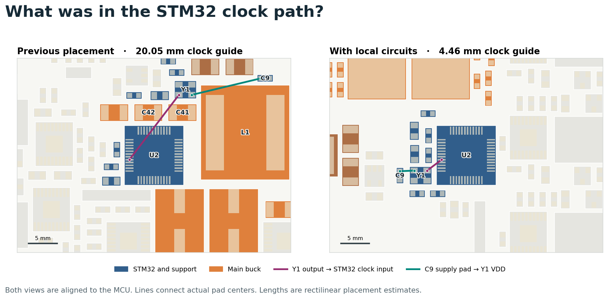
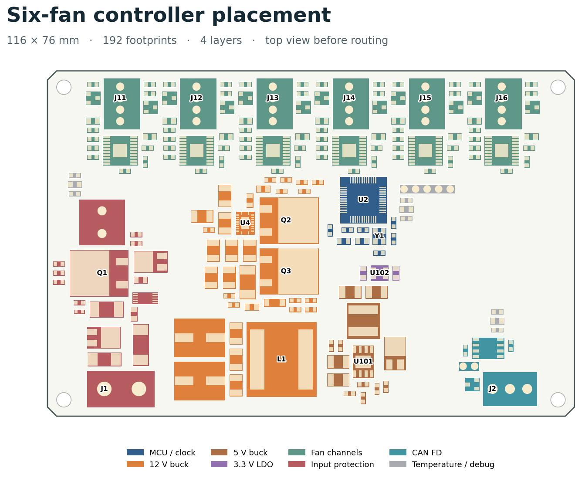

# Six-fan controller with local-circuit placement

Open [the corrected placement](compact-six-amp.fg) in PCB Layout. It uses the [six-amp schematic](six-amp-schematic.fg) and its four-layer stack. The preceding [100 × 72 mm placement](independent-compact.fg) put C41 and C42 from the 12 V buck across the direct path from oscillator Y1 to STM32 U2. Its oscillator bypass C9 was beyond L1. The old ranking measured a combined bypass length for C4 and C10. It never evaluated which components sat between Y1 and its pins.



## What changed

The packer can fit a local circuit around its pin-to-pin connections, reserve the enclosing courtyard rectangle and carry both its geometry and pad offsets into the board-level search. The generic repack command infers groups from verified supply/return links and compatible single-sink clocks. An additional oscillator bypass fulfillment in the example schematic identifies C9 as belonging to Y1 on its shared 3.3 V rail. The board-specific templates supply further membership and known pin-side arrangements for the STM32, reference filter, reset, main buck, auxiliary converter, LDO, input protection, CAN and fan channels. Each thermal divider also travels together. The main buck switching cell is fitted inside a separate working area before joining its inductor and output bank. This prevents the control passives from spreading through the output bank.

A reference or agent can declare more groups using the PCB query syntax `repack circuit=U2,Y1,C4,C5,C6,C7,C8,C9,R9,R10`. The tool tests and reports every compatible single-sink clock or linked local guide against other top-side courtyard polygons on this board. It returns the references crossed by each straight pad-to-pad segment. Placement ranking prefers fewer local crossings. Repacking excludes a source layout from selection when foreign packages occupy a reserved circuit. Multi-receiver clocks retain ordinary guides. Circuit membership on a shared rail requires device intent.

On the saved 100 × 72 mm board, a separate run of `repack rotate` with no fan-controller template or list of references inferred exactly two circuits: C4/C9/U2/Y1 and C10/U3. The original clock guide crossed C41 and C42. The packed guide measured 4.19 mm and crossed zero courtyards. This checks the generic repair independently of the full-board version study.

## Comparison

| Measure | Earlier compact board | Corrected board |
|---|---:|---:|
| Outline | 100 × 72 mm | 116 × 76 mm |
| Unrelated courtyards entering the STM32 support rectangle | 11 | 0 |
| Y1 output → U2 clock input | 20.05 mm | 4.46 mm |
| C9 supply pad → Y1 VDD | 14.98 mm | 2.63 mm |
| C8 reset capacitor → U2 reset pin | 23.79 mm | 5.05 mm |
| Buck switching-loop guide total | 74.12 mm | 41.22 mm |
| Two gate-drive guides | 17.47 mm | 14.60 mm |
| Six current-sense tap → ADC guides | 207.64 mm | 345.00 mm |

The selected board puts six fan ports on one edge. The [adjacent-edge version](compact-adjacent-ports.fg) puts three on each of two edges on the same 116 × 76 mm outline and also passes every handoff budget. Its 5 V to LDO guide is 14.60 mm versus 7.40 mm on the selected board.

The ten checked STM32 and oscillator support connections have zero crossings by parts from outside that circuit. Distances are rectilinear pad-center estimates. The illustration shows straight guides to make obstruction by another package visible. Parts in the same circuit can still require a detour during routing.

The search tried 3,456 starts across nine outlines. Variables included the harness arrangement, switch and output-bank arrangement, buck orientation, MCU orientation and board-level placement of the power and logic circuits. 261 starts fit every reserved rectangle. ForgeCAD rebuilt 18 finalists, shortlisted by outline, harness and buck arrangement, and selected `one-edge-folded-116x76-r0-m1-a2` only after checking individual interstage handoffs. Among boards meeting those budgets, the smallest area wins, followed by the native placement score. The five budgets are study assumptions in millimetres. They are independent of manufacturing clearance rules.

| Interstage guide | Placement budget, mm | Selected, mm |
|---|---:|---:|
| Reverse-protection output → input shunt | 16 | 8.00 |
| Hot-swap FET → main buck input capacitor | 36 | 32.21 |
| 5 V output capacitor → LDO input | 25 | 7.40 |
| LDO output capacitor → MCU bypass | 25 | 16.52 |
| Low-side switch pad → main inductor input | 24 | 21.00 |

A shorter estimate on another connection cannot offset a handoff above its budget. The fixed top-side templates and rectangular envelopes make the search conservative. Its smallest passing board is an observed result under those assumptions. The tighter original sense distances remain a disadvantage of the replacement.

### Finalists meeting all five handoff budgets

| Candidate in the replay output | Outline, mm | Six ADC guides, mm | Inlet to shunt, mm | 5 V to LDO, mm |
|---|---:|---:|---:|---:|
| one-edge-folded-116x76-r0-m1-a2 | 116 × 76 | 345.00 | 8.00 | 7.40 |
| corner-folded-116x76-r0-m1-a2 | 116 × 76 | 343.40 | 8.00 | 14.60 |
| one-edge-folded-116x82-r0-m1-a2 | 116 × 82 | 345.00 | 8.00 | 7.40 |
| corner-folded-116x82-r0-m1-a2 | 116 × 82 | 364.46 | 8.00 | 12.60 |



## Replay and verification

```sh
cargo run -p forge-lang --example compact_fans -- examples/electronics/fan-controller/six-amp.fg /tmp/forge-local-study
forgecad pcb examples/electronics/fan-controller/compact-six-amp.fg drc --json
forgecad pcb examples/electronics/fan-controller/independent-compact.fg floorplan --json
forgecad schematic examples/electronics/fan-controller/six-amp-schematic.fg erc --json
```

Use an empty destination for the search. It writes the native source of each finalist, its compiled placement evidence, a search ledger, and the selected ID. The [previous independent-footprint study](compact-independent-study.md) remains available for comparison. Native DRC reports 466 unrouted connections and zero other findings. The same 192 footprints retain all 624 pad assignments. ERC reports zero findings and 478 checks without enough source data. Routing, loaded thermal behavior, mechanical access and converter performance remain open.
