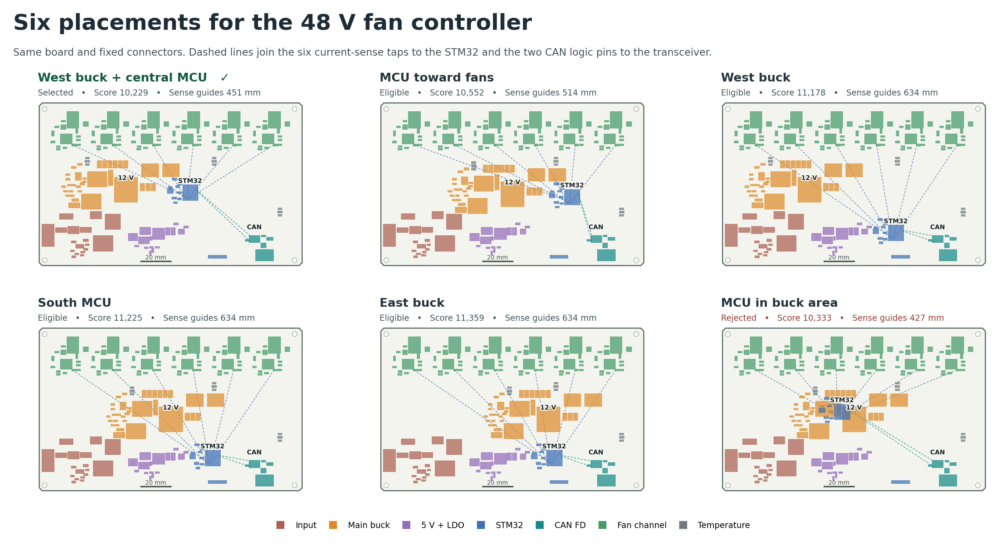
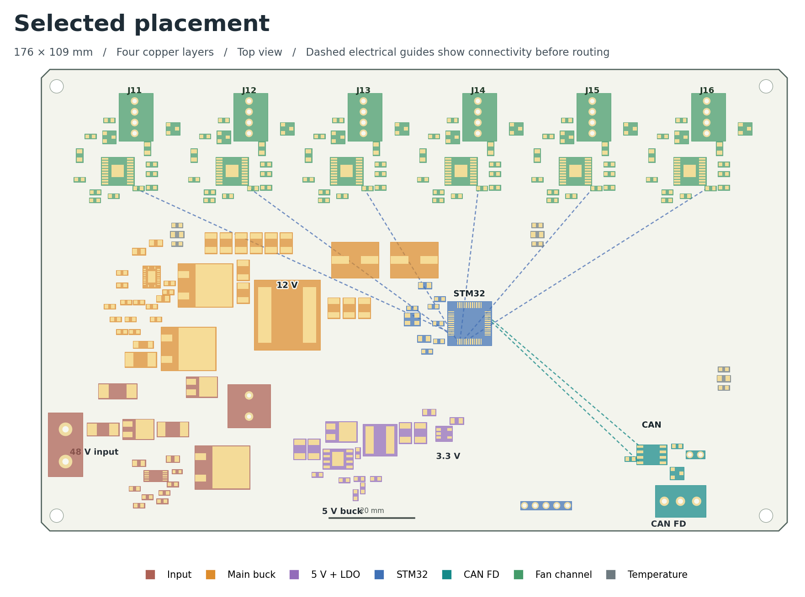

# Six-amp fan controller placement study

Open [six-amp.fg](six-amp.fg) for the selected placement and [six-amp-schematic.fg](six-amp-schematic.fg) for its schematic. The placement study uses 192 footprints and 624 pads on a 176 × 109 mm four-layer board. The STM32G0B1CBT6 drives six four-pin fan channels and communicates through a TCAN3414 CAN FD transceiver.



## Power and protection

- The 48 V input has a fuse, TVS, reverse-polarity diode and LM5069-1 hot-swap circuit ahead of the main buck.
- The discrete LM5146 synchronous converter supplies a **6 A continuous design target** at 12 V. This is the combined fan and auxiliary load. At 48 V, 250 kHz and 8.2 µH, ideal ripple is 4.39 A peak-to-peak. With a 3 mΩ shunt, 165 Ω ILIM resistor and nominal 100 µA shunt-mode bias, the valley limit is 5.5 A, about 7.7 A average at that operating point. This leaves overload headroom above the continuous target. [LM5146, §8.3.6](https://www.ti.com/lit/ds/symlink/lm5146.pdf)
- The LM5013 takes its input and enable from 12 V. Its 158 kΩ and 49.9 kΩ feedback divider gives a nominal 5.00 V. A TLV75533PDBVR and local ceramic capacitors supply 3.3 V to the STM32 and CAN transceiver. [LM5013](https://www.ti.com/lit/ds/symlink/lm5013.pdf) · [TLV755P](https://www.ti.com/lit/ds/symlink/tlv755p.pdf)
- Each header has its own TPS26630 latched eFuse, current monitor, fault and enable, open-drain PWM driver and tach input. Each connector also has a PESD5V0S2BT protecting both signal lines. The inherited 6.49 kΩ branch setting gives approximately 2.77 A nominal overload threshold. The sum of those six thresholds exceeds the supply budget. The CAN connector has ESD protection and selectable termination. [TPS2663](https://www.ti.com/lit/ds/symlink/tps2663.pdf) · [PESD5V0S2BT](https://assets.nexperia.com/documents/data-sheet/PESD5V0S2BT.pdf)

## Results

The replay starts at the selected placement. It translates the main converter and its thermal sensor together, or the MCU, oscillator, reference filter and local capacitors together. Input protection, connectors, fan circuits, CAN transceiver, LDO and auxiliary buck retain the same poses in every comparison.

| Placement | Score, lower wins | Six sense-tap guides, mm | Placement blockers |
|---|---:|---:|---:|
| West buck + central MCU (selected) | 10,229 | 451 | 0 |
| MCU toward fans | 10,552 | 514 | 0 |
| West buck | 11,178 | 634 | 0 |
| South MCU | 11,225 | 634 | 0 |
| East buck | 11,359 | 634 | 0 |
| MCU in buck area | 10,333 | 427 | 163 |

Relative to the south-MCU placement, moving the buck 30 mm west and 3 mm north and the MCU group 15 mm west and 27 mm north reduces the six sense-tap guides from 634.04 to 450.78 mm. The protected-input net's rectilinear tree falls from 134.95 to 126.26 mm. The first fan's sense tap R221.1 to STM32 pad 11 falls from 150.75 to 108.75 mm. There is a measurable cost on the CAN controller side. TX grows from 24.825 to 66.825 mm and RX from 28.135 to 70.135 mm. The external CAN pair, oscillator and bypass loops retain their geometry. The rejected MCU position shortens the sense guides further but overlaps the switching stage, including Q2's courtyard.



Run the comparison with the repository's native CLI. The shell script only supplies candidate translations. All scoring, filling and geometry tests run in ForgeCAD.

```sh
./compare-six-amp.sh > candidates.json
forgecad schematic six-amp-schematic.fg erc --json
forgecad pcb six-amp.fg drc --json
```

This is a placement deliverable. The signal guides are estimates, and the board has an inner ground pour. Native board DRC reports 466 unrouted connections and zero other findings. ERC reports zero findings and 478 check instances with missing device ratings or other required fields. Component selection and protection are modeled. Thermal performance, converter stability and transient response, EMC/ESD immunity, fault coordination and loaded hardware operation remain unqualified.
