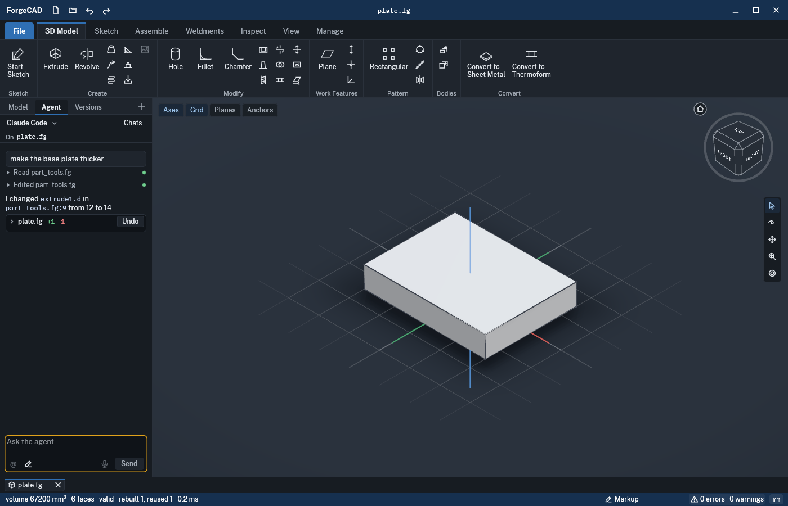

# The Agent tab against a terminal: audit

Goal (David): the Agent tab should be as good as or better than a terminal for work in the app, and
it should work in the browser.

Date 2026-11-24, main at db5c075. Code read: `interface/forge-render/src/agent/*` (backends),
`src/shell/agent.rs` (the tab), `src/gui_agent.rs` (the host), `src/shell/agent_settings.rs`,
`interface/forge-agent`. Pictures are in `shots/`, from `tests/agent_audit_shots.rs` (headless app,
lavapipe) and the page under `forgecad web` (Chromium, SwiftShader WebGPU).

## What the tab is today

Three backends behind one transcript (`agent::Backend`):

- **Claude Code**: `claude -p --input-format stream-json --output-format stream-json
  --include-partial-messages`, one process per chat kept open across turns, `--resume <id>` if it
  dies. The person's own login and settings. The app's own tools (`app_*`: tree, show/hide,
  select, view, section, drive a joint, screenshot) reach it over MCP through `forge-app
  --mcp-bridge`; the `fg_*` / `project_*` tools too.
- **Codex**: `codex exec --json`, one process per turn, `resume <id>`.
- **OpenAI-compatible endpoint**: ForgeCAD's own loop (`openai.rs`) with six file tools
  (`read_file`, `replace_text`, `apply_op`, `create_file`, `query`, `run_check`) plus the app tools.
  Key in the OS keyring.

The transcript (`Entry`): your message (with attached ids and a markup picture), the agent's text
(streamed), one row per tool call (click to open: input, then the first 40 lines of output), a diff
card per file per turn with Undo/Redo, notes, and a problem card with a copyable fix. Esc or Stop
interrupts; messages sent while it runs queue. Conversations save per project and come back from
"Chats" or `/resume`.

## Side by side with Claude Code in a terminal, same repo, same tools

| | Terminal (`claude` in the project) | Agent tab |
|---|---|---|
| Streaming | text streams; spinner with elapsed time and tokens; thinking indicator | text streams (`--include-partial-messages`); a pulsing dot on the running tool; no elapsed time, tokens or cost |
| Tool calls | one line each, Ctrl+O for the whole | one row each, click to open; output cut at 40 lines with no "show all"; a subagent's work is hidden in its row |
| Edits as diffs | each Edit shows its diff inline | each Edit's -/+ in its row, and a per-file diff card at the turn's end (collapsed, 60 lines shown) |
| Undo / redo | `/rewind` to a checkpoint (files and conversation) | **better**: Undo/Redo on each diff card is one step in the document's own undo history, labelled "Agent: ..."; new files go to `.forgecad-trash` and back. **But not after a restart**: a resumed chat's diffs become plain notes |
| Interrupt | Esc; type while it works to steer | Esc / Stop (an `interrupt` control request); typing while it runs queues a follow-up (can't be edited or dropped once queued) |
| History across restarts | `claude -c` / `--resume`, the whole transcript | saved per project, resumed from Chats or `/resume`; **not reopened on launch**; diffs come back as notes; markup pictures as text |
| Context: open part | cwd + CLAUDE.md | system prompt names the open file; switching files adds "(The open file is now X)" |
| Context: selection | n/a | the `@` button attaches the current selection's id, one click per id. Nothing is attached unless you click; no `@` typed in the box |
| @-mentions | `@file` with completion | none: you can't type `@boss.end` or `@plate.fg` and pick from a list |
| **Approvals** | a prompt for each risky action: yes / yes-don't-ask-again / no; Shift+Tab cycles modes (default, acceptEdits, plan) | **none**. No `--permission-prompt-tool` is passed, so anything that would prompt is denied without asking. On a default install that includes **editing the open part** (measured below). The denial shows only as a red dot; the `permission_denied` event is ignored |
| Slash commands | `/model /clear /compact /context /cost /permissions /rewind /resume`, the person's own commands and skills | `/new`, `/resume` only. No list or completion when you type `/` |
| Model choice | `/model`, `--model` | the header's switcher: backend and a model text field (Claude Code alias or id). Switching keeps the Claude session (`--resume`). No effort level |
| Copy / paste | terminal selection; paste text and images | selectable text, a Copy button on code blocks and on the fix; paste text. No image paste or drop (markup and the app's screenshot instead) |
| Errors | the CLI's own messages | not installed / not signed in get a card with the one command that fixes it; a dead process says stderr's last line; HTTP errors are worded. Rate-limit events and permission denials are dropped silently |
| Rendering | Markdown | inline code and fenced code only: headings, lists, tables, bold show as raw text |
| Latency | same CLI | same CLI, kept warm across turns (see below). After every tool call the whole project is re-read to find changed files |
| Input | history with ↑, multiline, Ctrl+R search | multiline (Shift+Enter); no ↑ history |
| Browser | n/a | **no agent at all**: Claude Code and Codex can't run in a page, and the endpoint loop returns "the browser's agent doesn't reach endpoints yet" (`openai.rs`) |

### Measured

- **Approvals.** In a fresh folder with default settings, `claude -p` (2.1.331) asked to change
  `p.fg` with Edit: `permission_denied`, "Claude requested permissions to write to .../p.fg, but you
  haven't granted it yet", and the file stayed as it was. A `curl` in Bash: denied the same way.
  With `--permission-prompt-tool stdio` the CLI instead sends the host
  `{"type":"control_request","request":{"subtype":"can_use_tool","tool_name":"Bash","input":{..},
  "permission_suggestions":[..],"tool_use_id":..}}` and waits for the answer: the hook an approval
  card needs is there. So today the tab only works for someone whose `~/.claude/settings.json`
  already allows Edit and the MCP tools; for everyone else it can read and talk but not change the
  part.
- **Claude Code latency** (haiku, this container): process start to `init` 0.86 s, first reply
  text 2.58 s, turn done 2.66 s. The tab keeps the process across turns, so only the first turn of
  a chat pays the start.
- **The tab's own cost**: a fake turn's round trip through the app (stand-in `claude` script,
  diff, reload) 100 ms. Frame time with an empty transcript 10.8 ms, with 1200 entries 15.6 ms
  (software renderer): every entry is laid out every frame; a long chat costs about 4 µs a row.

## Gaps, ranked by how much they hurt real work

1. **No approvals (blocker).** On a default install the agent can't edit the part, and nothing
   says why except a red dot and the model's apology. In a terminal you press "yes". Fix: pass
   `--permission-prompt-tool stdio`, answer `can_use_tool` with an approval card in the
   transcript (Allow once / Always for this session / Deny, Enter and Esc), show the tool's input
   (an Edit as its diff), and a mode switch in the header (Ask / Accept edits / Plan) mapped to
   `--permission-mode`. Also show `permission_denied` as a note. Same card for the endpoint loop's
   writes when the person wants it. Codex: `exec` has no prompt channel; keep its sandbox.
2. **No agent in the browser (blocker for the page).** See "Browser" below.
3. **Context is manual.** "This face" is how people talk about CAD; today the selection goes only
   if you click `@` first. Fix: the current selection rides along as a removable chip by default;
   `@` in the box opens a completion list of features, faces (by name), occurrences, params and
   project files; the open file and its build status (errors/warnings count) go with each turn.
4. **History doesn't really survive a restart.** The chat isn't reopened at launch, and its diffs
   lose their Undo/Redo and their lines. Fix: reopen the last chat of the project at launch (one
   click to start fresh), and save the diff (before/after per file, capped) so a resumed diff
   card still shows and can still undo through the file's undo log (the log already persists:
   `forge_lang::undo::log_path`).
5. **Slash commands.** Only `/new` and `/resume`. Fix: `/` opens a list: `/new`, `/resume`,
   `/model`, `/mode` (permissions), `/clear`, `/compact` and `/cost` (passed to Claude Code where its
   stream-json input accepts them: to check per command), `/undo` (last turn), plus the person's own commands and skills
   from the `init` event's `slash_commands`.
6. **Can't see what it costs or how long it's been.** Fix: a status line under the transcript
   while a turn runs: elapsed, tokens in/out, and the turn's cost from the `result` event; the
   rate-limit event as a note when it isn't "allowed".
7. **Markdown.** Lists, headings, bold and tables show raw. Fix: render them (egui's text layout
   is enough for these; no new dependency).
8. **Tool output cut at 40 lines, no "show all"; queued messages can't be edited or dropped; no ↑
   history; no image paste.** Small, each a few lines.
9. **Long chats cost frame time** (≈4 µs a row, 5 ms at 1200 rows). Fix with row height caching
   and drawing only visible rows when it matters; not urgent.
10. **The project is re-read after each tool.** Fine for small projects; on a large one it's a
    stall per tool call. Fix: compare mtimes/sizes first, read only what changed.

What's already better than a terminal and should stay: per-turn undo/redo in the document's own
history, the part reloading as the agent writes, markup drawn on the view, the app tools (the agent
can see and drive the view), the not-installed / not-signed-in cards.

## Browser: how the agent runs in the page

The page already has everything but the model call: the kernel, forge-lang and the agent's file
tools run in the wasm (`agent::tools::call` works on `forge_dirs::fs`, the page's filesystem), and
the app tools are in process. Claude Code and Codex can't run in a page (they're processes).

**The loop** runs in the page, in Rust, as an async version of `openai.rs`'s turn:
`wasm_bindgen_futures::spawn_local`, the model call by the page's `fetch` with a streamed body
(a small JS helper in `app.js`: `forge_agent_fetch(url, headers, body, onChunk) -> Promise`), the
SSE lines parsed by the existing `Acc` (and an Anthropic Messages parser beside it), tools called
between steps on the main thread as builds are today. The default wasm build is single threaded
(`plat::spawn` runs the closure inline), so the loop must not block: that's why it's async and not
the native thread. Stop sets the flag and aborts the fetch (`AbortController`).

**The model call**, options:

| | How | Key | Privacy | Cost to us |
|---|---|---|---|---|
| A. Your own key, direct from the page | the page calls the provider itself: Anthropic Messages (`anthropic-dangerous-direct-browser-access: true`), OpenAI, OpenRouter, or a local server (Ollama with `OLLAMA_ORIGINS`, LM Studio). Preflights checked 2026-11-24: Anthropic allows `x-api-key, anthropic-version, content-type, anthropic-dangerous-direct-browser-access` from any origin; OpenAI and OpenRouter allow `authorization, content-type` | held in the page: in memory for the tab by default; "Remember on this device" puts it in this origin's `localStorage` (as `keys_web.rs` does now) | the conversation and the part go only to the provider you chose; nothing to us; no telemetry | none |
| B. A relay we run | the page calls our server, which holds a key or forwards yours | ours, or yours passing through us | we see every conversation and part; we'd have to promise not to log | a server, its key, abuse handling, uptime |
| C. Your own machine as the relay | when the page is served by `forgecad web` (already a local server with Origin/Host checks and a token), it gains `/api/agent`, which runs `claude -p` on that machine and streams its stream-json back over SSE | Claude Code's own login, never in the page | as the desktop app | none (the person runs it) |
| D. OpenRouter's OAuth (PKCE) | a "Connect" button gets a key scoped to this app with no server | as A | as A, with OpenRouter in the middle | none |

The risks of A and how to hold them:

- **A key in a page is readable by any script that page runs.** The page runs only its own files
  (no third-party scripts, no CDN). Add a Content-Security-Policy to `index.html`: `script-src
  'self' 'wasm-unsafe-eval'` (the inline module in `index.html` moves to a file or gets a hash),
  so an injected script can't run. `connect-src` can't be narrowed to
  one host because the endpoint is the person's choice; leave it `'self' https: http://localhost:*
  http://127.0.0.1:*` and say so.
- **Storage.** Default to memory only (gone when the tab closes). Opt-in to `localStorage`, with
  the words "kept in this browser for this site; anyone with this computer's profile can read it".
  WebCrypto with a non-extractable key in IndexedDB doesn't help: the page itself must be able to
  decrypt it, so a script in the page can too. Not worth the code.
- **Origin.** On a shared host (GitHub Pages under a user's domain) every page on that origin can
  read `localStorage`. Say so in the settings when the origin isn't `localhost`; memory-only is the
  default anyway.
- **Spend.** A leaked key costs money: point to the provider's per-key limits; Anthropic and
  OpenAI keys can be workspace-scoped with a spend cap.
- **No telemetry**: the page talks to the provider and its own origin only; nothing else is
  added.

**Recommendation: A, with C as the follow-up.** A works on any static host, needs no server, keeps
the person's data between them and the provider they chose, and reuses the loop and tools that
already exist (the endpoint backend gains an Anthropic Messages dialect, which the desktop's
endpoint option gets too). B is a server, a key and a privacy promise for a feature A gives without
them: not recommended. C is the way to use a Claude subscription (no API key) from the browser and
gives the page the full Claude Code agent, but only where `forgecad web` is running; build it after
A. D is a nicer key handoff for OpenRouter users; optional.

Tests: `web/tests/agent.cjs` runs the page with `page.route()` answering the provider's URL with a
canned SSE stream (a tool call that edits `plate.fg`, then a reply), and checks the file changed,
the diff card shows, Undo puts it back, Stop aborts the fetch, and no request went anywhere but
the mocked provider.

## Plan (one branch per slice, off main, in this order)

1. `agent/approvals`: permission prompts for Claude Code (card, modes, denials shown).
2. `agent/browser`: the async loop in the page, Anthropic Messages + OpenAI dialects, key in memory
   or opt-in local, CSP, `web/tests/agent.cjs` with the model mocked.
3. `agent/context`: selection as a default chip, `@` completion, build status with each turn.
4. `agent/history`: reopen the last chat at launch, diffs saved with undo after restart.
5. `agent/commands`: `/` menu, passthrough commands, status line (elapsed, tokens, cost).
6. `agent/polish`: Markdown, show-all output, edit/drop queued, ↑ history, image paste.
7. `web/agent-local` (C): `forgecad web`'s `/api/agent` running Claude Code for the page.
