# UI audit: every ribbon command, clicked

Made by `tools/ui-audit/crawl.sh` (the crawler is `interface/forge-render/tests/ui_audit`). Each command is clicked headless in a document that suits it, from the app's own registry (`Shell::ribbon_live`), at 1400x860 and again at 480 px wide. What it did is classed; what it opened is judged against docs/ux/STANDARD.md (automatic rules, then the visual review in `verdicts.tsv`). Verdicts: good / fix / redo.

Crawl of main ded2d224 (the app before the fixes), native, lavapipe. Status says where each
finding stands (`status.tsv`): fixed on a branch, or with its owner. Caveat: this crawl predates
two judge fixes (the document's own names, e.g. `right_lip`, are no raw keys; the status is judged
as drawn), so some sheet-metal "raw-text" and "Saved <path>" findings here are noise that the next
crawl drops.

**782 commands** in 10 documents.

| What a click does | Commands |
|---|---|
| DIALOG | 338 |
| DISABLED | 164 |
| ACTION | 111 |
| WORKSPACE | 43 |
| PANEL | 37 |
| HOST | 28 |
| ERROR TEXT | 28 |
| MODE | 17 |
| NOTHING VISIBLE | 16 |

| Verdict (live commands) | Commands |
|---|---|
| redo | 71 |
| fix | 62 |
| good | 485 |

| Rule broken | Commands |
|---|---|
| raw-text | 55 |
| tiny-text | 30 |
| nothing@narrow | 21 |
| clipped@narrow | 19 |
| off-screen | 17 |
| nothing | 16 |
| off-screen@narrow | 14 |
| clipped | 12 |
| crash@narrow | 6 |
| contrast | 6 |
| overlap | 3 |
| silent-mode | 2 |
| no-exit | 1 |

## The 20 worst

1. **plate/3D Model/Draft** (P1, DIALOG, score 103, redo): crash@narrow: min > max, or either was NaN. min = 356.5, max = 328.0 → **fixed: ui/audit-words3 (batch 3, 480 px crash; = ui/bughunt-3 e90d49ec)**
2. **part/3D Model/Split** (P1, DIALOG, score 103, redo): crash@narrow: min > max, or either was NaN. min = 378.46875, max = 328.0 → **fixed: ui/audit-words3 (batch 3, 480 px crash)**
3. **part/3D Model/Combine** (P1, DIALOG, score 103, redo): crash@narrow: min > max, or either was NaN. min = 374.21875, max = 328.0 → **fixed: ui/audit-words3 (batch 3, 480 px crash)**
4. **part/3D Model/Delete Face** (P1, DIALOG, score 103, redo): crash@narrow: min > max, or either was NaN. min = 378.875, max = 328.0 → **fixed: ui/audit-words3 (batch 3, 480 px crash)**
5. **start/Machine Builder: Machine Builder/Home Axes** (P1, NOTHING VISIBLE, score 100, redo): nothing: nothing a person can see happens; nothing@narrow: no popup, panel, status line or change in the view → **fixed: machines/builder-off-reasons (MACHINE-BUILDER)**
6. **sketch/menu File/Save** (P1, NOTHING VISIBLE, score 100, redo): nothing: nothing a person can see happens; nothing@narrow: no popup, panel, status line or change in the view → **fixed: ui/audit-shell (batch 1, state_status)**
7. **sketch/menu Browser: sketch row/delete** (P1, NOTHING VISIBLE, score 100, redo): nothing: nothing a person can see happens; nothing@narrow: no popup, panel, status line or change in the view → **fixed: ui/audit-shell (batch 1, off with "Finish or cancel the sketch first")**
8. **sketch/menu Browser: sketch row/down** (P1, NOTHING VISIBLE, score 100, redo): nothing: nothing a person can see happens; nothing@narrow: no popup, panel, status line or change in the view → **fixed: ui/audit-shell (batch 1, off with "Finish or cancel the sketch first")**
9. **sketch/menu Browser: extrude row/up** (P1, NOTHING VISIBLE, score 100, redo): nothing: nothing a person can see happens; nothing@narrow: no popup, panel, status line or change in the view → **fixed: ui/audit-shell (batch 1, off with "Finish or cancel the sketch first")**
10. **sketch/Assemble/Pattern** (P1, NOTHING VISIBLE, score 100, redo): nothing: nothing a person can see happens; nothing@narrow: no popup, panel, status line or change in the view → **fixed: ui/audit-shell (batch 1, off until a part is chosen)**
11. **sketch/Assemble/Mirror** (P1, NOTHING VISIBLE, score 100, redo): nothing: nothing a person can see happens; nothing@narrow: no popup, panel, status line or change in the view → **fixed: ui/audit-shell (batch 1, off until a part is chosen)**
12. **sketch/Assemble/Copy** (P1, NOTHING VISIBLE, score 100, redo): nothing: nothing a person can see happens; nothing@narrow: no popup, panel, status line or change in the view → **fixed: ui/audit-shell (batch 1, off until a part is chosen)**
13. **sheet/Flat Pattern: Flat Pattern/Bend Simulation** (P1, WORKSPACE, score 100, redo): crash@narrow: Negative width makes no sense, but got: -167 → **with BENDSIM-ENV (480 px crash, bendsim_env.rs:347)**
14. **drawing/Manage/Update** (P1, NOTHING VISIBLE, score 100, redo): nothing: nothing a person can see happens; nothing@narrow: no popup, panel, status line or change in the view → **fixed: ui/audit-words3 (batch 3)**
15. **drawing/Manage/Zoom All** (P1, NOTHING VISIBLE, score 100, redo): nothing: nothing a person can see happens; nothing@narrow: no popup, panel, status line or change in the view → **fixed: ui/audit-words3 (batch 3)**
16. **plate/Assemble/Content Center** (P2, DIALOG, score 63, redo): tiny-text: "O-ring" at 9.5 px; tiny-text: "Plain washer, type A" at 9.5 px; tiny-text: "Hex cap screw" at 9.5 px; tiny-text: "Hex nut" at 9.5 px; tiny-text: "Button head socket cap screw" at 9.5 px; tiny-text: "Flat head socket cap screw" at 9.5 px; tiny-text: "Socket head cap screw" at 9.5 px; tiny-text: "Retaining ring for shafts" at 9.5 px; tiny-text: "Retaining ring for bores" at 9.5 px; tiny-text: "Parallel key, form A" at 9.5 px → open
17. **sheet/Sheet Metal/Insert Hardware** (P2, DIALOG, score 63, redo): raw-text: "right_lip" (a raw key); raw-text: "left_lip" (a raw key) → open
18. **sketch/Manage/Save** (P1, NOTHING VISIBLE, score 60, redo): nothing: nothing a person can see happens → **fixed: ui/audit-shell (batch 1, state_status)**
19. **sheet/Bend Simulation: Bend Simulation/Suggest Order** (P1, NOTHING VISIBLE, score 60, redo): nothing: nothing a person can see happens → **with BENDSIM-ENV (after the train-7 freeze; 480 px crash sent)**
20. **sheet/Bend Simulation: Bend Simulation/Simulate Again** (P1, NOTHING VISIBLE, score 60, redo): nothing: nothing a person can see happens → **with BENDSIM-ENV (after the train-7 freeze; 480 px crash sent)**

## Every command

### start · menu File

| Command | What happens | Page | Verdict | P | Problems | Shot |
|---|---|---|---|---|---|---|
| File › Export 3MF... | DISABLED: off: the menu stays open |  | good | P3 | label: "Export 3MF...": three dots for "…" |  |
| File › Export OBJ... | DISABLED: off: the menu stays open |  | good | P3 | label: "Export OBJ...": three dots for "…" |  |
| File › Export STL... | DISABLED: off: the menu stays open |  | good | P3 | label: "Export STL...": three dots for "…" |  |
| File › New | WORKSPACE: a new document tab |  | good |  |  |  |
| File › New Drawing... | DISABLED: off: the menu stays open |  | good | P3 | label: "New Drawing...": three dots for "…" |  |
| File › New Sheet Metal | HOST: the window's host is asked: Sheet(NewPart) |  | good |  |  |  |
| File › Open... | HOST: the window's host is asked: Open |  | good | P3 | label: "Open...": three dots for "…" |  |
| File › Save | DISABLED: off: the menu stays open |  | good |  |  |  |

### start · 3D Model

| Command | What happens | Page | Verdict | P | Problems | Shot |
|---|---|---|---|---|---|---|
| Sketch › Start Sketch | DISABLED: Start a 2D sketch: pick a plane or a flat face,… / Off: open or create a part first (File > New, o… |  | good |  |  |  |
| Create › Extrude | DISABLED: Pull a sketch's profile into a solid (or cut wi… / Off: open or create a part first (File > New, o… |  | good |  |  |  |
| Create › Revolve | DISABLED: Turn a sketch's profile about an axis into a so… / Off: open or create a part first (File > New, o… |  | good |  |  |  |
| Create › Loft | DISABLED: Join two or more profiles with a smooth solid / Off: open or create a part first (File > New, o… |  | good |  |  |  |
| Create › Sweep | DISABLED: Run a profile along a path / Off: open or create a part first (File > New, o… |  | good |  |  |  |
| Create › Coil | DISABLED: A spring or thread-like coil of a profile, by p… / Off: open or create a part first (File > New, o… |  | good |  |  |  |
| Create › Rib | DISABLED: A thin web from an open sketch line to the face… / Off: open or create a part first (File > New, o… |  | good |  |  |  |
| Create › Emboss | DISABLED: Raise or cut text or a profile onto a face / Off: open or create a part first (File > New, o… |  | good |  |  |  |
| Create › Import | DISABLED: Bring in a STEP, IGES or .brep file as a body / Off: open or create a part first (File > New, o… |  | good |  |  |  |
| Create › Decal | DISABLED: Wrap an image onto a face / Off: not yet: the kernel has no image projectio… |  | good |  |  |  |
| Modify › Hole | DISABLED: Drilled, counterbored, countersunk or tapped ho… / Off: open or create a part first (File > New, o… |  | good |  |  |  |
| Modify › Fillet | DISABLED: Round chosen edges by a radius / Off: open or create a part first (File > New, o… |  | good |  |  |  |
| Modify › Chamfer | DISABLED: Bevel chosen edges by a distance / Off: open or create a part first (File > New, o… |  | good |  |  |  |
| Modify › Shell | DISABLED: Hollow the part to a wall thickness, leaving ch… / Off: open or create a part first (File > New, o… |  | good |  |  |  |
| Modify › Draft | DISABLED: Lean chosen faces by an angle from a pull direc… / Off: open or create a part first (File > New, o… |  | good |  |  |  |
| Modify › Thread | DISABLED: Model a thread on a cylindrical face / Off: open or create a part first (File > New, o… |  | good |  |  |  |
| Modify › Split | DISABLED: Split a body or faces with a plane or a surface / Off: open or create a part first (File > New, o… |  | good |  |  |  |
| Modify › Combine | DISABLED: Join, cut or intersect bodies / Off: open or create a part first (File > New, o… |  | good |  |  |  |
| Modify › Thicken | DISABLED: Give a face or surface a thickness / Off: open or create a part first (File > New, o… |  | good |  |  |  |
| Modify › Direct | DISABLED: Move, turn or size faces of the solid directly / Off: open or create a part first (File > New, o… |  | good |  |  |  |
| Modify › Delete Face | DISABLED: Take faces out and let the solid heal over the … / Off: open or create a part first (File > New, o… |  | good |  |  |  |
| Modify › Replace | DISABLED: Replace faces with another face or surface / Off: open or create a part first (File > New, o… |  | good |  |  |  |
| Work Features › Plane | DISABLED: A work plane: offset or angled from faces and p… / Off: open or create a part first (File > New, o… |  | good |  |  |  |
| Work Features › Axis | DISABLED: A work axis through edges or points / Off: open or create a part first (File > New, o… |  | good |  |  |  |
| Work Features › Point | DISABLED: A work point at a vertex or an intersection / Off: open or create a part first (File > New, o… |  | good |  |  |  |
| Work Features › UCS | DISABLED: A user coordinate system: an origin and three a… / Off: open or create a part first (File > New, o… |  | good |  |  |  |
| Pattern › Rectangular | DISABLED: Copy features along one or two directions / Off: open or create a part first (File > New, o… |  | good |  |  |  |
| Pattern › Circular | DISABLED: Copy features about an axis / Off: open or create a part first (File > New, o… |  | good |  |  |  |
| Pattern › Sketch | DISABLED: Copy features at a sketch's points / Off: open or create a part first (File > New, o… |  | good |  |  |  |
| Pattern › Mirror | DISABLED: Mirror features across a plane / Off: open or create a part first (File > New, o… |  | good |  |  |  |
| Bodies › Move | DISABLED: Move or rotate whole bodies / Off: open or create a part first (File > New, o… |  | good |  |  |  |
| Bodies › Copy | DISABLED: Copy whole bodies / Off: open or create a part first (File > New, o… |  | good |  |  |  |

### start · Inspect

| Command | What happens | Page | Verdict | P | Problems | Shot |
|---|---|---|---|---|---|---|
| Measure › Measure | DISABLED: Distances, angles and sizes between what is pic… / Off: open or create a part first (File > New, o… |  | good |  |  |  |
| Measure › Wall | DISABLED: The wall thickness at a point / Off: open or create a part first (File > New, o… |  | good |  |  |  |
| Measure › Mass | DISABLED: The part's mass, volume and area / Off: open or create a part first (File > New, o… |  | good |  |  |  |
| Measure › CG Marker | DISABLED: Show the centre of gravity in the view / Off: open or create a part first (File > New, o… |  | good |  |  |  |
| Analysis › Section | DISABLED: Cut the view open with a plane to look inside / Off: open or create a part first (File > New, o… |  | good |  |  |  |
| Analysis › Check | DISABLED: Check the solid for faults / Off: open or create a part first (File > New, o… |  | good |  |  |  |
| Properties › iProperties | DISABLED: The part's properties: physical, summary, proje… / Off: open or create a part first (File > New, o… |  | good |  |  |  |
| Properties › Materials | DISABLED: Choose and edit the part's material / Off: open or create a part first (File > New, o… |  | good |  |  |  |

### start · View

| Command | What happens | Page | Verdict | P | Problems | Shot |
|---|---|---|---|---|---|---|
| Appearance › Visual Style | DISABLED: L / How the model is drawn: shaded, with edges, hid… / Off: open or create a part first (File > New, o… |  | good |  |  |  |
| Appearance › Section | DISABLED: S / Cut the view open with a plane / Off: open or create a part first (File > New, o… |  | good |  |  |  |
| Appearance › Explode | DISABLED: E / Pull an assembly's parts apart along their join… / Off: open or create a part first (File > New, o… |  | good |  |  |  |
| Appearance › Relationships | DISABLED: Show or hide the joint and constraint marks in … / Off: open or create a part first (File > New, o… |  | good |  |  |  |
| Appearance › Ground Plane | DISABLED: A floor under the model, with its grid (Setting… / Off: open or create a part first (File > New, o… |  | good |  |  |  |
| Appearance › Reflections | DISABLED: The model mirrored in the ground plane; needs t… / Off: open or create a part first (File > New, o… |  | good |  |  |  |
| Appearance › Ground Shadows | DISABLED: The model's shadow cast down on the ground plane / Off: open or create a part first (File > New, o… |  | good |  |  |  |
| Appearance › Object Shadows | DISABLED: Parts shadow each other, from the lighting styl… / Off: open or create a part first (File > New, o… |  | good |  |  |  |
| Appearance › Ambient Shadows | DISABLED: Darkens creases and corners light can't reach, … / Off: open or create a part first (File > New, o… |  | good |  |  |  |
| Navigate › Orbit | DISABLED: The left button turns the view / Off: open or create a part first (File > New, o… |  | good |  |  |  |
| Navigate › Pan | DISABLED: The left button moves the view / Off: open or create a part first (File > New, o… |  | good |  |  |  |
| Navigate › Zoom | DISABLED: The left button zooms the view / Off: open or create a part first (File > New, o… |  | good |  |  |  |
| Navigate › Fit All | DISABLED: A / Fit everything in the view / Off: open or create a part first (File > New, o… |  | good |  |  |  |
| Capture › Photo | DISABLED: Ctrl+Shift+P / Save the view as a PNG at the photo size (Captu… / Off: open or create a part first (File > New, o… |  | good |  |  |  |
| Capture › Record Turntable | DISABLED: Ctrl+Shift+R / A video of the view as you see it, the camera o… / Off: open or create a part first (File > New, o… |  | good |  |  |  |
| Capture › Capture Settings | DISABLED: Photo and video size, frames a second, the turn… / Off: open or create a part first (File > New, o… |  | good |  |  |  |

### start · Manage

| Command | What happens | Page | Verdict | P | Problems | Shot |
|---|---|---|---|---|---|---|
| Parameters › Parameters | DISABLED: The part's parameters: names, values and what t… / Off: open or create a part first (File > New, o… |  | good |  |  |  |
| Document › Save | DISABLED: Ctrl+S / Write the part to its file / Off: open or create a part first (File > New, o… |  | good |  |  |  |
| Document › Open | HOST: the window's host is asked: Open |  | good |  |  |  |
| Versions › Create Version | DISABLED: Save the document and mark it as its next named… / Off: open or create a part first (File > New, o… |  | good |  |  |  |
| Versions › Versions | DISABLED: The document's versions and saves, and the part… / Off: open or create a part first (File > New, o… |  | good |  |  |  |
| Versions › Compare | DISABLED: The newest version against the part as it is no… / Off: open or create a part first (File > New, o… |  | good |  |  |  |
| Versions › Release | DISABLED: Release the document as its next revision: a na… / Off: open or create a part first (File > New, o… |  | good |  |  |  |
| Versions › Update All | DISABLED: Every pinned part to its newest version / Off: open or create a part first (File > New, o… |  | good |  |  |  |
| Machines › Machine Builder | DISABLED: Machines as real parts: axes, kinematics and li… / Off: open or create a part first (File > New, o… |  | good |  |  |  |
| Options › Settings | DIALOG: 1 popup(s), 902x682 |  | fix | P1 | no-focus: nothing has the keyboard when it opens esc: Esc leaves it open **off-screen@narrow**: 902x682 at (0,82) leaves the 480x860 window **clipped@narrow**: "A pastel per part" | 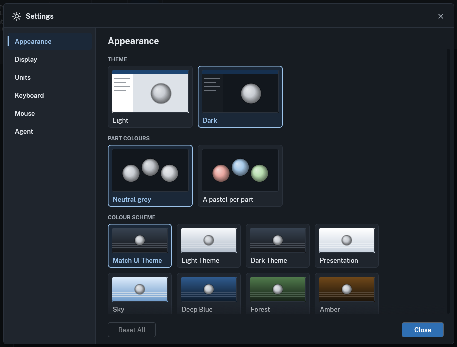 |

### start · Environments

| Command | What happens | Page | Verdict | P | Problems | Shot |
|---|---|---|---|---|---|---|
| Manufacture › Manufacture | DISABLED: CAM: setups, operations, toolpaths and posts fo… / Off: open the part's machining document (File >… |  | good |  |  |  |
| Manufacture › Machine Builder | DISABLED: Machines as real parts: axes, kinematics and li… / Off: open or create a part first (File > New, o… |  | good |  |  |  |
| Forming › Thermoform | DISABLED: Thermoforming: convert the shape, simulate the … / Off: open or create a Forge part first (File > … |  | good |  |  |  |
| Forming › Flat Pattern | DISABLED: The sheet metal part flattened: bend lines, the… / Off: open or create a Forge part first (File > … |  | good |  |  |  |
| Forming › Bend Simulation | DISABLED: The part bent on a press brake, bend by bend: t… / Off: open or create a Forge part first (File > … |  | good |  |  |  |
| Robotics › Robot | DISABLED: The robot (URDF) made from the assembly: links,… / Off: open a part, an assembly or a robot docume… |  | good |  |  |  |
| Visualize › Render Studio | DISABLED: The picture of the model: style, ground, shadow… / Off: open a part or an assembly first |  | good |  |  |  |
| Document › Drawing | DISABLED: A drawing of the part: views, dimensions and th… / Off: open a part or an assembly first |  | good |  |  |  |
| Analysis › Simulation | DISABLED: Structural and motion analysis of the part / Off: not yet: the kernel has no structural or m… |  | good |  |  |  |

### start · Machine Builder: Machine Builder

| Command | What happens | Page | Verdict | P | Problems | Shot |
|---|---|---|---|---|---|---|
| Library › New from Template | ACTION: the view changed (75280 px) |  | good |  |  |  |
| Library › Derive Copy | ACTION: the view changed (74512 px) |  | good |  |  |  |
| Library › Save | DISABLED: Ctrl+S / Write the part to its file / Off: open or create a part first (File > New, o… |  | good |  |  |  |
| Check › Check | PANEL: panel |  | good |  |  |  |
| Motion › Home Axes | NOTHING VISIBLE: no popup, panel, status line or change in the view |  | redo | P1 | **nothing**: nothing a person can see happens **nothing@narrow**: no popup, panel, status line or change in the view |  |
| Capture › Photo | DISABLED: Ctrl+Shift+P / Save the view as a PNG at the photo size (Captu… / Off: open or create a part first (File > New, o… |  | good |  |  |  |
| Capture › Record Turntable | DISABLED: Ctrl+Shift+R / A video of the view as you see it, the camera o… / Off: open or create a part first (File > New, o… |  | good |  |  |  |
| Capture › Capture Settings | DISABLED: Photo and video size, frames a second, the turn… / Off: open or create a part first (File > New, o… |  | good |  |  |  |
| Exit › Finish Machine Builder | WORKSPACE: into the design |  | good |  |  |  |

### plate · menu File

| Command | What happens | Page | Verdict | P | Problems | Shot |
|---|---|---|---|---|---|---|
| File › Export 3MF... | HOST: the window's host is asked: ExportMesh(ThreeMf) |  | good | P3 | label: "Export 3MF...": three dots for "…" |  |
| File › Export OBJ... | HOST: the window's host is asked: ExportMesh(Obj) |  | good | P3 | label: "Export OBJ...": three dots for "…" |  |
| File › Export STL... | HOST: the window's host is asked: ExportMesh(Stl) |  | good | P3 | label: "Export STL...": three dots for "…" |  |
| File › New | WORKSPACE: a new document tab |  | good |  |  |  |
| File › New Drawing... | DIALOG: 1 popup(s), 594x227 [OK, Cancel] |  | fix | P1 | label: "New Drawing...": three dots for "…" no-focus: nothing has the keyboard when it opens esc: Esc leaves it open **off-screen@narrow**: 594x227 at (0,220) leaves the 480x860 window **clipped@narrow**: "E  1117.6 x 863.6" **clipped@narrow**: "A0  1189 x 841" | 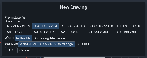 |
| File › New Sheet Metal | HOST: the window's host is asked: Sheet(NewPart) |  | good |  |  |  |
| File › Open... | HOST: the window's host is asked: Open |  | good | P3 | label: "Open...": three dots for "…" |  |
| File › Save | ACTION: status: "Saved /tmp/fg-ui-audit-3127/plate/run/plate.fg" |  | fix | P2 | **raw-text**: status "Saved /tmp/fg-ui-audit-3127/plate/run/plate.fg" (a temporary path) |  |

### plate · menu Browser: sketch row

| Command | What happens | Page | Verdict | P | Problems | Shot |
|---|---|---|---|---|---|---|
| Browser: sketch row › delete | ERROR TEXT: "Delete plan refused: StillRead: plate reads pla…" |  | redo | P2 | **raw-text**: status "Delete plan refused: StillRead: plate reads pla…" (an error code) |  |
| Browser: sketch row › down | ERROR TEXT: "Move plan to the end refused: StillRead: plate …" |  | redo | P2 | **raw-text**: status "Move plan to the end refused: StillRead: plate …" (an error code) |  |
| Browser: sketch row › edit-sketch | DIALOG: a note: "Editing sketch Finish Cancel" |  | good |  |  | 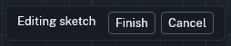 |
| Browser: sketch row › rename | ACTION: the view changed (1935 px) |  | good |  |  |  |
| Browser: sketch row › rollback | ACTION: the document changed status: "nothing built · rebuilt 0, reused 1 · 0.1 ms" |  | good |  |  |  |
| Browser: sketch row › suppress | PANEL: panel fg:suppressed:plan |  | good |  |  |  |

### plate · menu Browser: extrude row

| Command | What happens | Page | Verdict | P | Problems | Shot |
|---|---|---|---|---|---|---|
| Browser: extrude row › delete | ACTION: the document changed status: "nothing built · rebuilt 0, reused 1 · 0.0 ms" |  | good |  |  |  |
| Browser: extrude row › edit | DIALOG: 1 popup(s), 310x469 [OK, Cancel] |  | good | P3 | no-focus: nothing has the keyboard when it opens | 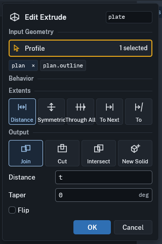 |
| Browser: extrude row › rename | ACTION: the view changed (1586 px) |  | good |  |  |  |
| Browser: extrude row › rollback | ACTION: the document changed status: "volume 14400 mm³ · 6 faces · valid · rebuilt 0,…" |  | good |  |  |  |
| Browser: extrude row › suppress | PANEL: panel fg:suppressed:plate |  | good |  |  |  |
| Browser: extrude row › up | ERROR TEXT: "Move plate above plan refused: StillRead: plate…" |  | redo | P2 | **raw-text**: status "Move plate above plan refused: StillRead: plate…" (an error code) |  |

### plate · 3D Model

| Command | What happens | Page | Verdict | P | Problems | Shot |
|---|---|---|---|---|---|---|
| Sketch › Start Sketch | DIALOG: a note: "Pick a plane, a planar face, or a sketch to edit Cancel" |  | good |  |  |  |
| Create › Extrude | DIALOG: a note: "Pick a plane, a planar face, or a sketch to edit Cancel" |  | good |  |  |  |
| Create › Revolve | DIALOG: a note: "Pick a plane, a planar face, or a sketch to edit Cancel" |  | good |  |  |  |
| Create › Loft | DIALOG: 1 popup(s), 310x317 [OK, Cancel] |  | good | P3 | no-focus: nothing has the keyboard when it opens | 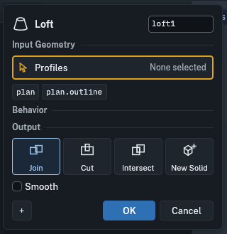 |
| Create › Sweep | DIALOG: 1 popup(s), 310x307 [OK, Cancel] |  | good | P3 | no-focus: nothing has the keyboard when it opens | 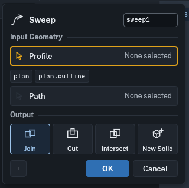 |
| Create › Coil | DIALOG: 1 popup(s), 310x427 [OK, Cancel] |  | good | P3 | no-focus: nothing has the keyboard when it opens | 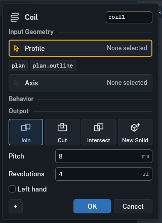 |
| Create › Rib | DIALOG: 1 popup(s), 310x322 [OK, Cancel] |  | good | P3 | no-focus: nothing has the keyboard when it opens |  |
| Create › Emboss | DIALOG: 1 popup(s), 310x497 [OK, Cancel] |  | good | P3 | no-focus: nothing has the keyboard when it opens | 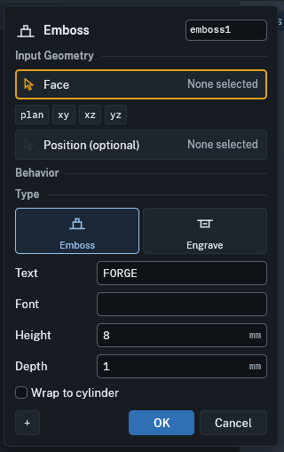 |
| Create › Import | DIALOG: 1 popup(s), 310x258 [OK, Cancel] |  | good | P3 | no-focus: nothing has the keyboard when it opens |  |
| Create › Decal | DISABLED: Wrap an image onto a face / Off: not yet: the kernel has no image projectio… |  | good |  |  |  |
| Modify › Hole | DIALOG: 1 popup(s), 310x586 [OK, Cancel] |  | redo | P1 | no-focus: nothing has the keyboard when it opens **nothing@narrow**: no popup, panel, status line or change in the view | 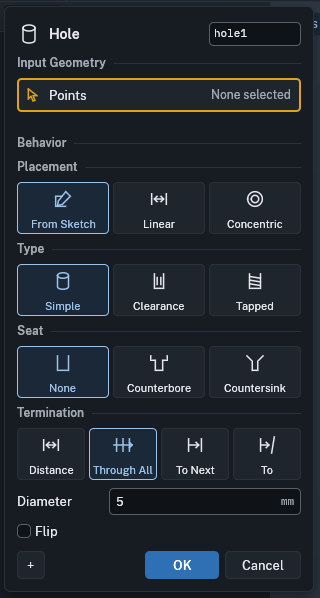 |
| Modify › Fillet | DIALOG: 1 popup(s), 310x316 [OK, Cancel] |  | good | P3 | no-focus: nothing has the keyboard when it opens |  |
| Modify › Chamfer | DIALOG: 1 popup(s), 310x396 [OK, Cancel] |  | good | P3 | no-focus: nothing has the keyboard when it opens |  |
| Modify › Shell | DIALOG: 1 popup(s), 310x314 [OK, Cancel] |  | good | P3 | no-focus: nothing has the keyboard when it opens | 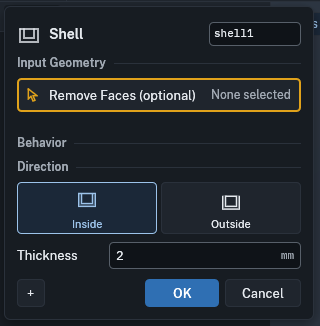 |
| Modify › Draft | DIALOG: 1 popup(s), 310x272 [OK, Cancel] |  | redo | P1 | no-focus: nothing has the keyboard when it opens **crash@narrow**: min > max, or either was NaN. min = 356.5, max = 328.0 | 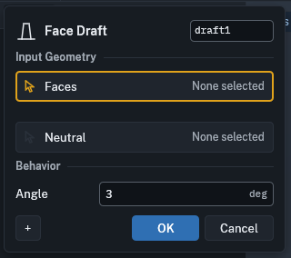 |
| Modify › Thread | DIALOG: 1 popup(s), 310x290 [OK, Cancel] |  | redo | P1 | no-focus: nothing has the keyboard when it opens **nothing@narrow**: no popup, panel, status line or change in the view | 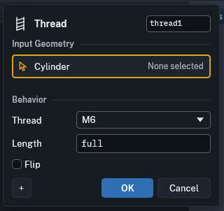 |
| Modify › Split | DIALOG: 1 popup(s), 310x243 [OK, Cancel] |  | good | P3 | no-focus: nothing has the keyboard when it opens | 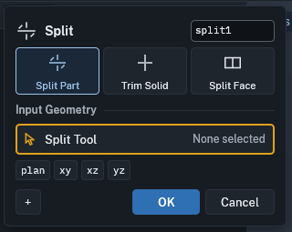 |
| Modify › Combine | DIALOG: 1 popup(s), 310x357 [OK, Cancel] |  | good | P3 | no-focus: nothing has the keyboard when it opens | 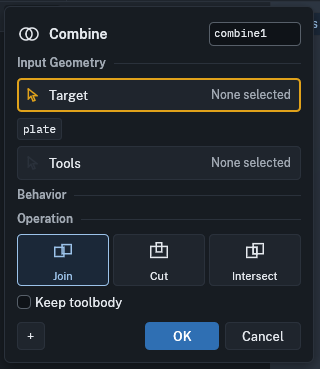 |
| Modify › Thicken | DIALOG: 1 popup(s), 310x396 [OK, Cancel] |  | good | P3 | no-focus: nothing has the keyboard when it opens | 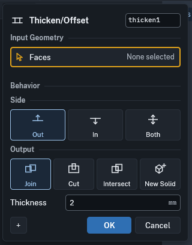 |
| Modify › Direct | DIALOG: 1 popup(s), 310x330 [OK, Cancel] |  | good | P3 | no-focus: nothing has the keyboard when it opens | 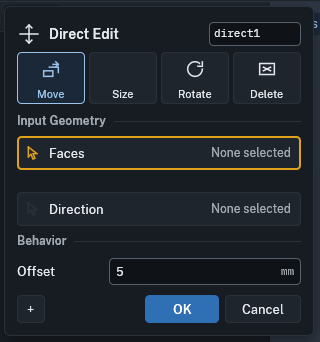 |
| Modify › Delete Face | DIALOG: 1 popup(s), 310x173 [OK, Cancel] |  | good | P3 | no-focus: nothing has the keyboard when it opens | 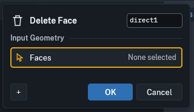 |
| Modify › Replace | DIALOG: 1 popup(s), 310x213 [OK, Cancel] |  | good | P3 | no-focus: nothing has the keyboard when it opens |  |
| Work Features › Plane | DIALOG: 1 popup(s), 310x296 [OK, Cancel] |  | good | P3 | no-focus: nothing has the keyboard when it opens | 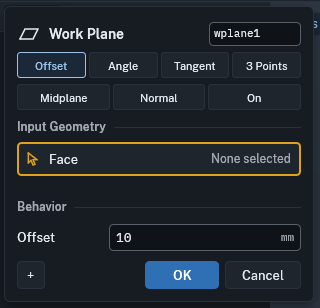 |
| Work Features › Axis | DIALOG: 1 popup(s), 310x231 [OK, Cancel] |  | good | P3 | no-focus: nothing has the keyboard when it opens |  |
| Work Features › Point | DIALOG: 1 popup(s), 310x231 [OK, Cancel] |  | good | P3 | no-focus: nothing has the keyboard when it opens | 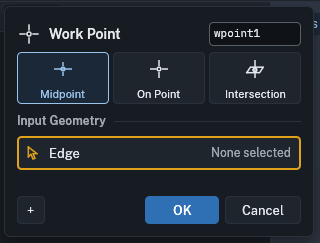 |
| Work Features › UCS | DIALOG: 1 popup(s), 310x243 [OK, Cancel] |  | good | P3 | no-focus: nothing has the keyboard when it opens |  |
| Pattern › Rectangular | DIALOG: 1 popup(s), 310x487 [OK, Cancel] |  | good | P3 | no-focus: nothing has the keyboard when it opens | 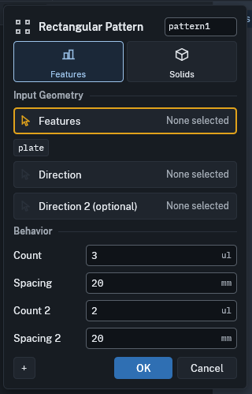 |
| Pattern › Circular | DIALOG: 1 popup(s), 310x403 [OK, Cancel] |  | good | P3 | no-focus: nothing has the keyboard when it opens | 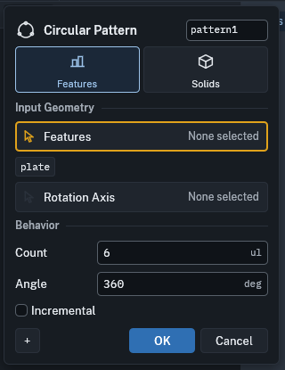 |
| Pattern › Sketch | DIALOG: 1 popup(s), 310x225 [OK, Cancel] |  | good | P3 | no-focus: nothing has the keyboard when it opens | 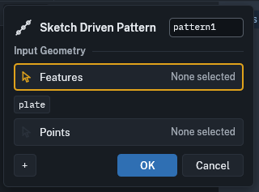 |
| Pattern › Mirror | DIALOG: 1 popup(s), 310x283 [OK, Cancel] |  | good | P3 | no-focus: nothing has the keyboard when it opens | 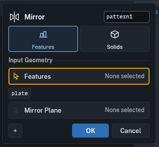 |
| Bodies › Move | DIALOG: 1 popup(s), 310x342 [OK, Cancel] |  | good | P3 | no-focus: nothing has the keyboard when it opens |  |
| Bodies › Copy | DIALOG: 1 popup(s), 310x342 [OK, Cancel] |  | good | P3 | no-focus: nothing has the keyboard when it opens | 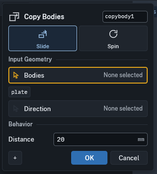 |
| Convert › Convert to Sheet Metal | PANEL: switches to tab 5 |  | good |  |  |  |
| Convert › Convert to Thermoform | DIALOG: 1 popup(s), 448x540 [OK, Cancel] |  | good | P3 | no-focus: nothing has the keyboard when it opens esc: Esc leaves it open | 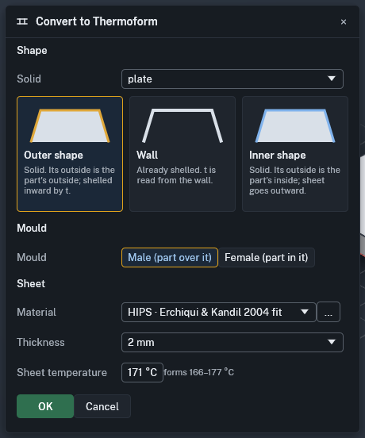 |

### plate · Assemble

| Command | What happens | Page | Verdict | P | Problems | Shot |
|---|---|---|---|---|---|---|
| Component › Place | DIALOG: 1 popup(s), 366x170 [OK, Cancel] |  | good | P3 | no-focus: nothing has the keyboard when it opens | 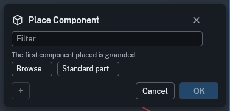 |
| Component › Content Center | DIALOG: 1 popup(s), 860x539 |  | redo | P2 | **tiny-text**: "O-ring" at 9.5 px **tiny-text**: "Plain washer, type A" at 9.5 px **tiny-text**: "Hex cap screw" at 9.5 px **tiny-text**: "Hex nut" at 9.5 px **tiny-text**: "Button head socket cap screw" at 9.5 px **tiny-text**: "Flat head socket cap screw" at 9.5 px **tiny-text**: "Socket head cap screw" at 9.5 px **tiny-text**: "Retaining ring for shafts" at 9.5 px **tiny-text**: "Retaining ring for bores" at 9.5 px **tiny-text**: "Parallel key, form A" at 9.5 px no-focus: nothing has the keyboard when it opens |  |
| Component › Pattern | ACTION: status: "Pattern: choose a top-level part in the browser…" |  | good |  |  |  |
| Component › Mirror | ACTION: status: "Choose a top-level part in the browser first" |  | good |  |  |  |
| Component › Copy | ACTION: status: "Choose a top-level part in the browser first" |  | good |  |  |  |
| Position › Free Move | DIALOG: 1 popup(s), 340x101 |  | good | P3 | no-focus: nothing has the keyboard when it opens | 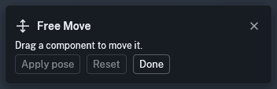 |
| Position › Free Rotate | DIALOG: 1 popup(s), 340x101 |  | good | P3 | no-focus: nothing has the keyboard when it opens | 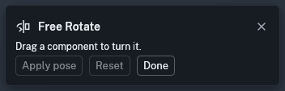 |
| Position › Keep Position | DISABLED: Off: not built yet |  | good |  |  |  |
| Position › Return to Design | DISABLED: Off: not built yet |  | good |  |  |  |
| Relationships › Joint | DIALOG: 1 popup(s), 366x336 [OK, Cancel] |  | fix | P3 | **contrast**: "1" 2.2:1 no-focus: nothing has the keyboard when it opens | 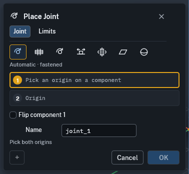 |
| Relationships › Constrain | DIALOG: 1 popup(s), 366x371 [OK, Cancel] |  | fix | P3 | **contrast**: "1" 2.2:1 no-focus: nothing has the keyboard when it opens | 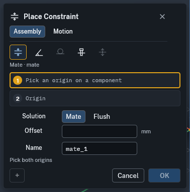 |
| Manage › Bill of Materials | DIALOG: 1 popup(s), 400x100 |  | good | P3 | no-focus: nothing has the keyboard when it opens esc: Esc leaves it open | 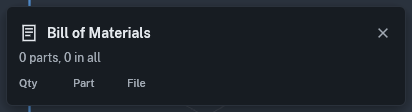 |
| Manage › Parameters | DIALOG: 1 popup(s), 760x129 |  | good | P3 | no-focus: nothing has the keyboard when it opens esc: Esc leaves it open | 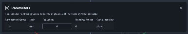 |
| Productivity › Explode | DIALOG: 1 popup(s), 340x83 |  | good | P3 | no-focus: nothing has the keyboard when it opens esc: Esc leaves it open | 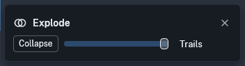 |

### plate · Weldments

| Command | What happens | Page | Verdict | P | Problems | Shot |
|---|---|---|---|---|---|---|
| Sketch › Start Sketch | DIALOG: a note: "Pick a plane, a planar face, or a sketch to edit Cancel" |  | good |  |  | 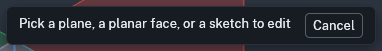 |
| Structure › Members | DIALOG: 1 popup(s), 310x695 [OK, Cancel] |  | good | P3 | no-focus: nothing has the keyboard when it opens |  |
| Ends › End Trim | DIALOG: 1 popup(s), 310x354 [OK, Cancel] |  | good | P3 | no-focus: nothing has the keyboard when it opens | 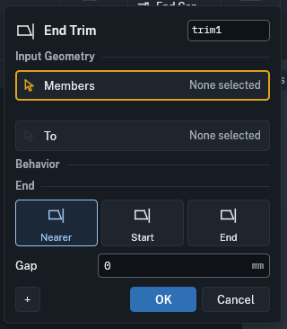 |
| Ends › End Cap | DIALOG: 1 popup(s), 310x314 [OK, Cancel] |  | good | P3 | no-focus: nothing has the keyboard when it opens | 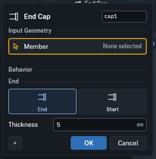 |
| Plates › Corner Plate | DIALOG: 1 popup(s), 310x342 [OK, Cancel] |  | good | P3 | no-focus: nothing has the keyboard when it opens | 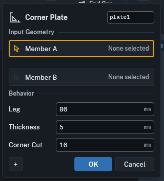 |
| Report › Cut List | DIALOG: 1 popup(s), 760x72 |  | good | P3 | no-focus: nothing has the keyboard when it opens esc: Esc leaves it open | 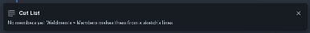 |

### plate · Inspect

| Command | What happens | Page | Verdict | P | Problems | Shot |
|---|---|---|---|---|---|---|
| Measure › Measure | DIALOG: 1 popup(s), 336x221 |  | good | P3 | no-focus: nothing has the keyboard when it opens | 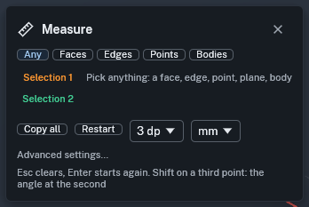 |
| Measure › Wall | DIALOG: 1 popup(s), 330x119 |  | good | P3 | no-focus: nothing has the keyboard when it opens | 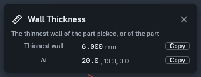 |
| Measure › Mass | DIALOG: 1 popup(s), 600x598 |  | fix | P1 | no-focus: nothing has the keyboard when it opens esc: Esc leaves it open **off-screen@narrow**: 540x598 at (0,186) leaves the 480x860 window **clipped@narrow**: "Browse…" | 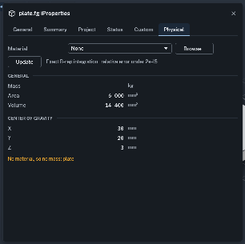 |
| Measure › CG Marker | ACTION: the view changed (395 px) |  | good |  |  |  |
| Analysis › Section | DIALOG: 2 popup(s), 508x302 |  | good | P3 | no-focus: nothing has the keyboard when it opens esc: Esc leaves it open | 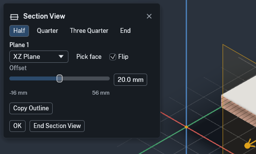 |
| Analysis › Check | DISABLED: Check the solid for faults / Off: not built yet |  | good |  |  |  |
| Properties › iProperties | DIALOG: 1 popup(s), 600x598 |  | good | P3 | no-focus: nothing has the keyboard when it opens esc: Esc leaves it open | 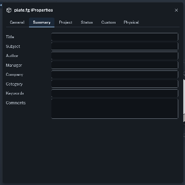 |
| Properties › Materials | DIALOG: 1 popup(s), 1162x662 |  | fix | P1 | **clipped**: "stand-in" no-focus: nothing has the keyboard when it opens esc: Esc leaves it open **off-screen@narrow**: 1162x662 at (0,140) leaves the 480x860 window **clipped@narrow**: "stand-in" | 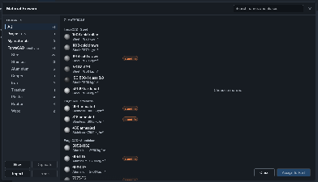 |

### plate · View

| Command | What happens | Page | Verdict | P | Problems | Shot |
|---|---|---|---|---|---|---|
| Appearance › Visual Style | PANEL: panel style:Illustration, style:Monochrome, style:Realistic |  | good |  |  |  |
| Appearance › Section | ACTION: the view changed (23445 px) |  | redo | P1 | **nothing@narrow**: not placed on screen: nothing to click |  |
| Appearance › Explode | DISABLED: E / Pull an assembly's parts apart along their join… / Off: not built yet |  | good |  |  |  |
| Appearance › Relationships | DISABLED: Show or hide the joint and constraint marks in … / Off: not built yet |  | good |  |  |  |
| Appearance › Ground Plane | ACTION: the view changed (179270 px) |  | good |  |  |  |
| Appearance › Reflections | ACTION: the view changed (8495 px) |  | good |  |  |  |
| Appearance › Ground Shadows | MODE: the button stays on; no prompt |  | good |  |  |  |
| Appearance › Object Shadows | MODE: the button stays on; no prompt |  | good |  |  |  |
| Appearance › Ambient Shadows | MODE: the button stays on; no prompt |  | good |  |  |  |
| Navigate › Orbit | MODE: the button stays on; no prompt |  | good |  |  |  |
| Navigate › Pan | MODE: the button stays on; no prompt |  | good |  |  |  |
| Navigate › Zoom | MODE: the button stays on; no prompt |  | good |  |  |  |
| Navigate › Fit All | ACTION: the view changed (95332 px) |  | good |  |  |  |
| Capture › Photo | DIALOG: a note: "Photo saved: plate-view-20261124-203518.png Open folder" |  | good |  |  | 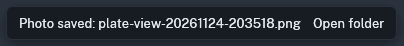 |
| Capture › Record Turntable | DIALOG: a note: "Recording · frame 6 of 360 Stop" |  | good |  |  | 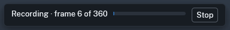 |
| Capture › Capture Settings | DIALOG: 1 popup(s), 374x321 |  | good | P3 | no-focus: nothing has the keyboard when it opens esc: Esc leaves it open | 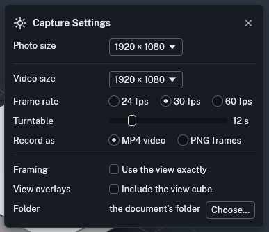 |

### plate · Manage

| Command | What happens | Page | Verdict | P | Problems | Shot |
|---|---|---|---|---|---|---|
| Parameters › Parameters | DIALOG: 1 popup(s), 760x129 |  | good | P3 | no-focus: nothing has the keyboard when it opens esc: Esc leaves it open |  |
| Document › Save | ACTION: status: "Saved /tmp/fg-ui-audit-3127/plate/run/plate.fg" |  | fix | P2 | **raw-text**: status "Saved /tmp/fg-ui-audit-3127/plate/run/plate.fg" (a temporary path) |  |
| Document › Open | HOST: the window's host is asked: Open |  | good |  |  |  |
| Versions › Create Version | DIALOG: 1 popup(s), 340x212 |  | good | P3 | no-focus: nothing has the keyboard when it opens esc: Esc leaves it open | 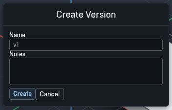 |
| Versions › Versions | ACTION: the view changed (3894 px) |  | good |  |  |  |
| Versions › Compare | ACTION: the view changed (3894 px) |  | good |  |  |  |
| Versions › Release | DIALOG: 1 popup(s), 340x233 |  | good | P3 | no-focus: nothing has the keyboard when it opens esc: Esc leaves it open | 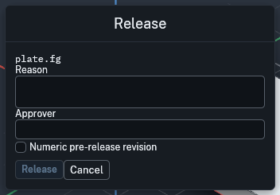 |
| Versions › Update All | DISABLED: Every pinned part to its newest version / Off: not built yet |  | good |  |  |  |
| Machines › Machine Builder | WORKSPACE: into Machine Builder |  | good |  |  |  |
| Options › Settings | DIALOG: 1 popup(s), 902x682 |  | good | P3 | no-focus: nothing has the keyboard when it opens esc: Esc leaves it open |  |

### plate · Environments

| Command | What happens | Page | Verdict | P | Problems | Shot |
|---|---|---|---|---|---|---|
| Manufacture › Manufacture | DISABLED: CAM: setups, operations, toolpaths and posts fo… / Off: open the part's machining document (File >… |  | good |  |  |  |
| Manufacture › Machine Builder | WORKSPACE: into Machine Builder |  | good |  |  |  |
| Forming › Thermoform | WORKSPACE: into Thermoform |  | good |  |  |  |
| Forming › Flat Pattern | DISABLED: The sheet metal part flattened: bend lines, the… / Off: make the part sheet metal first (3D Model … |  | good |  |  |  |
| Forming › Bend Simulation | DISABLED: The part bent on a press brake, bend by bend: t… / Off: make the part sheet metal first (3D Model … |  | good |  |  |  |
| Robotics › Robot | WORKSPACE: into Robot |  | good |  |  |  |
| Visualize › Render Studio | WORKSPACE: into Render Studio |  | good |  |  |  |
| Document › Drawing | DIALOG: 1 popup(s), 594x227 [OK, Cancel] |  | good | P3 | no-focus: nothing has the keyboard when it opens esc: Esc leaves it open |  |
| Analysis › Simulation | DISABLED: Structural and motion analysis of the part / Off: not yet: the kernel has no structural or m… |  | good |  |  |  |

### plate · Thermoform: Thermoform

| Command | What happens | Page | Verdict | P | Problems | Shot |
|---|---|---|---|---|---|---|
| Formed Part › Edit Formed Part | DISABLED: The thermoform's material, sheet and mould side… / Off: convert the solid to a thermoformed part f… |  | good |  |  |  |
| Check › Check Forming | DISABLED: The formed wall: thinnest and thickest, against… / Off: convert the solid to a thermoformed part f… |  | good |  |  |  |
| Mould › Make Mould | DISABLED: The mould the sheet is formed on / Off: convert the solid to a thermoformed part f… |  | good |  |  |  |
| Modify › Trim | DISABLED: Trim the formed sheet / Off: convert the solid to a thermoformed part f… |  | good |  |  |  |
| Modify › Plug | DISABLED: A plug assist / Off: convert the solid to a thermoformed part f… |  | good |  |  |  |
| Modify › Vents | DISABLED: Vent holes in the mould / Off: convert the solid to a thermoformed part f… |  | good |  |  |  |
| Display › Simulated Wall | DISABLED: The formed part's wall as simulated or as model… / Off: convert the solid to a thermoformed part f… |  | good |  |  |  |
| Display › Thickness Colours | DISABLED: The wall thickness's colours on the part / Off: convert the solid to a thermoformed part f… |  | good |  |  |  |
| Capture › Photo | DIALOG: a note: "Photo saved: plate-thermoform-20261124-203645.png Open folder" |  | good |  |  | 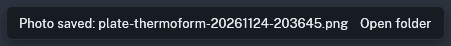 |
| Capture › Record Turntable | DIALOG: a note: "Recording · frame 6 of 360 Stop" |  | good |  |  |  |
| Capture › Capture Settings | DIALOG: 1 popup(s), 374x321 |  | fix | P1 | no-focus: nothing has the keyboard when it opens esc: Esc leaves it open **off-screen@narrow**: 374x321 at (271,234) leaves the 480x860 window |  |
| Exit › Finish Thermoform | WORKSPACE: into the design |  | good |  |  |  |

### plate · Robot: Robot

| Command | What happens | Page | Verdict | P | Problems | Shot |
|---|---|---|---|---|---|---|
| Robot › Export URDF | DISABLED: Off: not built yet |  | good |  |  |  |
| Robot › Undo | DISABLED: Off: not built yet |  | good |  |  |  |
| Drive › Export Pose | DISABLED: Off: not built yet |  | good |  |  |  |
| Drive › Joint axes | MODE: the button stays on; no prompt |  | fix | P1 | label: "Joint axes": not Title Case (axes) **silent-mode**: a mode with no prompt, outside the allowed list |  |
| Drive › Centres of mass | ACTION: the view changed (1811 px), but it changes by itself too |  | good | P3 | label: "Centres of mass": not Title Case (mass) unsure: only the view changed, and the view animates by itself: no other sign the click was taken |  |
| Structure › Make root | DISABLED: Off: not built yet |  | good | P3 | label: "Make root": not Title Case (root) |  |
| Structure › Drop | DISABLED: Off: not built yet |  | good |  |  |  |
| Structure › Merge into parent | DISABLED: Off: not built yet |  | good | P3 | label: "Merge into parent": not Title Case (parent) |  |
| Structure › Freeze here | DISABLED: Off: not built yet |  | good | P3 | label: "Freeze here": not Title Case (here) |  |
| Structure › Add frame | DISABLED: Off: not built yet |  | good | P3 | label: "Add frame": not Title Case (frame) |  |
| Structure › Collision: hull | DISABLED: Off: not built yet |  | good | P3 | label: "Collision: hull": not Title Case (hull) |  |
| Capture › Photo | DIALOG: a note: "Photo saved: plate-robot-20261124-203717.png Open folder" |  | good |  |  |  |
| Capture › Record Turntable | DIALOG: a note: "Recording · frame 6 of 360 Stop" |  | good |  |  |  |
| Capture › Capture Settings | DIALOG: 1 popup(s), 374x321 |  | fix | P1 | no-focus: nothing has the keyboard when it opens esc: Esc leaves it open **off-screen@narrow**: 374x321 at (271,234) leaves the 480x860 window |  |
| Exit › Finish Robot | WORKSPACE: into the design |  | good |  |  |  |

### plate · Render Studio: Render Studio

| Command | What happens | Page | Verdict | P | Problems | Shot |
|---|---|---|---|---|---|---|
| Render › Render Image | ACTION: the view changed (1208 px), but it changes by itself too |  | good | P3 | unsure: only the view changed, and the view animates by itself: no other sign the click was taken |  |
| Render › Render Turntable | ACTION: the view changed (941 px), but it changes by itself too |  | good | P3 | unsure: only the view changed, and the view animates by itself: no other sign the click was taken |  |
| Render › Cancel | DISABLED: Stop the render under way and drop the queued o… / Off: not built yet |  | good |  |  |  |
| Scene › Floor | ACTION: the view changed (678917 px), but it changes by itself too |  | good | P3 | unsure: only the view changed, and the view animates by itself: no other sign the click was taken |  |
| Scene › Denoise | ACTION: the view changed (6082 px), but it changes by itself too |  | good | P3 | unsure: only the view changed, and the view animates by itself: no other sign the click was taken |  |
| Scene › Start Again | ACTION: the view changed (803 px), but it changes by itself too |  | good | P3 | unsure: only the view changed, and the view animates by itself: no other sign the click was taken |  |
| Camera › Depth of Field | ACTION: the view changed (6410 px), but it changes by itself too |  | good | P3 | unsure: only the view changed, and the view animates by itself: no other sign the click was taken |  |
| Camera › Perspective | ACTION: the view changed (23898 px), but it changes by itself too |  | good | P3 | unsure: only the view changed, and the view animates by itself: no other sign the click was taken |  |
| Camera › Fit All | ACTION: the view changed (119514 px), but it changes by itself too |  | good | P3 | unsure: only the view changed, and the view animates by itself: no other sign the click was taken |  |
| Capture › Photo | DIALOG: a note: "Photo saved: plate-render-20261124-204638.png Open folder" |  | good |  |  |  |
| Capture › Record Turntable | DIALOG: a note: "Recording · frame 6 of 360 Stop" |  | good |  |  |  |
| Capture › Capture Settings | DIALOG: 1 popup(s), 374x321 |  | fix | P1 | no-focus: nothing has the keyboard when it opens esc: Esc leaves it open **off-screen@narrow**: 374x321 at (271,234) leaves the 480x860 window |  |
| Exit › Finish Render Studio | WORKSPACE: into the design |  | good |  |  |  |

### part · menu Browser: sketch row

| Command | What happens | Page | Verdict | P | Problems | Shot |
|---|---|---|---|---|---|---|
| Browser: sketch row › delete | ERROR TEXT: "Delete sk1 refused: StillRead: extrude1 reads s…" |  | redo | P2 | **raw-text**: status "Delete sk1 refused: StillRead: extrude1 reads s…" (an error code) |  |
| Browser: sketch row › down | ERROR TEXT: "Move sk1 above sk2 refused: StillRead: extrude1…" |  | redo | P2 | **raw-text**: status "Move sk1 above sk2 refused: StillRead: extrude1…" (an error code) |  |
| Browser: sketch row › edit-sketch | DIALOG: a note: "Editing sketch Finish Cancel" |  | good |  |  |  |
| Browser: sketch row › rename | ACTION: the view changed (7468 px), but it changes by itself too |  | good | P3 | unsure: only the view changed, and the view animates by itself: no other sign the click was taken |  |
| Browser: sketch row › rollback | ACTION: the document changed status: "nothing built · rebuilt 0, reused 1 · 0.4 ms" |  | good |  |  |  |
| Browser: sketch row › suppress | PANEL: panel fg:suppressed:sk1 |  | good |  |  |  |

### part · menu Browser: extrude row

| Command | What happens | Page | Verdict | P | Problems | Shot |
|---|---|---|---|---|---|---|
| Browser: extrude row › delete | ERROR TEXT: "Delete extrude1 refused: StillRead: sk2 reads e…" |  | redo | P2 | **raw-text**: status "Delete extrude1 refused: StillRead: sk2 reads e…" (an error code) |  |
| Browser: extrude row › down | ERROR TEXT: "Move extrude1 above extrude2 refused: StillRead…" |  | redo | P2 | **raw-text**: status "Move extrude1 above extrude2 refused: StillRead…" (an error code) |  |
| Browser: extrude row › edit | DIALOG: 1 popup(s), 310x469 [OK, Cancel] |  | good | P3 | no-focus: nothing has the keyboard when it opens |  |
| Browser: extrude row › rename | ACTION: the view changed (7468 px), but it changes by itself too |  | good | P3 | unsure: only the view changed, and the view animates by itself: no other sign the click was taken |  |
| Browser: extrude row › rollback | ACTION: the document changed status: "volume 57600 mm³ · 6 faces · valid · rebuilt 0,…" |  | good |  |  |  |
| Browser: extrude row › suppress | PANEL: panel fg:suppressed:extrude1 |  | good |  |  |  |
| Browser: extrude row › up | ERROR TEXT: "Move extrude1 above sk1 refused: StillRead: ext…" |  | redo | P2 | **raw-text**: status "Move extrude1 above sk1 refused: StillRead: ext…" (an error code) |  |

### part · menu Browser: hole row

| Command | What happens | Page | Verdict | P | Problems | Shot |
|---|---|---|---|---|---|---|
| Browser: hole row › delete | ERROR TEXT: "Delete hole1 refused: StillRead: pattern1 reads…" |  | redo | P2 | **raw-text**: status "Delete hole1 refused: StillRead: pattern1 reads…" (an error code) |  |
| Browser: hole row › down | ACTION: the document changed status: "volume 58522.4 mm³ · 133 faces · valid · rebuil…" |  | good |  |  |  |
| Browser: hole row › edit | DIALOG: 1 popup(s), 310x720 [OK, Cancel] |  | good | P3 | no-focus: nothing has the keyboard when it opens |  |
| Browser: hole row › rename | ACTION: the view changed (5581 px), but it changes by itself too |  | good | P3 | unsure: only the view changed, and the view animates by itself: no other sign the click was taken |  |
| Browser: hole row › rollback | ACTION: the document changed status: "volume 60851.5 mm³ · 11 faces · valid · rebuilt…" |  | good |  |  |  |
| Browser: hole row › suppress | PANEL: panel fg:suppressed:hole1 |  | good |  |  |  |
| Browser: hole row › up | ACTION: the document changed status: "volume 58522.4 mm³ · 133 faces · valid · rebuil…" |  | good |  |  |  |

### part · menu Browser: fillet row

| Command | What happens | Page | Verdict | P | Problems | Shot |
|---|---|---|---|---|---|---|
| Browser: fillet row › delete | ACTION: the document changed status: "volume 58584.8 mm³ · 132 faces · valid · rebuil…" |  | good |  |  |  |
| Browser: fillet row › down | ACTION: the document changed status: "volume 58522.4 mm³ · 133 faces · valid · rebuil…" |  | good |  |  |  |
| Browser: fillet row › edit | DIALOG: 1 popup(s), 408x328 [OK, Cancel] |  | good | P3 | no-focus: nothing has the keyboard when it opens |  |
| Browser: fillet row › rename | ACTION: the view changed (5506 px), but it changes by itself too |  | good | P3 | unsure: only the view changed, and the view animates by itself: no other sign the click was taken |  |
| Browser: fillet row › rollback | ACTION: the document changed status: "volume 60789.2 mm³ · 12 faces · valid · rebuilt…" |  | good |  |  |  |
| Browser: fillet row › suppress | PANEL: panel fg:suppressed:fillet1 |  | good |  |  |  |
| Browser: fillet row › up | ACTION: the document changed status: "volume 58522.4 mm³ · 133 faces · valid · rebuil…" |  | good |  |  |  |

### part · 3D Model

| Command | What happens | Page | Verdict | P | Problems | Shot |
|---|---|---|---|---|---|---|
| Sketch › Start Sketch | DIALOG: a note: "Pick a plane, a planar face, or a sketch to edit Cancel" |  | good |  |  |  |
| Create › Extrude | DIALOG: a note: "Pick a plane, a planar face, or a sketch to edit Cancel" |  | good |  |  |  |
| Create › Revolve | DIALOG: a note: "Pick a plane, a planar face, or a sketch to edit Cancel" |  | good |  |  |  |
| Create › Loft | DIALOG: 1 popup(s), 310x317 [OK, Cancel] |  | good | P3 | no-focus: nothing has the keyboard when it opens |  |
| Create › Sweep | DIALOG: 1 popup(s), 310x307 [OK, Cancel] |  | good | P3 | no-focus: nothing has the keyboard when it opens |  |
| Create › Coil | DIALOG: 1 popup(s), 310x427 [OK, Cancel] |  | good | P3 | no-focus: nothing has the keyboard when it opens |  |
| Create › Rib | DIALOG: 1 popup(s), 310x322 [OK, Cancel] |  | good | P3 | no-focus: nothing has the keyboard when it opens |  |
| Create › Emboss | DIALOG: 1 popup(s), 310x520 [OK, Cancel] |  | good | P3 | no-focus: nothing has the keyboard when it opens |  |
| Create › Import | DIALOG: 1 popup(s), 310x258 [OK, Cancel] |  | good | P3 | no-focus: nothing has the keyboard when it opens |  |
| Create › Decal | DISABLED: Wrap an image onto a face / Off: not yet: the kernel has no image projectio… |  | good |  |  |  |
| Modify › Hole | DIALOG: 1 popup(s), 310x624 [OK, Cancel] |  | redo | P1 | no-focus: nothing has the keyboard when it opens **nothing@narrow**: no popup, panel, status line or change in the view |  |
| Modify › Fillet | DIALOG: 1 popup(s), 310x316 [OK, Cancel] |  | good | P3 | no-focus: nothing has the keyboard when it opens |  |
| Modify › Chamfer | DIALOG: 1 popup(s), 310x396 [OK, Cancel] |  | good | P3 | no-focus: nothing has the keyboard when it opens |  |
| Modify › Shell | DIALOG: 1 popup(s), 310x334 [OK, Cancel] |  | good | P2 | error-text: Build: shell1: the kernel refused it: shell no-focus: nothing has the keyboard when it opens |  |
| Modify › Draft | DIALOG: 1 popup(s), 310x272 [OK, Cancel] |  | redo | P1 | no-focus: nothing has the keyboard when it opens **crash@narrow**: min > max, or either was NaN. min = 376.21875, max = 328.0 |  |
| Modify › Thread | DIALOG: 1 popup(s), 310x290 [OK, Cancel] |  | redo | P1 | no-focus: nothing has the keyboard when it opens **nothing@narrow**: no popup, panel, status line or change in the view |  |
| Modify › Split | DIALOG: 1 popup(s), 310x269 [OK, Cancel] |  | redo | P1 | no-focus: nothing has the keyboard when it opens **crash@narrow**: min > max, or either was NaN. min = 378.46875, max = 328.0 |  |
| Modify › Combine | DIALOG: 1 popup(s), 310x409 [OK, Cancel] |  | redo | P1 | no-focus: nothing has the keyboard when it opens **crash@narrow**: min > max, or either was NaN. min = 374.21875, max = 328.0 |  |
| Modify › Thicken | DIALOG: 1 popup(s), 310x396 [OK, Cancel] |  | good | P3 | no-focus: nothing has the keyboard when it opens |  |
| Modify › Direct | DIALOG: 1 popup(s), 310x330 [OK, Cancel] |  | redo | P1 | no-focus: nothing has the keyboard when it opens **nothing@narrow**: no popup, panel, status line or change in the view |  |
| Modify › Delete Face | DIALOG: 1 popup(s), 310x173 [OK, Cancel] |  | redo | P1 | no-focus: nothing has the keyboard when it opens **crash@narrow**: min > max, or either was NaN. min = 378.875, max = 328.0 |  |
| Modify › Replace | DIALOG: 1 popup(s), 310x213 [OK, Cancel] |  | good | P3 | no-focus: nothing has the keyboard when it opens |  |
| Work Features › Plane | DIALOG: 1 popup(s), 310x296 [OK, Cancel] |  | good | P3 | no-focus: nothing has the keyboard when it opens |  |
| Work Features › Axis | DIALOG: 1 popup(s), 310x231 [OK, Cancel] |  | good | P3 | no-focus: nothing has the keyboard when it opens |  |
| Work Features › Point | DIALOG: 1 popup(s), 310x231 [OK, Cancel] |  | good | P3 | no-focus: nothing has the keyboard when it opens |  |
| Work Features › UCS | DIALOG: 1 popup(s), 310x269 [OK, Cancel] |  | good | P3 | no-focus: nothing has the keyboard when it opens |  |
| Pattern › Rectangular | DIALOG: 1 popup(s), 310x539 [OK, Cancel] |  | good | P3 | no-focus: nothing has the keyboard when it opens |  |
| Pattern › Circular | DIALOG: 1 popup(s), 310x455 [OK, Cancel] |  | good | P3 | no-focus: nothing has the keyboard when it opens |  |
| Pattern › Sketch | DIALOG: 1 popup(s), 310x277 [OK, Cancel] |  | good | P3 | no-focus: nothing has the keyboard when it opens |  |
| Pattern › Mirror | DIALOG: 1 popup(s), 310x335 [OK, Cancel] |  | good | P3 | no-focus: nothing has the keyboard when it opens |  |
| Bodies › Move | DIALOG: 1 popup(s), 310x394 [OK, Cancel] |  | good | P3 | no-focus: nothing has the keyboard when it opens |  |
| Bodies › Copy | DIALOG: 1 popup(s), 310x394 [OK, Cancel] |  | good | P3 | no-focus: nothing has the keyboard when it opens |  |
| Convert › Convert to Sheet Metal | PANEL: switches to tab 5 |  | good |  |  |  |
| Convert › Convert to Thermoform | DIALOG: 1 popup(s), 448x540 [OK, Cancel] |  | good | P3 | no-focus: nothing has the keyboard when it opens esc: Esc leaves it open |  |

### part · Environments

| Command | What happens | Page | Verdict | P | Problems | Shot |
|---|---|---|---|---|---|---|
| Manufacture › Manufacture | DISABLED: CAM: setups, operations, toolpaths and posts fo… / Off: open the part's machining document (File >… |  | good |  |  |  |
| Manufacture › Machine Builder | WORKSPACE: into Machine Builder |  | good |  |  |  |
| Forming › Thermoform | WORKSPACE: into Thermoform |  | good |  |  |  |
| Forming › Flat Pattern | DISABLED: The sheet metal part flattened: bend lines, the… / Off: make the part sheet metal first (3D Model … |  | good |  |  |  |
| Forming › Bend Simulation | DISABLED: The part bent on a press brake, bend by bend: t… / Off: make the part sheet metal first (3D Model … |  | good |  |  |  |
| Robotics › Robot | WORKSPACE: into Robot |  | good |  |  |  |
| Visualize › Render Studio | WORKSPACE: into Render Studio |  | good |  |  |  |
| Document › Drawing | DIALOG: 1 popup(s), 594x227 [OK, Cancel] |  | good | P3 | no-focus: nothing has the keyboard when it opens esc: Esc leaves it open |  |
| Analysis › Simulation | DISABLED: Structural and motion analysis of the part / Off: not yet: the kernel has no structural or m… |  | good |  |  |  |

### sketch · menu File

| Command | What happens | Page | Verdict | P | Problems | Shot |
|---|---|---|---|---|---|---|
| File › Export 3MF... | HOST: the window's host is asked: ExportMesh(ThreeMf) |  | good | P3 | label: "Export 3MF...": three dots for "…" |  |
| File › Export OBJ... | HOST: the window's host is asked: ExportMesh(Obj) |  | good | P3 | label: "Export OBJ...": three dots for "…" |  |
| File › Export STL... | HOST: the window's host is asked: ExportMesh(Stl) |  | good | P3 | label: "Export STL...": three dots for "…" |  |
| File › New | WORKSPACE: a new document tab |  | good |  |  |  |
| File › New Drawing... | DIALOG: 1 popup(s), 594x227 [OK, Cancel] |  | fix | P1 | label: "New Drawing...": three dots for "…" no-focus: nothing has the keyboard when it opens esc: Esc leaves it open **off-screen@narrow**: 594x227 at (0,220) leaves the 480x860 window **clipped@narrow**: "E  1117.6 x 863.6" **clipped@narrow**: "A0  1189 x 841" |  |
| File › New Sheet Metal | HOST: the window's host is asked: Sheet(NewPart) |  | good |  |  |  |
| File › Open... | HOST: the window's host is asked: Open |  | good | P3 | label: "Open...": three dots for "…" |  |
| File › Save | NOTHING VISIBLE: no popup, panel, status line or change in the view |  | redo | P1 | **nothing**: nothing a person can see happens **nothing@narrow**: no popup, panel, status line or change in the view |  |

### sketch · menu Browser: sketch row

| Command | What happens | Page | Verdict | P | Problems | Shot |
|---|---|---|---|---|---|---|
| Browser: sketch row › delete | NOTHING VISIBLE: no popup, panel, status line or change in the view |  | redo | P1 | **nothing**: nothing a person can see happens **nothing@narrow**: no popup, panel, status line or change in the view |  |
| Browser: sketch row › down | NOTHING VISIBLE: no popup, panel, status line or change in the view |  | redo | P1 | **nothing**: nothing a person can see happens **nothing@narrow**: no popup, panel, status line or change in the view |  |
| Browser: sketch row › edit-sketch | ACTION: the view changed (5500 px) |  | good |  |  |  |
| Browser: sketch row › rename | ACTION: the view changed (1935 px) |  | good |  |  |  |
| Browser: sketch row › rollback | ACTION: the document changed |  | good |  |  |  |
| Browser: sketch row › suppress | PANEL: panel fg:suppressed:plan |  | good |  |  |  |

### sketch · menu Browser: extrude row

| Command | What happens | Page | Verdict | P | Problems | Shot |
|---|---|---|---|---|---|---|
| Browser: extrude row › delete | ACTION: the document changed |  | good |  |  |  |
| Browser: extrude row › edit | DIALOG: 1 popup(s), 310x469 [OK, Cancel] |  | good | P3 | no-focus: nothing has the keyboard when it opens |  |
| Browser: extrude row › rename | ACTION: the view changed (1586 px) |  | good |  |  |  |
| Browser: extrude row › rollback | ACTION: the document changed |  | good |  |  |  |
| Browser: extrude row › suppress | PANEL: panel fg:suppressed:plate |  | good |  |  |  |
| Browser: extrude row › up | NOTHING VISIBLE: no popup, panel, status line or change in the view |  | redo | P1 | **nothing**: nothing a person can see happens **nothing@narrow**: no popup, panel, status line or change in the view |  |

### sketch · 3D Model

| Command | What happens | Page | Verdict | P | Problems | Shot |
|---|---|---|---|---|---|---|
| Sketch › Start Sketch | DIALOG: a note: "Pick a plane, a planar face, or a sketch to edit Cancel" |  | good |  |  |  |
| Create › Extrude | DIALOG: a note: "Pick a plane, a planar face, or a sketch to edit Cancel" |  | good |  |  |  |
| Create › Revolve | DIALOG: a note: "Pick a plane, a planar face, or a sketch to edit Cancel" |  | good |  |  |  |
| Create › Loft | DIALOG: 1 popup(s), 310x317 [OK, Cancel] |  | good | P3 | no-focus: nothing has the keyboard when it opens |  |
| Create › Sweep | DIALOG: 1 popup(s), 310x307 [OK, Cancel] |  | good | P3 | no-focus: nothing has the keyboard when it opens |  |
| Create › Coil | DIALOG: 1 popup(s), 310x427 [OK, Cancel] |  | good | P3 | no-focus: nothing has the keyboard when it opens |  |
| Create › Rib | DIALOG: 1 popup(s), 310x322 [OK, Cancel] |  | good | P3 | no-focus: nothing has the keyboard when it opens |  |
| Create › Emboss | DIALOG: 1 popup(s), 310x497 [OK, Cancel] |  | good | P3 | no-focus: nothing has the keyboard when it opens |  |
| Create › Import | DIALOG: 1 popup(s), 310x258 [OK, Cancel] |  | good | P3 | no-focus: nothing has the keyboard when it opens |  |
| Create › Decal | DISABLED: Wrap an image onto a face / Off: not yet: the kernel has no image projectio… |  | good |  |  |  |
| Modify › Hole | DIALOG: 1 popup(s), 310x586 [OK, Cancel] |  | redo | P1 | no-focus: nothing has the keyboard when it opens **nothing@narrow**: no popup, panel, status line or change in the view |  |
| Modify › Fillet | DIALOG: 1 popup(s), 310x316 [OK, Cancel] |  | good | P3 | no-focus: nothing has the keyboard when it opens |  |
| Modify › Chamfer | DIALOG: 1 popup(s), 310x396 [OK, Cancel] |  | good | P3 | no-focus: nothing has the keyboard when it opens |  |
| Modify › Shell | DIALOG: 1 popup(s), 310x314 [OK, Cancel] |  | good | P3 | no-focus: nothing has the keyboard when it opens |  |
| Modify › Draft | DIALOG: 1 popup(s), 310x272 [OK, Cancel] |  | good | P3 | no-focus: nothing has the keyboard when it opens |  |
| Modify › Thread | DIALOG: 1 popup(s), 310x290 [OK, Cancel] |  | redo | P1 | no-focus: nothing has the keyboard when it opens **nothing@narrow**: no popup, panel, status line or change in the view |  |
| Modify › Split | DIALOG: 1 popup(s), 310x243 [OK, Cancel] |  | good | P3 | no-focus: nothing has the keyboard when it opens |  |
| Modify › Combine | DIALOG: 1 popup(s), 310x357 [OK, Cancel] |  | good | P3 | no-focus: nothing has the keyboard when it opens |  |
| Modify › Thicken | DIALOG: 1 popup(s), 310x396 [OK, Cancel] |  | good | P3 | no-focus: nothing has the keyboard when it opens |  |
| Modify › Direct | DIALOG: 1 popup(s), 310x330 [OK, Cancel] |  | good | P3 | no-focus: nothing has the keyboard when it opens |  |
| Modify › Delete Face | DIALOG: 1 popup(s), 310x173 [OK, Cancel] |  | good | P3 | no-focus: nothing has the keyboard when it opens |  |
| Modify › Replace | DIALOG: 1 popup(s), 310x213 [OK, Cancel] |  | good | P3 | no-focus: nothing has the keyboard when it opens |  |
| Work Features › Plane | DIALOG: 1 popup(s), 310x296 [OK, Cancel] |  | good | P3 | no-focus: nothing has the keyboard when it opens |  |
| Work Features › Axis | DIALOG: 1 popup(s), 310x231 [OK, Cancel] |  | good | P3 | no-focus: nothing has the keyboard when it opens |  |
| Work Features › Point | DIALOG: 1 popup(s), 310x231 [OK, Cancel] |  | good | P3 | no-focus: nothing has the keyboard when it opens |  |
| Work Features › UCS | DIALOG: 1 popup(s), 310x243 [OK, Cancel] |  | good | P3 | no-focus: nothing has the keyboard when it opens |  |
| Pattern › Rectangular | DIALOG: 1 popup(s), 310x487 [OK, Cancel] |  | good | P3 | no-focus: nothing has the keyboard when it opens |  |
| Pattern › Circular | DIALOG: 1 popup(s), 310x403 [OK, Cancel] |  | good | P3 | no-focus: nothing has the keyboard when it opens |  |
| Pattern › Sketch | DIALOG: 1 popup(s), 310x225 [OK, Cancel] |  | good | P3 | no-focus: nothing has the keyboard when it opens |  |
| Pattern › Mirror | DIALOG: 1 popup(s), 310x283 [OK, Cancel] |  | good | P3 | no-focus: nothing has the keyboard when it opens |  |
| Bodies › Move | DIALOG: 1 popup(s), 310x342 [OK, Cancel] |  | good | P3 | no-focus: nothing has the keyboard when it opens |  |
| Bodies › Copy | DIALOG: 1 popup(s), 310x342 [OK, Cancel] |  | good | P3 | no-focus: nothing has the keyboard when it opens |  |
| Convert › Convert to Sheet Metal | PANEL: switches to tab 5 |  | good |  |  |  |
| Convert › Convert to Thermoform | DIALOG: 1 popup(s), 448x540 [OK, Cancel] |  | good | P3 | no-focus: nothing has the keyboard when it opens esc: Esc leaves it open |  |

### sketch · Assemble

| Command | What happens | Page | Verdict | P | Problems | Shot |
|---|---|---|---|---|---|---|
| Component › Place | DIALOG: 1 popup(s), 366x170 [OK, Cancel] |  | good | P3 | no-focus: nothing has the keyboard when it opens |  |
| Component › Content Center | DIALOG: 1 popup(s), 860x539 |  | redo | P2 | **tiny-text**: "O-ring" at 9.5 px **tiny-text**: "Plain washer, type A" at 9.5 px **tiny-text**: "Hex cap screw" at 9.5 px **tiny-text**: "Hex nut" at 9.5 px **tiny-text**: "Button head socket cap screw" at 9.5 px **tiny-text**: "Flat head socket cap screw" at 9.5 px **tiny-text**: "Socket head cap screw" at 9.5 px **tiny-text**: "Retaining ring for shafts" at 9.5 px **tiny-text**: "Retaining ring for bores" at 9.5 px **tiny-text**: "Parallel key, form A" at 9.5 px no-focus: nothing has the keyboard when it opens |  |
| Component › Pattern | NOTHING VISIBLE: no popup, panel, status line or change in the view |  | redo | P1 | **nothing**: nothing a person can see happens **nothing@narrow**: no popup, panel, status line or change in the view |  |
| Component › Mirror | NOTHING VISIBLE: no popup, panel, status line or change in the view |  | redo | P1 | **nothing**: nothing a person can see happens **nothing@narrow**: no popup, panel, status line or change in the view |  |
| Component › Copy | NOTHING VISIBLE: no popup, panel, status line or change in the view |  | redo | P1 | **nothing**: nothing a person can see happens **nothing@narrow**: no popup, panel, status line or change in the view |  |
| Position › Free Move | DIALOG: 1 popup(s), 340x101 |  | good | P3 | no-focus: nothing has the keyboard when it opens |  |
| Position › Free Rotate | DIALOG: 1 popup(s), 340x101 |  | good | P3 | no-focus: nothing has the keyboard when it opens |  |
| Position › Keep Position | DISABLED: Off: not built yet |  | good |  |  |  |
| Position › Return to Design | DISABLED: Off: not built yet |  | good |  |  |  |
| Relationships › Joint | DIALOG: 1 popup(s), 366x336 [OK, Cancel] |  | fix | P3 | **contrast**: "1" 2.2:1 no-focus: nothing has the keyboard when it opens |  |
| Relationships › Constrain | DIALOG: 1 popup(s), 366x371 [OK, Cancel] |  | fix | P3 | **contrast**: "1" 2.2:1 no-focus: nothing has the keyboard when it opens |  |
| Manage › Bill of Materials | DIALOG: 1 popup(s), 400x100 |  | good | P3 | no-focus: nothing has the keyboard when it opens esc: Esc leaves it open |  |
| Manage › Parameters | DIALOG: 1 popup(s), 760x129 |  | good | P3 | no-focus: nothing has the keyboard when it opens esc: Esc leaves it open |  |
| Productivity › Explode | DIALOG: 1 popup(s), 340x83 |  | good | P3 | no-focus: nothing has the keyboard when it opens esc: Esc leaves it open |  |

### sketch · Weldments

| Command | What happens | Page | Verdict | P | Problems | Shot |
|---|---|---|---|---|---|---|
| Sketch › Start Sketch | DIALOG: a note: "Pick a plane, a planar face, or a sketch to edit Cancel" |  | good |  |  |  |
| Structure › Members | DIALOG: 1 popup(s), 310x695 [OK, Cancel] |  | good | P3 | no-focus: nothing has the keyboard when it opens |  |
| Ends › End Trim | DIALOG: 1 popup(s), 310x354 [OK, Cancel] |  | good | P3 | no-focus: nothing has the keyboard when it opens |  |
| Ends › End Cap | DIALOG: 1 popup(s), 310x314 [OK, Cancel] |  | good | P3 | no-focus: nothing has the keyboard when it opens |  |
| Plates › Corner Plate | DIALOG: 1 popup(s), 310x342 [OK, Cancel] |  | good | P3 | no-focus: nothing has the keyboard when it opens |  |
| Report › Cut List | DIALOG: 1 popup(s), 760x72 |  | good | P3 | no-focus: nothing has the keyboard when it opens esc: Esc leaves it open |  |

### sketch · Inspect

| Command | What happens | Page | Verdict | P | Problems | Shot |
|---|---|---|---|---|---|---|
| Measure › Measure | DIALOG: 1 popup(s), 336x221 |  | good | P3 | no-focus: nothing has the keyboard when it opens |  |
| Measure › Wall | DIALOG: 1 popup(s), 330x119 |  | good | P3 | no-focus: nothing has the keyboard when it opens |  |
| Measure › Mass | DIALOG: 1 popup(s), 600x598 |  | fix | P1 | no-focus: nothing has the keyboard when it opens esc: Esc leaves it open **off-screen@narrow**: 540x598 at (0,186) leaves the 480x860 window **clipped@narrow**: "Browse…" |  |
| Measure › CG Marker | ACTION: the view changed (250 px) |  | good |  |  |  |
| Analysis › Section | DIALOG: 2 popup(s), 560x332 |  | good | P3 | no-focus: nothing has the keyboard when it opens esc: Esc leaves it open |  |
| Analysis › Check | DISABLED: Check the solid for faults / Off: not built yet |  | good |  |  |  |
| Properties › iProperties | DIALOG: 1 popup(s), 600x598 |  | good | P3 | no-focus: nothing has the keyboard when it opens esc: Esc leaves it open |  |
| Properties › Materials | DIALOG: 1 popup(s), 1162x662 |  | fix | P1 | **clipped**: "stand-in" no-focus: nothing has the keyboard when it opens esc: Esc leaves it open **off-screen@narrow**: 1162x662 at (0,140) leaves the 480x860 window **clipped@narrow**: "stand-in" |  |

### sketch · View

| Command | What happens | Page | Verdict | P | Problems | Shot |
|---|---|---|---|---|---|---|
| Appearance › Visual Style | PANEL: panel style:Illustration, style:Monochrome, style:Realistic |  | good |  |  |  |
| Appearance › Section | ACTION: the view changed (37183 px) |  | redo | P1 | **nothing@narrow**: not placed on screen: nothing to click |  |
| Appearance › Explode | DISABLED: E / Pull an assembly's parts apart along their join… / Off: not built yet |  | good |  |  |  |
| Appearance › Relationships | DISABLED: Show or hide the joint and constraint marks in … / Off: not built yet |  | good |  |  |  |
| Appearance › Ground Plane | MODE: the button stays on; no prompt |  | good |  |  |  |
| Appearance › Reflections | MODE: the button stays on; no prompt |  | good |  |  |  |
| Appearance › Ground Shadows | MODE: the button stays on; no prompt |  | good |  |  |  |
| Appearance › Object Shadows | ACTION: the view changed (792 px) |  | good |  |  |  |
| Appearance › Ambient Shadows | ACTION: the view changed (1382 px) |  | good |  |  |  |
| Navigate › Orbit | ACTION: the view changed (2054 px) |  | good |  |  |  |
| Navigate › Pan | ACTION: the view changed (3933 px) |  | good |  |  |  |
| Navigate › Zoom | ACTION: the view changed (3655 px) |  | good |  |  |  |
| Navigate › Fit All | ACTION: the view changed (131996 px) |  | good |  |  |  |
| Capture › Photo | DIALOG: a note: "Photo saved: plate-view-20261124-205636.png Open folder" |  | good |  |  |  |
| Capture › Record Turntable | DIALOG: a note: "Recording · frame 6 of 360 Stop" |  | good |  |  |  |
| Capture › Capture Settings | DIALOG: 1 popup(s), 374x321 |  | good | P3 | no-focus: nothing has the keyboard when it opens esc: Esc leaves it open |  |

### sketch · Manage

| Command | What happens | Page | Verdict | P | Problems | Shot |
|---|---|---|---|---|---|---|
| Parameters › Parameters | DIALOG: 1 popup(s), 760x129 |  | good | P3 | no-focus: nothing has the keyboard when it opens esc: Esc leaves it open |  |
| Document › Save | NOTHING VISIBLE: no popup, panel, status line or change in the view |  | redo | P1 | **nothing**: nothing a person can see happens |  |
| Document › Open | HOST: the window's host is asked: Open |  | good |  |  |  |
| Versions › Create Version | DIALOG: 1 popup(s), 340x212 |  | good | P3 | no-focus: nothing has the keyboard when it opens esc: Esc leaves it open |  |
| Versions › Versions | ACTION: the view changed (3894 px) |  | good |  |  |  |
| Versions › Compare | ACTION: the view changed (3894 px) |  | good |  |  |  |
| Versions › Release | DIALOG: 1 popup(s), 340x233 |  | good | P3 | no-focus: nothing has the keyboard when it opens esc: Esc leaves it open |  |
| Versions › Update All | DISABLED: Every pinned part to its newest version / Off: not built yet |  | good |  |  |  |
| Machines › Machine Builder | WORKSPACE: into Machine Builder |  | good |  |  |  |
| Options › Settings | DIALOG: 1 popup(s), 902x682 |  | good | P3 | no-focus: nothing has the keyboard when it opens esc: Esc leaves it open |  |

### sketch · Environments

| Command | What happens | Page | Verdict | P | Problems | Shot |
|---|---|---|---|---|---|---|
| Manufacture › Manufacture | DISABLED: CAM: setups, operations, toolpaths and posts fo… / Off: open the part's machining document (File >… |  | good |  |  |  |
| Manufacture › Machine Builder | WORKSPACE: into Machine Builder |  | good |  |  |  |
| Forming › Thermoform | WORKSPACE: into Thermoform |  | good |  |  |  |
| Forming › Flat Pattern | DISABLED: The sheet metal part flattened: bend lines, the… / Off: make the part sheet metal first (3D Model … |  | good |  |  |  |
| Forming › Bend Simulation | DISABLED: The part bent on a press brake, bend by bend: t… / Off: make the part sheet metal first (3D Model … |  | good |  |  |  |
| Robotics › Robot | WORKSPACE: into Robot |  | good |  |  |  |
| Visualize › Render Studio | WORKSPACE: into Render Studio |  | good |  |  |  |
| Document › Drawing | DIALOG: 1 popup(s), 594x227 [OK, Cancel] |  | good | P3 | no-focus: nothing has the keyboard when it opens esc: Esc leaves it open |  |
| Analysis › Simulation | DISABLED: Structural and motion analysis of the part / Off: not yet: the kernel has no structural or m… |  | good |  |  |  |

### assembly · menu File

| Command | What happens | Page | Verdict | P | Problems | Shot |
|---|---|---|---|---|---|---|
| File › Export 3MF... | HOST: the window's host is asked: ExportMesh(ThreeMf) |  | good | P3 | label: "Export 3MF...": three dots for "…" |  |
| File › Export OBJ... | HOST: the window's host is asked: ExportMesh(Obj) |  | good | P3 | label: "Export OBJ...": three dots for "…" |  |
| File › Export STL... | HOST: the window's host is asked: ExportMesh(Stl) |  | good | P3 | label: "Export STL...": three dots for "…" |  |
| File › New | WORKSPACE: a new document tab |  | good |  |  |  |
| File › New Drawing... | DIALOG: 1 popup(s), 594x227 [OK, Cancel] |  | fix | P1 | label: "New Drawing...": three dots for "…" no-focus: nothing has the keyboard when it opens esc: Esc leaves it open **off-screen@narrow**: 594x227 at (0,220) leaves the 480x860 window **clipped@narrow**: "E  1117.6 x 863.6" **clipped@narrow**: "A0  1189 x 841" |  |
| File › New Sheet Metal | HOST: the window's host is asked: Sheet(NewPart) |  | good |  |  |  |
| File › Open... | HOST: the window's host is asked: Open |  | good | P3 | label: "Open...": three dots for "…" |  |
| File › Save | ACTION: status: "Saved /tmp/fg-ui-audit-3127/assembly/run/tray_a…" |  | fix | P2 | **raw-text**: status "Saved /tmp/fg-ui-audit-3127/assembly/run/tray_a…" (a temporary path) |  |

### assembly · 3D Model

| Command | What happens | Page | Verdict | P | Problems | Shot |
|---|---|---|---|---|---|---|
| Sketch › Start Sketch | DIALOG: a note: "Pick a plane, a planar face, or a sketch to edit Cancel" |  | good |  |  |  |
| Create › Extrude | DIALOG: 1 popup(s), 310x457 [OK, Cancel] |  | good | P3 | no-focus: nothing has the keyboard when it opens |  |
| Create › Revolve | DIALOG: 1 popup(s), 310x436 [OK, Cancel] |  | good | P3 | no-focus: nothing has the keyboard when it opens |  |
| Create › Loft | DIALOG: 1 popup(s), 310x305 [OK, Cancel] |  | good | P3 | no-focus: nothing has the keyboard when it opens |  |
| Create › Sweep | DIALOG: 1 popup(s), 310x295 [OK, Cancel] |  | good | P3 | no-focus: nothing has the keyboard when it opens |  |
| Create › Coil | DIALOG: 1 popup(s), 310x415 [OK, Cancel] |  | good | P3 | no-focus: nothing has the keyboard when it opens |  |
| Create › Rib | DIALOG: 1 popup(s), 310x258 [OK, Cancel] |  | good | P3 | no-focus: nothing has the keyboard when it opens |  |
| Create › Emboss | DIALOG: 1 popup(s), 310x497 [OK, Cancel] |  | good | P3 | no-focus: nothing has the keyboard when it opens |  |
| Create › Import | DIALOG: 1 popup(s), 310x258 [OK, Cancel] |  | good | P3 | no-focus: nothing has the keyboard when it opens |  |
| Create › Decal | DISABLED: Wrap an image onto a face / Off: not yet: the kernel has no image projectio… |  | good |  |  |  |
| Modify › Hole | DIALOG: 1 popup(s), 310x586 [OK, Cancel] |  | redo | P1 | no-focus: nothing has the keyboard when it opens **nothing@narrow**: no popup, panel, status line or change in the view |  |
| Modify › Fillet | DIALOG: 1 popup(s), 310x316 [OK, Cancel] |  | good | P3 | no-focus: nothing has the keyboard when it opens |  |
| Modify › Chamfer | DIALOG: 1 popup(s), 310x396 [OK, Cancel] |  | good | P3 | no-focus: nothing has the keyboard when it opens |  |
| Modify › Shell | DIALOG: 1 popup(s), 310x348 [OK, Cancel] |  | good | P2 | error-text: Build: shell1: the kernel refused it: nothing t… no-focus: nothing has the keyboard when it opens |  |
| Modify › Draft | DIALOG: 1 popup(s), 310x272 [OK, Cancel] |  | good | P3 | no-focus: nothing has the keyboard when it opens |  |
| Modify › Thread | DIALOG: 1 popup(s), 310x290 [OK, Cancel] |  | good | P3 | no-focus: nothing has the keyboard when it opens |  |
| Modify › Split | DIALOG: 1 popup(s), 310x243 [OK, Cancel] |  | good | P3 | no-focus: nothing has the keyboard when it opens |  |
| Modify › Combine | DIALOG: 1 popup(s), 310x357 [OK, Cancel] |  | redo | P1 | no-focus: nothing has the keyboard when it opens **nothing@narrow**: no popup, panel, status line or change in the view |  |
| Modify › Thicken | DIALOG: 1 popup(s), 310x396 [OK, Cancel] |  | good | P3 | no-focus: nothing has the keyboard when it opens |  |
| Modify › Direct | DIALOG: 1 popup(s), 310x330 [OK, Cancel] |  | good | P3 | no-focus: nothing has the keyboard when it opens |  |
| Modify › Delete Face | DIALOG: 1 popup(s), 310x173 [OK, Cancel] |  | good | P3 | no-focus: nothing has the keyboard when it opens |  |
| Modify › Replace | DIALOG: 1 popup(s), 310x213 [OK, Cancel] |  | good | P3 | no-focus: nothing has the keyboard when it opens |  |
| Work Features › Plane | DIALOG: 1 popup(s), 310x296 [OK, Cancel] |  | good | P3 | no-focus: nothing has the keyboard when it opens |  |
| Work Features › Axis | DIALOG: 1 popup(s), 310x231 [OK, Cancel] |  | good | P3 | no-focus: nothing has the keyboard when it opens |  |
| Work Features › Point | DIALOG: 1 popup(s), 310x231 [OK, Cancel] |  | good | P3 | no-focus: nothing has the keyboard when it opens |  |
| Work Features › UCS | DIALOG: 1 popup(s), 310x243 [OK, Cancel] |  | good | P3 | no-focus: nothing has the keyboard when it opens |  |
| Pattern › Rectangular | DIALOG: 1 popup(s), 310x487 [OK, Cancel] |  | good | P3 | no-focus: nothing has the keyboard when it opens |  |
| Pattern › Circular | DIALOG: 1 popup(s), 310x403 [OK, Cancel] |  | good | P3 | no-focus: nothing has the keyboard when it opens |  |
| Pattern › Sketch | DIALOG: 1 popup(s), 310x225 [OK, Cancel] |  | good | P3 | no-focus: nothing has the keyboard when it opens |  |
| Pattern › Mirror | DIALOG: 1 popup(s), 310x283 [OK, Cancel] |  | good | P3 | no-focus: nothing has the keyboard when it opens |  |
| Bodies › Move | DIALOG: 1 popup(s), 310x342 [OK, Cancel] |  | good | P3 | no-focus: nothing has the keyboard when it opens |  |
| Bodies › Copy | DIALOG: 1 popup(s), 310x342 [OK, Cancel] |  | good | P3 | no-focus: nothing has the keyboard when it opens |  |
| Convert › Convert to Sheet Metal | ACTION: status: "Sheet Metal: Face makes the first wall from a s…" |  | good |  |  |  |
| Convert › Convert to Thermoform | DIALOG: 1 popup(s), 448x540 [OK, Cancel] |  | good | P3 | no-focus: nothing has the keyboard when it opens esc: Esc leaves it open |  |

### assembly · Assemble

| Command | What happens | Page | Verdict | P | Problems | Shot |
|---|---|---|---|---|---|---|
| Component › Place | DIALOG: 1 popup(s), 366x331 [OK, Cancel] |  | good | P3 | no-focus: nothing has the keyboard when it opens |  |
| Component › Content Center | DIALOG: 1 popup(s), 860x539 |  | redo | P2 | **tiny-text**: "O-ring" at 9.5 px **tiny-text**: "Plain washer, type A" at 9.5 px **tiny-text**: "Hex cap screw" at 9.5 px **tiny-text**: "Hex nut" at 9.5 px **tiny-text**: "Button head socket cap screw" at 9.5 px **tiny-text**: "Flat head socket cap screw" at 9.5 px **tiny-text**: "Socket head cap screw" at 9.5 px **tiny-text**: "Retaining ring for shafts" at 9.5 px **tiny-text**: "Retaining ring for bores" at 9.5 px **tiny-text**: "Parallel key, form A" at 9.5 px no-focus: nothing has the keyboard when it opens |  |
| Component › Pattern | ACTION: status: "Pattern: choose a top-level part in the browser…" |  | good |  |  |  |
| Component › Mirror | ACTION: status: "Choose a top-level part in the browser first" |  | good |  |  |  |
| Component › Copy | ACTION: status: "Choose a top-level part in the browser first" |  | good |  |  |  |
| Position › Free Move | DIALOG: 1 popup(s), 340x101 |  | good | P3 | no-focus: nothing has the keyboard when it opens |  |
| Position › Free Rotate | DIALOG: 1 popup(s), 340x101 |  | good | P3 | no-focus: nothing has the keyboard when it opens |  |
| Position › Keep Position | DISABLED: Off: not built yet |  | good |  |  |  |
| Position › Return to Design | DISABLED: Off: not built yet |  | good |  |  |  |
| Relationships › Joint | DIALOG: 1 popup(s), 366x336 [OK, Cancel] |  | fix | P3 | **contrast**: "1" 2.2:1 no-focus: nothing has the keyboard when it opens |  |
| Relationships › Constrain | DIALOG: 1 popup(s), 366x371 [OK, Cancel] |  | fix | P3 | **contrast**: "1" 2.2:1 no-focus: nothing has the keyboard when it opens |  |
| Manage › Bill of Materials | DIALOG: 1 popup(s), 400x146 |  | fix | P2 | **raw-text**: "load_tray" (a raw key) **raw-text**: "rack_face" (a raw key) no-focus: nothing has the keyboard when it opens esc: Esc leaves it open |  |
| Manage › Parameters | DIALOG: 1 popup(s), 760x159 |  | good | P3 | no-focus: nothing has the keyboard when it opens esc: Esc leaves it open |  |
| Productivity › Explode | DIALOG: 1 popup(s), 340x83 |  | good | P3 | no-focus: nothing has the keyboard when it opens esc: Esc leaves it open |  |

### assembly · Weldments

| Command | What happens | Page | Verdict | P | Problems | Shot |
|---|---|---|---|---|---|---|
| Sketch › Start Sketch | DIALOG: a note: "Pick a plane, a planar face, or a sketch to edit Cancel" |  | good |  |  |  |
| Structure › Members | DIALOG: 1 popup(s), 310x631 [OK, Cancel] |  | good | P3 | no-focus: nothing has the keyboard when it opens |  |
| Ends › End Trim | DIALOG: 1 popup(s), 310x354 [OK, Cancel] |  | good | P3 | no-focus: nothing has the keyboard when it opens |  |
| Ends › End Cap | DIALOG: 1 popup(s), 310x314 [OK, Cancel] |  | good | P3 | no-focus: nothing has the keyboard when it opens |  |
| Plates › Corner Plate | DIALOG: 1 popup(s), 310x342 [OK, Cancel] |  | good | P3 | no-focus: nothing has the keyboard when it opens |  |
| Report › Cut List | DIALOG: 1 popup(s), 760x72 |  | good | P3 | no-focus: nothing has the keyboard when it opens esc: Esc leaves it open |  |

### assembly · Harness

| Command | What happens | Page | Verdict | P | Problems | Shot |
|---|---|---|---|---|---|---|
| Create › Create Harness | DIALOG: 1 popup(s), 448x204 [OK, Cancel] |  | fix | P2 | no-unit: "0.03" in the row of "Slack" no-focus: nothing has the keyboard when it opens esc: Esc leaves it open |  |
| Create › Add Connector or Pin | DISABLED: Off: not built yet |  | good |  |  |  |
| Route › Route Segment | DISABLED: Off: not built yet |  | good |  |  |  |
| Route › Add Wire | DISABLED: Off: not built yet |  | good |  |  |  |
| Route › Route Wires | DISABLED: Off: not built yet |  | good |  |  |  |
| Wires › Wire Type | DISABLED: Off: not built yet |  | good |  |  |  |
| Wires › Wire Library | DISABLED: Off: not built yet |  | good |  |  |  |
| Manage › Import Wire List | DISABLED: Off: not built yet |  | good |  |  |  |
| Manage › Export Wire List | DISABLED: Off: not built yet |  | good |  |  |  |

### assembly · Inspect

| Command | What happens | Page | Verdict | P | Problems | Shot |
|---|---|---|---|---|---|---|
| Interference › Analyze Interference | DIALOG: 1 popup(s), 440x104 |  | good | P3 | no-focus: nothing has the keyboard when it opens esc: Esc leaves it open |  |
| Measure › Measure | DIALOG: 1 popup(s), 336x221 |  | good | P3 | no-focus: nothing has the keyboard when it opens |  |
| Measure › Wall | DIALOG: 1 popup(s), 330x105 |  | good | P3 | no-focus: nothing has the keyboard when it opens |  |
| Measure › Mass | DIALOG: 1 popup(s), 600x598 |  | good | P3 | no-focus: nothing has the keyboard when it opens esc: Esc leaves it open |  |
| Measure › CG Marker | ACTION: the view changed (395 px) |  | good |  |  |  |
| Analysis › Section | DIALOG: 2 popup(s), 473x302 |  | good | P3 | no-focus: nothing has the keyboard when it opens esc: Esc leaves it open |  |
| Analysis › Check | DISABLED: Check the solid for faults / Off: not built yet |  | good |  |  |  |
| Properties › iProperties | DIALOG: 1 popup(s), 600x598 |  | good | P3 | no-focus: nothing has the keyboard when it opens esc: Esc leaves it open |  |
| Properties › Materials | DIALOG: 1 popup(s), 1162x662 |  | fix | P2 | **clipped**: "stand-in" no-focus: nothing has the keyboard when it opens esc: Esc leaves it open |  |

### assembly · View

| Command | What happens | Page | Verdict | P | Problems | Shot |
|---|---|---|---|---|---|---|
| Appearance › Visual Style | PANEL: panel style:Illustration, style:Monochrome, style:Realistic |  | good |  |  |  |
| Appearance › Section | ACTION: the view changed (29716 px) |  | good |  |  |  |
| Appearance › Explode | DIALOG: 1 popup(s), 340x83 |  | good | P3 | no-focus: nothing has the keyboard when it opens esc: Esc leaves it open |  |
| Appearance › Relationships | MODE: the button stays on; no prompt |  | good |  |  |  |
| Appearance › Ground Plane | ACTION: the view changed (163752 px) |  | good |  |  |  |
| Appearance › Reflections | ACTION: the view changed (12267 px) |  | good |  |  |  |
| Appearance › Ground Shadows | MODE: the button stays on; no prompt |  | good |  |  |  |
| Appearance › Object Shadows | ACTION: the view changed (4144 px) |  | good |  |  |  |
| Appearance › Ambient Shadows | ACTION: the view changed (5866 px) |  | good |  |  |  |
| Navigate › Orbit | MODE: the button stays on; no prompt |  | good |  |  |  |
| Navigate › Pan | MODE: the button stays on; no prompt |  | good |  |  |  |
| Navigate › Zoom | MODE: the button stays on; no prompt |  | good |  |  |  |
| Navigate › Fit All | PANEL: panel |  | good |  |  |  |
| Capture › Photo | DIALOG: a note: "Photo saved: tray_asm-view-20261124-210126.png Open folder" |  | good |  |  |  |
| Capture › Record Turntable | DIALOG: a note: "Recording · frame 6 of 360 Stop" |  | good |  |  |  |
| Capture › Capture Settings | DIALOG: 1 popup(s), 374x321 |  | good | P3 | no-focus: nothing has the keyboard when it opens esc: Esc leaves it open |  |

### assembly · Manage

| Command | What happens | Page | Verdict | P | Problems | Shot |
|---|---|---|---|---|---|---|
| Parameters › Parameters | DIALOG: 1 popup(s), 760x159 |  | good | P3 | no-focus: nothing has the keyboard when it opens esc: Esc leaves it open |  |
| Document › Save | ACTION: status: "Saved /tmp/fg-ui-audit-3127/assembly/run/tray_a…" |  | fix | P2 | **raw-text**: status "Saved /tmp/fg-ui-audit-3127/assembly/run/tray_a…" (a temporary path) |  |
| Document › Open | HOST: the window's host is asked: Open |  | good |  |  |  |
| Versions › Create Version | DIALOG: 1 popup(s), 340x212 |  | good | P3 | no-focus: nothing has the keyboard when it opens esc: Esc leaves it open |  |
| Versions › Versions | ACTION: the view changed (4978 px) |  | good |  |  |  |
| Versions › Compare | ACTION: the view changed (4978 px) |  | good |  |  |  |
| Versions › Release | DIALOG: 1 popup(s), 340x233 |  | good | P3 | no-focus: nothing has the keyboard when it opens esc: Esc leaves it open |  |
| Versions › Update All | DISABLED: Every pinned part to its newest version / Off: not built yet |  | good |  |  |  |
| Machines › Machine Builder | WORKSPACE: into Machine Builder |  | good |  |  |  |
| Options › Settings | DIALOG: 1 popup(s), 902x682 |  | good | P3 | no-focus: nothing has the keyboard when it opens esc: Esc leaves it open |  |

### assembly · Environments

| Command | What happens | Page | Verdict | P | Problems | Shot |
|---|---|---|---|---|---|---|
| Manufacture › Manufacture | DISABLED: CAM: setups, operations, toolpaths and posts fo… / Off: open the part's machining document (File >… |  | good |  |  |  |
| Manufacture › Machine Builder | WORKSPACE: into Machine Builder |  | good |  |  |  |
| Forming › Thermoform | DISABLED: Thermoforming: convert the shape, simulate the … / Off: this assembly has no thermoformed parts |  | good |  |  |  |
| Forming › Flat Pattern | DISABLED: The sheet metal part flattened: bend lines, the… / Off: a part's, not an assembly's: open the part |  | good |  |  |  |
| Forming › Bend Simulation | DISABLED: The part bent on a press brake, bend by bend: t… / Off: a part's, not an assembly's: open the part |  | good |  |  |  |
| Robotics › Robot | WORKSPACE: into Robot |  | good |  |  |  |
| Visualize › Render Studio | WORKSPACE: into Render Studio |  | good |  |  |  |
| Document › Drawing | DIALOG: 1 popup(s), 594x227 [OK, Cancel] |  | good | P3 | no-focus: nothing has the keyboard when it opens esc: Esc leaves it open |  |
| Analysis › Simulation | DISABLED: Structural and motion analysis of the part / Off: not yet: the kernel has no structural or m… |  | good |  |  |  |

### sheet · menu Browser: sketch row

| Command | What happens | Page | Verdict | P | Problems | Shot |
|---|---|---|---|---|---|---|
| Browser: sketch row › delete | ERROR TEXT: "Delete plan refused: StillRead: tray reads plan…" |  | redo | P2 | **raw-text**: status "Delete plan refused: StillRead: tray reads plan…" (an error code) |  |
| Browser: sketch row › down | ERROR TEXT: "Move plan above right refused: StillRead: tray …" |  | redo | P2 | **raw-text**: status "Move plan above right refused: StillRead: tray …" (an error code) |  |
| Browser: sketch row › edit-sketch | DIALOG: a note: "Editing sketch Finish Cancel" |  | good |  |  |  |
| Browser: sketch row › rename | ACTION: the view changed (7612 px) |  | good |  |  |  |
| Browser: sketch row › rollback | ACTION: the document changed status: "nothing built · rebuilt 0, reused 1 · 1.6 ms" |  | good |  |  |  |
| Browser: sketch row › suppress | PANEL: panel fg:suppressed:plan, tool:Create Flat Pattern |  | good |  |  |  |

### sheet · menu Browser: sheet row

| Command | What happens | Page | Verdict | P | Problems | Shot |
|---|---|---|---|---|---|---|
| Browser: sheet row › delete | ERROR TEXT: "Delete tray refused: StillRead: right reads tra…" |  | redo | P2 | **raw-text**: status "Delete tray refused: StillRead: right reads tra…" (an error code) |  |
| Browser: sheet row › down | ERROR TEXT: "Move tray above left refused: StillRead: right …" |  | redo | P2 | **raw-text**: status "Move tray above left refused: StillRead: right …" (an error code) |  |
| Browser: sheet row › edit | DIALOG: 1 popup(s), 330x243 [OK, Cancel] |  | good | P3 | no-focus: nothing has the keyboard when it opens esc: Esc leaves it open |  |
| Browser: sheet row › rename | ACTION: the view changed (7240 px) |  | good |  |  |  |
| Browser: sheet row › rollback | PANEL: panel build-banner |  | good | P2 | error-text: Build failed |  |
| Browser: sheet row › suppress | PANEL: panel fg:suppressed:tray, tool:Create Flat Pattern |  | good |  |  |  |
| Browser: sheet row › up | ERROR TEXT: "Move tray above plan refused: StillRead: tray r…" |  | redo | P2 | **raw-text**: status "Move tray above plan refused: StillRead: tray r…" (an error code) |  |

### sheet · menu Browser: flange row

| Command | What happens | Page | Verdict | P | Problems | Shot |
|---|---|---|---|---|---|---|
| Browser: flange row › delete | ERROR TEXT: "Delete right refused: StillRead: right_lip read…" |  | redo | P2 | **raw-text**: status "Delete right refused: StillRead: right_lip read…" (an error code) |  |
| Browser: flange row › down | ACTION: the document changed status: "volume 63253.3 mm³ · 75 faces · valid · rebuilt…" |  | good |  |  |  |
| Browser: flange row › edit | DIALOG: 1 popup(s), 334x537 [OK, Cancel] |  | redo | P2 | **clipped**: "right_lip.start_side" **clipped**: "right_lip.end_side" no-focus: nothing has the keyboard when it opens esc: Esc leaves it open **clipped@narrow**: "right_lip.start_side" **clipped@narrow**: "right_lip.end_side" |  |
| Browser: flange row › rename | ACTION: the view changed (6968 px) |  | good |  |  |  |
| Browser: flange row › rollback | PANEL: panel build-banner |  | good | P2 | error-text: Build failed |  |
| Browser: flange row › suppress | PANEL: panel build-banner, fg:suppressed:right |  | good | P2 | error-text: Build failed |  |
| Browser: flange row › up | ERROR TEXT: "Move right above tray refused: StillRead: right…" |  | redo | P2 | **raw-text**: status "Move right above tray refused: StillRead: right…" (an error code) |  |

### sheet · Sheet Metal

| Command | What happens | Page | Verdict | P | Problems | Shot |
|---|---|---|---|---|---|---|
| Sketch › Start 2D Sketch | DIALOG: a note: "Pick a plane, a planar face, or a sketch to edit Cancel" |  | good |  |  |  |
| Create › Face | DIALOG: 1 popup(s), 330x243 [OK, Cancel] |  | good | P3 | no-focus: nothing has the keyboard when it opens esc: Esc leaves it open |  |
| Create › Contour Flange | DIALOG: 1 popup(s), 330x401 [OK, Cancel] |  | good | P3 | no-focus: nothing has the keyboard when it opens esc: Esc leaves it open |  |
| Create › Flange | DIALOG: 1 popup(s), 334x537 [OK, Cancel] |  | redo | P2 | **clipped**: "right_lip.start_side" **clipped**: "right_lip.end_side" no-focus: nothing has the keyboard when it opens esc: Esc leaves it open **clipped@narrow**: "right_lip.start_side" **clipped@narrow**: "right_lip.end_side" |  |
| Create › Contour Roll | DISABLED: A rolled shape from a profile revolved / Off: not built yet |  | good |  |  |  |
| Create › Lofted Flange | DISABLED: A flange lofted between two profiles / Off: not built yet |  | good |  |  |  |
| Create › Hem | DIALOG: 1 popup(s), 330x454 [OK, Cancel] |  | redo | P2 | **clipped**: "right_lip.start_side" **clipped**: "right_lip.end_side" no-focus: nothing has the keyboard when it opens esc: Esc leaves it open **clipped@narrow**: "right_lip.start_side" **clipped@narrow**: "right_lip.end_side" |  |
| Create › Fold | DIALOG: 1 popup(s), 330x531 [OK, Cancel] |  | fix | P2 | **raw-text**: "right_lip" (a raw key) **raw-text**: "left_lip" (a raw key) no-focus: nothing has the keyboard when it opens esc: Esc leaves it open |  |
| Create › Jog | DIALOG: 1 popup(s), 330x562 [OK, Cancel] |  | fix | P2 | **raw-text**: "right_lip" (a raw key) **raw-text**: "left_lip" (a raw key) no-focus: nothing has the keyboard when it opens esc: Esc leaves it open |  |
| Create › Bend | DISABLED: Bend between two faces / Off: not built yet |  | good |  |  |  |
| Modify › Cut | DIALOG: 1 popup(s), 330x293 [OK, Cancel] |  | good | P3 | no-focus: nothing has the keyboard when it opens esc: Esc leaves it open |  |
| Modify › Corner Seam | DIALOG: 1 popup(s), 330x326 [OK, Cancel] |  | fix | P2 | **raw-text**: "right_lip" (a raw key) **raw-text**: "left_lip" (a raw key) no-focus: nothing has the keyboard when it opens esc: Esc leaves it open |  |
| Modify › Corner Relief | DIALOG: 1 popup(s), 330x332 [OK, Cancel] |  | fix | P2 | **raw-text**: "right_lip" (a raw key) **raw-text**: "left_lip" (a raw key) no-focus: nothing has the keyboard when it opens esc: Esc leaves it open |  |
| Modify › Corner Round | DIALOG: 1 popup(s), 330x245 [OK, Cancel] |  | good | P3 | no-focus: nothing has the keyboard when it opens esc: Esc leaves it open |  |
| Modify › Corner Chamfer | DISABLED: Bevel sheet corners / Off: not built yet |  | good |  |  |  |
| Modify › Rip | DISABLED: Rip a gap along an edge / Off: not built yet |  | good |  |  |  |
| Modify › Unfold | DIALOG: 1 popup(s), 330x222 [OK, Cancel] |  | good | P3 | no-focus: nothing has the keyboard when it opens esc: Esc leaves it open |  |
| Modify › Refold | DISABLED: Fold unfolded bends back / Off: not built yet |  | good |  |  |  |
| Modify › Split | DISABLED: Split sheet faces / Off: not built yet |  | good |  |  |  |
| Punch › PunchTool | DIALOG: 1 popup(s), 334x611 [OK, Cancel] |  | redo | P2 | **raw-text**: status "PunchTool: Select a face (its wall) or a featur…" (an error code) **raw-text**: "right_lip" (a raw key) **raw-text**: "left_lip" (a raw key) no-focus: nothing has the keyboard when it opens esc: Esc leaves it open |  |
| Punch › Insert Hardware | DIALOG: 1 popup(s), 330x547 [OK, Cancel] |  | redo | P2 | **raw-text**: "right_lip" (a raw key) **raw-text**: "left_lip" (a raw key) no-unit: "4.22" in the row of "M3" no-unit: "4.8" in the row of "M3" no-unit: "5.41" in the row of "M4" no-unit: "6.9" in the row of "M4" no-unit: "6.35" in the row of "M5" no-unit: "7.1" in the row of "M5" no-unit: "4.2" in the row of "M3" no-unit: "5.4" in the row of "M4" no-unit: "7.2" in the row of "M5" no-focus: nothing has the keyboard when it opens esc: Esc leaves it open |  |
| Flat Pattern › Go to Flat Pattern | WORKSPACE: into Flat Pattern |  | good |  |  |  |
| Setup › Sheet Metal Defaults | DIALOG: 1 popup(s), 340x254 [OK, Cancel] |  | fix | P2 | no-unit: "0.42" in the row of "K-factor" no-focus: nothing has the keyboard when it opens esc: Esc leaves it open |  |
| Setup › Rules | DIALOG: 1 popup(s), 420x493 |  | fix | P2 | no-unit: "0.44" in the row of "K-factor" no-focus: nothing has the keyboard when it opens esc: Esc leaves it open |  |
| Setup › Vendor | DIALOG: 1 popup(s), 566x353 |  | fix | P1 | no-focus: nothing has the keyboard when it opens esc: Esc leaves it open **off-screen@narrow**: 566x353 at (0,222) leaves the 480x860 window **clipped@narrow**: "Source: https://sendcutsend.com/guidelines/ ; h…" **clipped@narrow**: "Does: laser, waterjet, bend, countersink, tap, …" |  |
| Setup › Check (DFM) | DIALOG: 1 popup(s), 500x64 |  | good | P3 | no-focus: nothing has the keyboard when it opens esc: Esc leaves it open |  |
| Setup › Convert to Part | ACTION: status: "Convert to Standard Part: the part's sheet meta…" |  | good |  |  |  |

### sheet · Environments

| Command | What happens | Page | Verdict | P | Problems | Shot |
|---|---|---|---|---|---|---|
| Manufacture › Manufacture | DISABLED: CAM: setups, operations, toolpaths and posts fo… / Off: open the part's machining document (File >… |  | good |  |  |  |
| Manufacture › Machine Builder | WORKSPACE: into Machine Builder |  | good |  |  |  |
| Forming › Thermoform | WORKSPACE: into Thermoform |  | good |  |  |  |
| Forming › Flat Pattern | WORKSPACE: into Flat Pattern |  | good |  |  |  |
| Forming › Bend Simulation | WORKSPACE: into Bend Simulation |  | good |  |  |  |
| Robotics › Robot | WORKSPACE: into Robot |  | good |  |  |  |
| Visualize › Render Studio | WORKSPACE: into Render Studio |  | good |  |  |  |
| Document › Drawing | DIALOG: 1 popup(s), 594x227 [OK, Cancel] |  | good | P3 | no-focus: nothing has the keyboard when it opens esc: Esc leaves it open |  |
| Analysis › Simulation | DISABLED: Structural and motion analysis of the part / Off: not yet: the kernel has no structural or m… |  | good |  |  |  |

### sheet · Flat Pattern: Flat Pattern

| Command | What happens | Page | Verdict | P | Problems | Shot |
|---|---|---|---|---|---|---|
| Manage › Bend Table | DIALOG: 1 popup(s), 460x235 |  | fix | P2 | **raw-text**: "left_lip" (a raw key) **raw-text**: "right_lip" (a raw key) no-focus: nothing has the keyboard when it opens esc: Esc leaves it open |  |
| Manage › Bend Simulation | WORKSPACE: into Bend Simulation |  | redo | P1 | **crash@narrow**: Negative width makes no sense, but got: -167 |  |
| Manage › Check (DFM) | DIALOG: 1 popup(s), 500x64 |  | good | P3 | no-focus: nothing has the keyboard when it opens esc: Esc leaves it open |  |
| Manage › Save Copy As DXF/DWG | DIALOG: 1 popup(s), 480x416 [OK, Cancel] |  | good | P3 | no-focus: nothing has the keyboard when it opens esc: Esc leaves it open |  |
| Show › Extents | ACTION: the view changed (966 px) |  | good |  |  |  |
| Show › Bend Lines | ACTION: the view changed (3360 px) |  | good |  |  |  |
| Show › Tangents | ACTION: the view changed (356 px) |  | good |  |  |  |
| Show › Punch Centres | MODE: the button stays on; no prompt |  | good |  |  |  |
| Folded Part › Go to Folded Part | WORKSPACE: into the design |  | good |  |  |  |
| Capture › Photo | DIALOG: a note: "Photo saved: load_tray-flat-pattern-20261124-210745.png Open folder" |  | good |  |  |  |
| Capture › Record Turntable | DIALOG: a note: "Recording · frame 6 of 360 Stop" |  | good |  |  |  |
| Capture › Capture Settings | DIALOG: 1 popup(s), 374x321 |  | fix | P1 | no-focus: nothing has the keyboard when it opens esc: Esc leaves it open **off-screen@narrow**: 374x321 at (271,234) leaves the 480x860 window |  |

### sheet · Bend Simulation: Bend Simulation

| Command | What happens | Page | Verdict | P | Problems | Shot |
|---|---|---|---|---|---|---|
| Machine › Choose Press | PANEL: panel |  | good |  |  |  |
| Machine › Tooling | PANEL: panel |  | good |  |  |  |
| Program › Suggest Order | NOTHING VISIBLE: no popup, panel, status line or change in the view |  | redo | P1 | **nothing**: nothing a person can see happens |  |
| Program › Write Program | ACTION: the view changed (33798 px) |  | good |  |  |  |
| Program › Simulate Again | NOTHING VISIBLE: no popup, panel, status line or change in the view |  | redo | P1 | **nothing**: nothing a person can see happens |  |
| Play › Play | MODE: the button stays on; no prompt |  | fix | P1 | **silent-mode**: a mode with no prompt, outside the allowed list |  |
| Play › First Bend | NOTHING VISIBLE: no popup, panel, status line or change in the view |  | redo | P1 | **nothing**: nothing a person can see happens |  |
| Play › Previous Bend | NOTHING VISIBLE: no popup, panel, status line or change in the view |  | redo | P1 | **nothing**: nothing a person can see happens |  |
| Play › Next Bend | ACTION: the view changed (101014 px) |  | good |  |  |  |
| Play › Last Bend | ACTION: the view changed (62913 px) |  | good |  |  |  |
| View › Press Overview | PANEL: panel |  | good |  |  |  |
| View › Follow Bend | PANEL: panel |  | good |  |  |  |
| View › See Through | PANEL: panel |  | good |  |  |  |
| Capture › Photo | DIALOG: a note: "Photo saved: load_tray-bendsim-20261124-211525.png Open folder" |  | good |  |  |  |
| Capture › Record | DIALOG: a note: "Recording · frame 6 of 720 Stop" |  | good |  |  |  |
| Capture › Capture Settings | DIALOG: 1 popup(s), 374x321 |  | good | P3 | no-focus: nothing has the keyboard when it opens esc: Esc leaves it open |  |
| Exit › Finish Bend Simulation | WORKSPACE: into the design |  | good |  |  |  |

### cam · menu File

| Command | What happens | Page | Verdict | P | Problems | Shot |
|---|---|---|---|---|---|---|
| File › Export 3MF... | HOST: the window's host is asked: ExportMesh(ThreeMf) |  | good | P3 | label: "Export 3MF...": three dots for "…" |  |
| File › Export OBJ... | HOST: the window's host is asked: ExportMesh(Obj) |  | good | P3 | label: "Export OBJ...": three dots for "…" |  |
| File › Export STL... | HOST: the window's host is asked: ExportMesh(Stl) |  | good | P3 | label: "Export STL...": three dots for "…" |  |
| File › New | WORKSPACE: into the design |  | good |  |  |  |
| File › New Drawing... | DIALOG: 1 popup(s), 594x227 [OK, Cancel] |  | fix | P3 | label: "New Drawing...": three dots for "…" no-focus: nothing has the keyboard when it opens esc: Esc leaves it open |  |
| File › New Sheet Metal | HOST: the window's host is asked: Sheet(NewPart) |  | good |  |  |  |
| File › Open... | HOST: the window's host is asked: Open |  | good | P3 | label: "Open...": three dots for "…" |  |
| File › Save | ACTION: status: "Saved /tmp/fg-ui-audit-3127/cam/run/bracket.fg" |  | fix | P2 | **raw-text**: status "Saved /tmp/fg-ui-audit-3127/cam/run/bracket.fg" (a temporary path) |  |

### cam · Manufacture

| Command | What happens | Page | Verdict | P | Problems | Shot |
|---|---|---|---|---|---|---|
| Setup › New Setup | DIALOG: 2 popup(s), 422x509 [OK, Cancel] |  | fix | P1 | **off-screen**: 422x446 at (990,174) leaves the 1400x860 window no-focus: nothing has the keyboard when it opens |  |
| 2D › Face | DIALOG: 2 popup(s), 422x509 [OK, Cancel] |  | fix | P1 | **off-screen**: 422x382 at (990,174) leaves the 1400x860 window no-focus: nothing has the keyboard when it opens |  |
| 2D › 2D Clear | DIALOG: 2 popup(s), 422x509 [OK, Cancel] |  | fix | P1 | **off-screen**: 422x396 at (990,174) leaves the 1400x860 window no-focus: nothing has the keyboard when it opens |  |
| 2D › 2D Contour | DIALOG: 2 popup(s), 422x509 [OK, Cancel] |  | fix | P1 | **off-screen**: 422x382 at (990,174) leaves the 1400x860 window no-focus: nothing has the keyboard when it opens |  |
| 2D › Pocket | DIALOG: 2 popup(s), 422x509 [OK, Cancel] |  | fix | P1 | **off-screen**: 422x396 at (990,174) leaves the 1400x860 window no-focus: nothing has the keyboard when it opens |  |
| 2D › Chamfer | DIALOG: 2 popup(s), 422x509 [OK, Cancel] |  | fix | P1 | **off-screen**: 422x396 at (990,174) leaves the 1400x860 window no-focus: nothing has the keyboard when it opens |  |
| 2D › Engrave | DIALOG: 2 popup(s), 422x509 [OK, Cancel] |  | fix | P1 | **off-screen**: 422x382 at (990,174) leaves the 1400x860 window no-focus: nothing has the keyboard when it opens |  |
| 2D › Adaptive | DIALOG: 2 popup(s), 422x509 [OK, Cancel] |  | fix | P1 | **off-screen**: 422x396 at (990,174) leaves the 1400x860 window no-focus: nothing has the keyboard when it opens |  |
| Drilling › Drill | DIALOG: 2 popup(s), 422x509 [OK, Cancel] |  | fix | P1 | **off-screen**: 422x288 at (990,174) leaves the 1400x860 window no-focus: nothing has the keyboard when it opens |  |
| Drilling › Thread Mill | DIALOG: 2 popup(s), 422x509 [OK, Cancel] |  | redo | P1 | **off-screen**: 422x396 at (990,174) leaves the 1400x860 window **raw-text**: "thread_mill2" (a raw key) no-focus: nothing has the keyboard when it opens |  |
| Drilling › Bore | DIALOG: 2 popup(s), 422x509 [OK, Cancel] |  | fix | P1 | **off-screen**: 422x382 at (990,174) leaves the 1400x860 window no-focus: nothing has the keyboard when it opens |  |
| 3D › 3D Rough | DIALOG: 2 popup(s), 422x509 [OK, Cancel] |  | fix | P1 | **off-screen**: 422x396 at (990,174) leaves the 1400x860 window no-focus: nothing has the keyboard when it opens |  |
| 3D › Parallel | DIALOG: 2 popup(s), 422x509 [OK, Cancel] |  | fix | P1 | **off-screen**: 422x382 at (990,174) leaves the 1400x860 window no-focus: nothing has the keyboard when it opens |  |
| 3D › Waterline | DIALOG: 2 popup(s), 422x509 [OK, Cancel] |  | fix | P1 | **off-screen**: 422x396 at (990,174) leaves the 1400x860 window no-focus: nothing has the keyboard when it opens |  |
| 3D › Pencil | DIALOG: 2 popup(s), 422x509 [OK, Cancel] |  | fix | P1 | **off-screen**: 422x396 at (990,174) leaves the 1400x860 window no-focus: nothing has the keyboard when it opens |  |
| 3D › Scallop | DIALOG: 2 popup(s), 422x509 [OK, Cancel] |  | fix | P1 | **off-screen**: 422x396 at (990,174) leaves the 1400x860 window no-focus: nothing has the keyboard when it opens |  |
| 3D › Rest Finish | DIALOG: 2 popup(s), 422x509 [OK, Cancel] |  | fix | P1 | **off-screen**: 422x382 at (990,174) leaves the 1400x860 window no-focus: nothing has the keyboard when it opens |  |
| Actions › Generate | ACTION: status: "bracket_cam.fg · 5/5 ops certified · 5:59 min f…" |  | good |  |  |  |
| Actions › Post Process | DIALOG: 1 popup(s), 622x580 |  | good | P3 | no-focus: nothing has the keyboard when it opens |  |
| Actions › NC Programs | DIALOG: 1 popup(s), 410x599 |  | good | P3 | no-focus: nothing has the keyboard when it opens |  |
| Actions › Quality | DIALOG: 1 popup(s), 410x507 |  | good | P3 | no-focus: nothing has the keyboard when it opens |  |
| Actions › Setup Sheet | ACTION: status: "Wrote /tmp/fg-ui-audit-3127/cam/run/bracket_cam…" |  | fix | P2 | **raw-text**: status "Wrote /tmp/fg-ui-audit-3127/cam/run/bracket_cam…" (a temporary path) |  |
| Actions › Export NC | NOTHING VISIBLE: no popup, panel, status line or change in the view |  | redo | P1 | **nothing**: nothing a person can see happens |  |
| Actions › Checks | ACTION: the view changed (184677 px) |  | good |  |  |  |
| Actions › Check Now | DIALOG: 1 popup(s), 462x420 |  | good | P3 | no-focus: nothing has the keyboard when it opens |  |
| Manage › Tool Library | DIALOG: 1 popup(s), 1129x634 |  | redo | P2 | **clipped**: "Material" **clipped**: "carbide" **overlap**: "bt40-er32: BT40 taper and flange from the inter…" over "Ø6 · Flat end mill" **overlap**: "bt40-er32: BT40 taper and flange from the inter…" over "flat-6 · 3 fl · 18 mm flute · carbide" **overlap**: "bt40-er32: BT40 taper and flange from the inter…" over "T2" no-focus: nothing has the keyboard when it opens |  |
| Manage › Document Text | DIALOG: 1 popup(s), 1113x211 |  | fix | P2 | error-text: machining # bracket.fg in two setups. op1: in t… no-focus: nothing has the keyboard when it opens esc: Esc leaves it open |  |
| Capture › Photo | DIALOG: a note: "Photo saved: bracket-manufacture-20261124-211849.png Open folder" |  | good |  |  |  |
| Capture › Record Turntable | DIALOG: 3 popup(s), 705x616 |  | fix | P2 | **clipped**: "skim · T1 flat-10 · rapid · F 24000 mm/min · X …" no-focus: nothing has the keyboard when it opens **no-exit**: no Cancel or Close, and Esc leaves it open |  |
| Capture › Capture Settings | DIALOG: 1 popup(s), 374x321 |  | good | P3 | no-focus: nothing has the keyboard when it opens esc: Esc leaves it open |  |

### thermo · menu Browser: sketch row

| Command | What happens | Page | Verdict | P | Problems | Shot |
|---|---|---|---|---|---|---|
| Browser: sketch row › delete | ERROR TEXT: "Delete footprint refused: StillRead: body reads…" |  | redo | P2 | **raw-text**: status "Delete footprint refused: StillRead: body reads…" (an error code) |  |
| Browser: sketch row › down | ERROR TEXT: "Move footprint above round refused: StillRead: …" |  | redo | P2 | **raw-text**: status "Move footprint above round refused: StillRead: …" (an error code) |  |
| Browser: sketch row › edit-sketch | DIALOG: a note: "Editing sketch Finish Cancel" |  | good |  |  |  |
| Browser: sketch row › rename | ACTION: the view changed (5745 px) |  | good |  |  |  |
| Browser: sketch row › rollback | ACTION: the document changed status: "nothing built · rebuilt 0, reused 1 · 0.2 ms" |  | good |  |  |  |
| Browser: sketch row › suppress | PANEL: panel fg:suppressed:footprint |  | good |  |  |  |

### thermo · menu Browser: extrude row

| Command | What happens | Page | Verdict | P | Problems | Shot |
|---|---|---|---|---|---|---|
| Browser: extrude row › delete | ERROR TEXT: "Delete body refused: StillRead: round reads bod…" |  | redo | P2 | **raw-text**: status "Delete body refused: StillRead: round reads bod…" (an error code) |  |
| Browser: extrude row › down | ERROR TEXT: "Move body above cover refused: StillRead: round…" |  | redo | P2 | **raw-text**: status "Move body above cover refused: StillRead: round…" (an error code) |  |
| Browser: extrude row › edit | DIALOG: 1 popup(s), 310x469 [OK, Cancel] |  | good | P3 | no-focus: nothing has the keyboard when it opens |  |
| Browser: extrude row › rename | ACTION: the view changed (4668 px) |  | good |  |  |  |
| Browser: extrude row › rollback | ACTION: the document changed status: "volume 313722.1 mm³ · 10 faces · valid · rebuil…" |  | good |  |  |  |
| Browser: extrude row › suppress | PANEL: panel fg:suppressed:body |  | good |  |  |  |
| Browser: extrude row › up | ERROR TEXT: "Move body above footprint refused: StillRead: b…" |  | redo | P2 | **raw-text**: status "Move body above footprint refused: StillRead: b…" (an error code) |  |

### thermo · menu Browser: fillet row

| Command | What happens | Page | Verdict | P | Problems | Shot |
|---|---|---|---|---|---|---|
| Browser: fillet row › delete | ACTION: the document changed status: "volume 479777.7 mm³ · 55 faces · valid · rebuil…" |  | good |  |  |  |
| Browser: fillet row › down | PANEL: panel build-banner |  | good | P2 | error-text: Build failed |  |
| Browser: fillet row › edit | DIALOG: 1 popup(s), 310x328 [OK, Cancel] |  | good | P3 | no-focus: nothing has the keyboard when it opens |  |
| Browser: fillet row › rename | ACTION: the view changed (4493 px) |  | good |  |  |  |
| Browser: fillet row › rollback | ACTION: the document changed status: "volume 312145.6 mm³ · 18 faces · valid · rebuil…" |  | good |  |  |  |
| Browser: fillet row › suppress | PANEL: panel fg:suppressed:round |  | good |  |  |  |
| Browser: fillet row › up | ERROR TEXT: "Move round above body refused: StillRead: round…" |  | redo | P2 | **raw-text**: status "Move round above body refused: StillRead: round…" (an error code) |  |

### thermo · menu Browser: thermoform row

| Command | What happens | Page | Verdict | P | Problems | Shot |
|---|---|---|---|---|---|---|
| Browser: thermoform row › Check Forming | ACTION: the view changed (3913 px) |  | good |  |  |  |
| Browser: thermoform row › Edit… | ACTION: status: "NoForgeForm: Edit Feature: thermoform has no di…" |  | fix | P2 | **raw-text**: status "NoForgeForm: Edit Feature: thermoform has no di…" (an error code) |  |
| Browser: thermoform row › Make Mould | PANEL: panel build-banner |  | good | P2 | error-text: Build failed |  |
| Browser: thermoform row › delete | ACTION: the document changed status: "volume 312145.6 mm³ · 18 faces · valid · rebuil…" |  | good |  |  |  |
| Browser: thermoform row › edit | ACTION: status: "NoForgeForm: Edit Feature: thermoform has no di…" |  | fix | P2 | **raw-text**: status "NoForgeForm: Edit Feature: thermoform has no di…" (an error code) |  |
| Browser: thermoform row › rename | ACTION: the view changed (3931 px) |  | good |  |  |  |
| Browser: thermoform row › rollback | ACTION: the document changed status: "volume 478192.1 mm³ · 83 faces · valid · rebuil…" |  | good |  |  |  |
| Browser: thermoform row › suppress | PANEL: panel fg:suppressed:cover |  | good |  |  |  |
| Browser: thermoform row › up | PANEL: panel build-banner |  | good | P2 | error-text: Build failed |  |

### thermo · Environments

| Command | What happens | Page | Verdict | P | Problems | Shot |
|---|---|---|---|---|---|---|
| Manufacture › Manufacture | DISABLED: CAM: setups, operations, toolpaths and posts fo… / Off: open the part's machining document (File >… |  | good |  |  |  |
| Manufacture › Machine Builder | WORKSPACE: into Machine Builder |  | good |  |  |  |
| Forming › Thermoform | WORKSPACE: into Thermoform |  | good |  |  |  |
| Forming › Flat Pattern | DISABLED: The sheet metal part flattened: bend lines, the… / Off: make the part sheet metal first (3D Model … |  | good |  |  |  |
| Forming › Bend Simulation | DISABLED: The part bent on a press brake, bend by bend: t… / Off: make the part sheet metal first (3D Model … |  | good |  |  |  |
| Robotics › Robot | WORKSPACE: into Robot |  | good |  |  |  |
| Visualize › Render Studio | WORKSPACE: into Render Studio |  | good |  |  |  |
| Document › Drawing | DIALOG: 1 popup(s), 594x227 [OK, Cancel] |  | good | P3 | no-focus: nothing has the keyboard when it opens esc: Esc leaves it open |  |
| Analysis › Simulation | DISABLED: Structural and motion analysis of the part / Off: not yet: the kernel has no structural or m… |  | good |  |  |  |

### weld · menu Browser: sketch row

| Command | What happens | Page | Verdict | P | Problems | Shot |
|---|---|---|---|---|---|---|
| Browser: sketch row › delete | ERROR TEXT: "Delete top refused: StillRead: fl reads top: th…" |  | redo | P2 | **raw-text**: status "Delete top refused: StillRead: fl reads top: th…" (an error code) |  |
| Browser: sketch row › down | ERROR TEXT: "Move top above bl refused: StillRead: fl reads …" |  | redo | P2 | **raw-text**: status "Move top above bl refused: StillRead: fl reads …" (an error code) |  |
| Browser: sketch row › edit-sketch | DIALOG: a note: "Editing sketch Finish Cancel" |  | good |  |  |  |
| Browser: sketch row › rename | ACTION: the view changed (8777 px) |  | good |  |  |  |
| Browser: sketch row › rollback | ACTION: the document changed status: "nothing built · rebuilt 0, reused 1 · 0.2 ms" |  | good |  |  |  |
| Browser: sketch row › suppress | PANEL: panel fg:suppressed:top |  | good |  |  |  |

### weld · menu Browser: row row

| Command | What happens | Page | Verdict | P | Problems | Shot |
|---|---|---|---|---|---|---|
| Browser: row row › delete | ERROR TEXT: "Delete fr refused: StillRead: foot reads fr: th…" |  | redo | P2 | **raw-text**: status "Delete fr refused: StillRead: foot reads fr: th…" (an error code) |  |
| Browser: row row › down | ERROR TEXT: "Move fr above foot2 refused: StillRead: foot re…" |  | redo | P2 | **raw-text**: status "Move fr above foot2 refused: StillRead: foot re…" (an error code) |  |
| Browser: row row › rename | ACTION: the view changed (7711 px) |  | good |  |  |  |
| Browser: row row › rollback | ACTION: the document changed status: "volume 2693267.2 mm³ · 144 faces · valid · rebu…" |  | good |  |  |  |
| Browser: row row › suppress | PANEL: panel fg:suppressed:fr |  | good |  |  |  |
| Browser: row row › up | ERROR TEXT: "Move fr above bl refused: StillRead: fr reads b…" |  | redo | P2 | **raw-text**: status "Move fr above bl refused: StillRead: fr reads b…" (an error code) |  |

### weld · menu Browser: end_cap row

| Command | What happens | Page | Verdict | P | Problems | Shot |
|---|---|---|---|---|---|---|
| Browser: end_cap row › delete | ACTION: the document changed status: "volume 2756803.7 mm³ · 186 faces · valid · rebu…" |  | good |  |  |  |
| Browser: end_cap row › down | ACTION: the document changed status: "volume 2764649.2 mm³ · 196 faces · valid · rebu…" |  | good |  |  |  |
| Browser: end_cap row › edit | DIALOG: 1 popup(s), 310x352 [OK, Cancel] |  | fix | P2 | **raw-text**: "t_foot" (a raw key) no-focus: nothing has the keyboard when it opens |  |
| Browser: end_cap row › rename | ACTION: the view changed (4102 px) |  | good |  |  |  |
| Browser: end_cap row › rollback | ACTION: the document changed status: "volume 2701112.7 mm³ · 154 faces · valid · rebu…" |  | good |  |  |  |
| Browser: end_cap row › suppress | PANEL: panel fg:suppressed:foot |  | good |  |  |  |
| Browser: end_cap row › up | ERROR TEXT: "Move foot above fr refused: StillRead: foot rea…" |  | redo | P2 | **raw-text**: status "Move foot above fr refused: StillRead: foot rea…" (an error code) |  |

### weld · Weldments

| Command | What happens | Page | Verdict | P | Problems | Shot |
|---|---|---|---|---|---|---|
| Sketch › Start Sketch | DIALOG: a note: "Pick a plane, a planar face, or a sketch to edit Cancel" |  | good |  |  |  |
| Structure › Members | DIALOG: 1 popup(s), 310x695 [OK, Cancel] |  | good | P3 | no-focus: nothing has the keyboard when it opens |  |
| Ends › End Trim | DIALOG: 1 popup(s), 310x392 [OK, Cancel] |  | good | P3 | no-focus: nothing has the keyboard when it opens |  |
| Ends › End Cap | DIALOG: 1 popup(s), 310x352 [OK, Cancel] |  | good | P3 | no-focus: nothing has the keyboard when it opens |  |
| Plates › Corner Plate | DIALOG: 1 popup(s), 310x380 [OK, Cancel] |  | good | P3 | no-focus: nothing has the keyboard when it opens |  |
| Report › Cut List | DIALOG: 1 popup(s), 801x341 |  | fix | P1 | no-focus: nothing has the keyboard when it opens esc: Esc leaves it open **off-screen@narrow**: 801x341 at (-321,455) leaves the 480x860 window |  |

### drawing · menu File

| Command | What happens | Page | Verdict | P | Problems | Shot |
|---|---|---|---|---|---|---|
| File › Close Drawing | WORKSPACE: a new document tab |  | good |  |  |  |
| File › Export 3MF... | DISABLED: off: the menu stays open |  | good | P3 | label: "Export 3MF...": three dots for "…" |  |
| File › Export OBJ... | DISABLED: off: the menu stays open |  | good | P3 | label: "Export OBJ...": three dots for "…" |  |
| File › Export STL... | DISABLED: off: the menu stays open |  | good | P3 | label: "Export STL...": three dots for "…" |  |
| File › New | WORKSPACE: a new document tab |  | good |  |  |  |
| File › New Drawing... | DISABLED: off: the menu stays open |  | good | P3 | label: "New Drawing...": three dots for "…" |  |
| File › New Sheet Metal | HOST: the window's host is asked: Sheet(NewPart) |  | good |  |  |  |
| File › Open... | HOST: the window's host is asked: Open |  | good | P3 | label: "Open...": three dots for "…" |  |
| File › Save | DISABLED: off: the menu stays open |  | good |  |  |  |

### drawing · Place Views

| Command | What happens | Page | Verdict | P | Problems | Shot |
|---|---|---|---|---|---|---|
| Create › Base | DIALOG: 1 popup(s), 340x360 [OK, Cancel] |  | good | P3 | no-focus: nothing has the keyboard when it opens esc: Esc leaves it open |  |
| Create › Projected | DIALOG: a note: "Projected Select a view Cancel" |  | good |  |  |  |
| Create › Auxiliary | DIALOG: a note: "Auxiliary Select a view Cancel" |  | good |  |  |  |
| Create › Section | DIALOG: a note: "Section Select a view Cancel" |  | good |  |  |  |
| Create › Detail | DIALOG: a note: "Detail Select a view Cancel" |  | good |  |  |  |
| Modify › Break | DIALOG: a note: "Break Select a view Cancel" |  | good |  |  |  |
| Modify › Crop | DIALOG: a note: "Crop Select a view Cancel" |  | good |  |  |  |
| Modify › Break Out | DISABLED: Cut part of a view away to show inside / Off: only in a Forge part (.fg): open one to us… |  | good |  |  |  |
| Sheets › New Sheet | PANEL: panel dwgrow:sheet1 |  | good |  |  |  |

### drawing · Annotate

| Command | What happens | Page | Verdict | P | Problems | Shot |
|---|---|---|---|---|---|---|
| Dimension › Dimension | DIALOG: a note: "Dimension Select an edge, circle or point Cancel" |  | good |  |  |  |
| Dimension › Baseline | DIALOG: a note: "Baseline Select the base edge Done Cancel" |  | good |  |  |  |
| Dimension › Ordinate | DIALOG: a note: "Ordinate Select the base edge Done Cancel" |  | good |  |  |  |
| Dimension › Chain | DIALOG: a note: "Chain Select the base edge Done Cancel" |  | good |  |  |  |
| Feature Notes › Hole and Thread | DIALOG: a note: "Hole and Thread Select a hole's circle Cancel" |  | good |  |  |  |
| Symbols › Feature Control Frame | DIALOG: 1 popup(s), 366x370 [OK, Cancel] |  | fix | P2 | no-unit: "0.1" in the row of "Ø" no-focus: nothing has the keyboard when it opens esc: Esc leaves it open |  |
| Symbols › Datum Identifier | DIALOG: 1 popup(s), 340x167 [OK, Cancel] |  | good | P3 | no-focus: nothing has the keyboard when it opens esc: Esc leaves it open |  |
| Symbols › Surface | DIALOG: 1 popup(s), 456x177 [OK, Cancel] |  | fix | P2 | no-unit: "1.6" in the row of "Ra (µm)" no-focus: nothing has the keyboard when it opens esc: Esc leaves it open |  |
| Symbols › Welding | DIALOG: 1 popup(s), 340x305 [OK, Cancel] |  | good | P3 | no-focus: nothing has the keyboard when it opens esc: Esc leaves it open |  |
| Symbols › Datum Target | DIALOG: a note: "Datum Target Select an edge or a dimension Cancel" |  | good |  |  |  |
| Symbols › Edge | DIALOG: a note: "Edge Select an edge or a dimension Cancel" |  | good |  |  |  |
| Text › Text | DIALOG: a note: "Text Click to place the text Cancel" |  | good |  |  |  |
| Text › Leader Text | DIALOG: a note: "Leader Text Select an edge or a dimension Cancel" |  | good |  |  |  |
| Center Marks › Automated Centerlines | DIALOG: a note: "Automated Centerlines Select a view Cancel" |  | good |  |  |  |
| Center Marks › Center Mark | DIALOG: a note: "Center Mark Select a hole's circle Cancel" |  | good |  |  |  |
| Center Marks › Centerline | DIALOG: a note: "Centerline Select two circles Cancel" |  | good |  |  |  |
| Center Marks › Bisector | DIALOG: a note: "Bisector Select two edges Cancel" |  | good |  |  |  |
| Table › Parts List | DIALOG: a note: "Parts List Select a view of the assembly Cancel" |  | good |  |  |  |
| Table › Balloon | DIALOG: a note: "Balloon Select a part's edge Cancel" |  | good |  |  |  |
| Table › Auto Balloon | DIALOG: a note: "Auto Balloon Select a view Cancel" |  | good |  |  |  |

### drawing · Sketch

| Command | What happens | Page | Verdict | P | Problems | Shot |
|---|---|---|---|---|---|---|
| Sketch › Text | DIALOG: a note: "Text Click to place the text Cancel" |  | good |  |  |  |
| Sketch › Leader Text | DIALOG: a note: "Leader Text Select an edge or a dimension Cancel" |  | good |  |  |  |

### drawing · Manage

| Command | What happens | Page | Verdict | P | Problems | Shot |
|---|---|---|---|---|---|---|
| Export › Export PDF | ACTION: status: "Wrote plate.pdf" |  | good |  |  |  |
| Export › Export DXF | ACTION: status: "Wrote plate.dxf" |  | good |  |  |  |
| Export › Export DWG | ACTION: status: "Wrote plate.dwg" |  | good |  |  |  |
| Update › Update | NOTHING VISIBLE: no popup, panel, status line or change in the view |  | redo | P1 | **nothing**: nothing a person can see happens **nothing@narrow**: no popup, panel, status line or change in the view |  |
| Update › Zoom All | NOTHING VISIBLE: no popup, panel, status line or change in the view |  | redo | P1 | **nothing**: nothing a person can see happens **nothing@narrow**: no popup, panel, status line or change in the view |  |

