# UI audit thumbnails

Every popup or panel a command opened, worst first.

**plate/3D Model/Draft** · redo · score 103

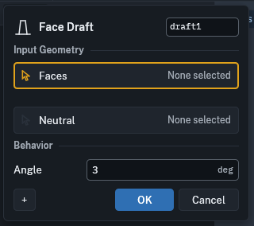

**part/3D Model/Draft** · redo · score 103

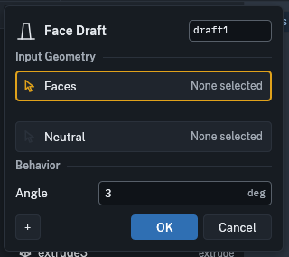

**part/3D Model/Split** · redo · score 103

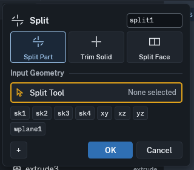

**part/3D Model/Combine** · redo · score 103

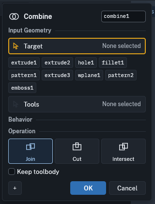

**part/3D Model/Delete Face** · redo · score 103

**plate/Assemble/Content Center** · redo · score 63

**sketch/Assemble/Content Center** · redo · score 63

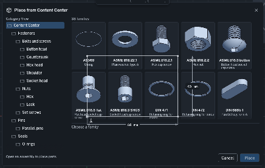

**assembly/Assemble/Content Center** · redo · score 63

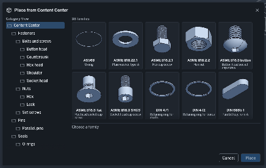

**sheet/Sheet Metal/Insert Hardware** · redo · score 63

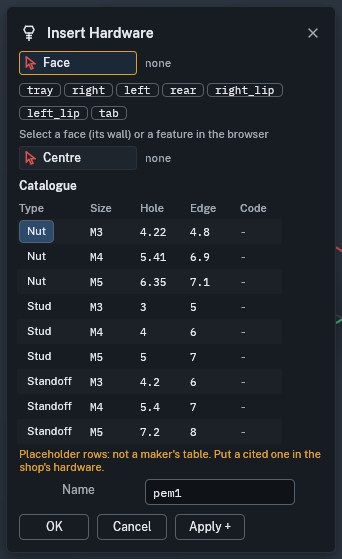

**cam/Manufacture/Tool Library** · redo · score 59

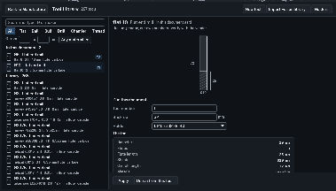

**sheet/Sheet Metal/PunchTool** · redo · score 51

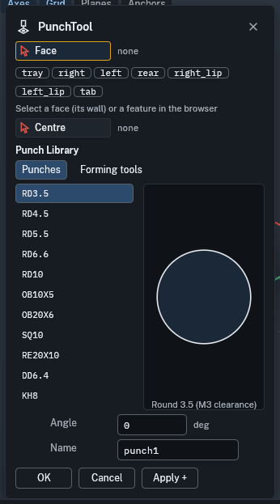

**plate/3D Model/Hole** · redo · score 43

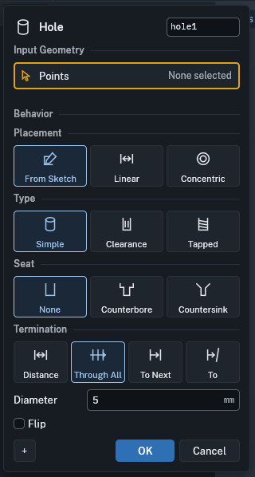

**plate/3D Model/Thread** · redo · score 43

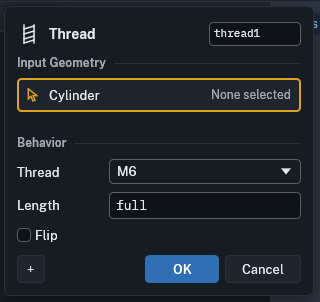

**part/3D Model/Hole** · redo · score 43

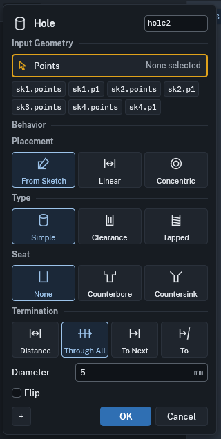

**part/3D Model/Thread** · redo · score 43

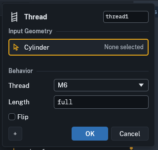

**part/3D Model/Direct** · redo · score 43

**sketch/3D Model/Hole** · redo · score 43

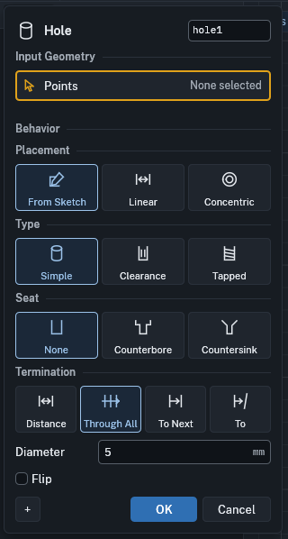

**sketch/3D Model/Thread** · redo · score 43

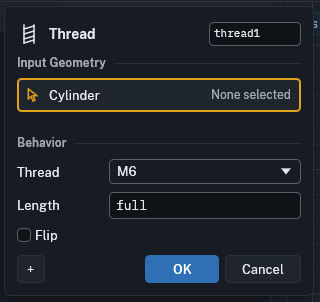

**assembly/3D Model/Hole** · redo · score 43

**assembly/3D Model/Combine** · redo · score 43

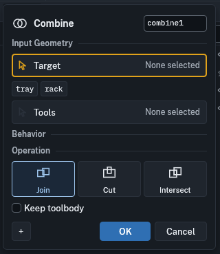

**cam/Manufacture/Thread Mill** · redo · score 43

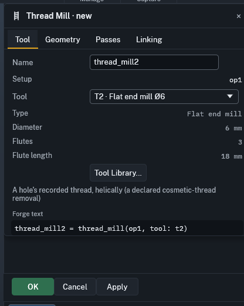

**sheet/menu Browser: flange row/edit** · redo · score 42

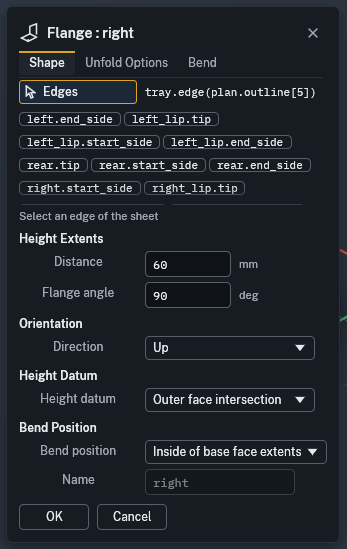

**sheet/Sheet Metal/Flange** · redo · score 42

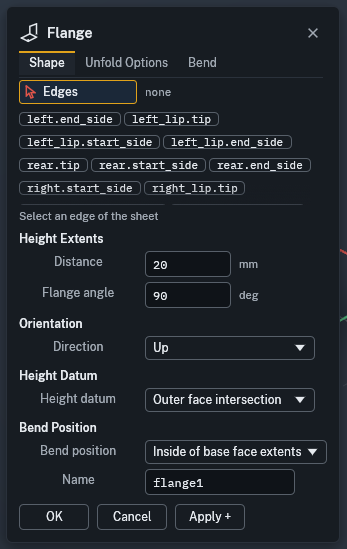

**sheet/Sheet Metal/Hem** · redo · score 42

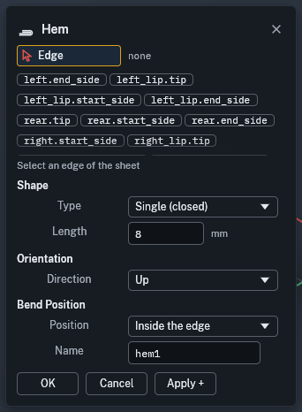

**cam/Manufacture/Record Turntable** · fix · score 38

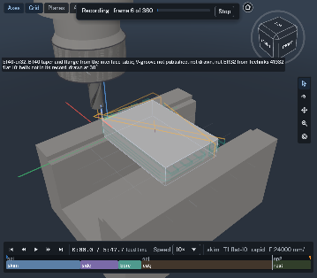

**assembly/Assemble/Bill of Materials** · fix · score 36

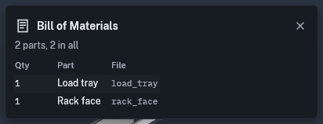

**sheet/Sheet Metal/Fold** · fix · score 36

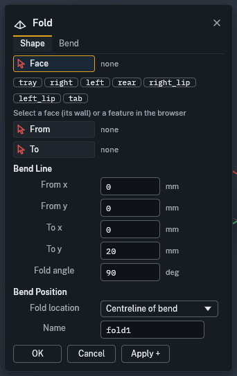

**sheet/Sheet Metal/Jog** · fix · score 36

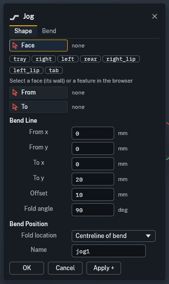

**sheet/Sheet Metal/Corner Seam** · fix · score 36

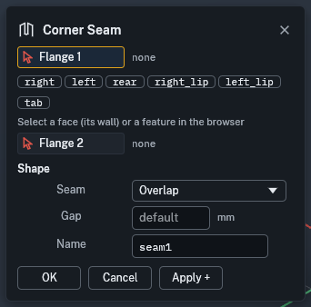

**sheet/Sheet Metal/Corner Relief** · fix · score 36

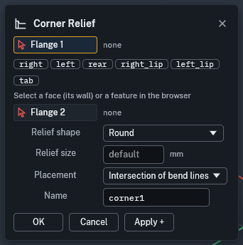

**sheet/Flat Pattern: Flat Pattern/Bend Table** · fix · score 36

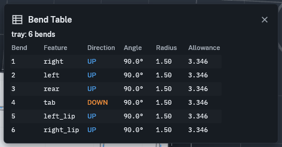

**plate/menu File/New Drawing...** · fix · score 33

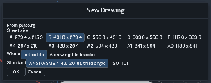

**sketch/menu File/New Drawing...** · fix · score 33

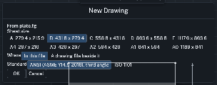

**assembly/menu File/New Drawing...** · fix · score 33

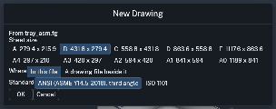

**plate/Inspect/Materials** · fix · score 32

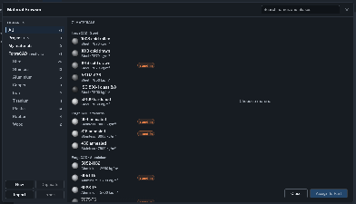

**sketch/Inspect/Materials** · fix · score 32

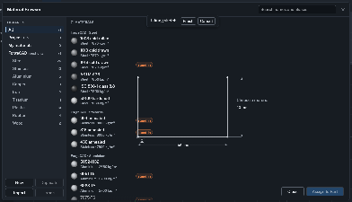

**sheet/Sheet Metal/Vendor** · fix · score 30

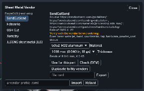

**cam/Manufacture/New Setup** · fix · score 28

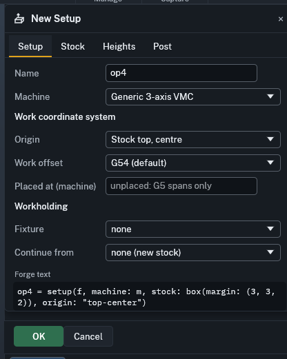

**cam/Manufacture/Face** · fix · score 28

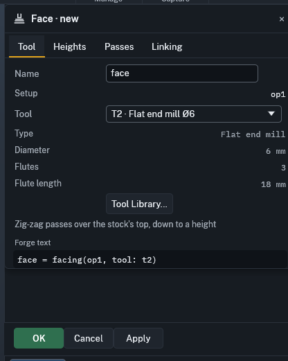

**cam/Manufacture/2D Clear** · fix · score 28

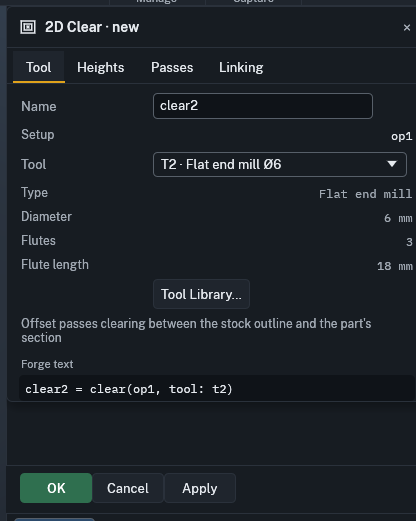

**cam/Manufacture/2D Contour** · fix · score 28

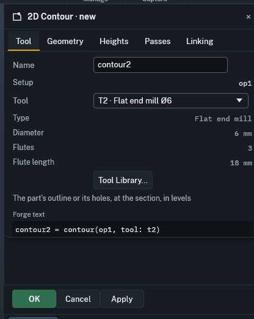

**cam/Manufacture/Pocket** · fix · score 28

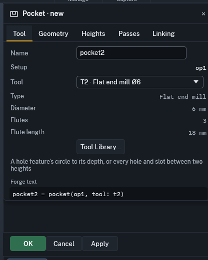

**cam/Manufacture/Chamfer** · fix · score 28

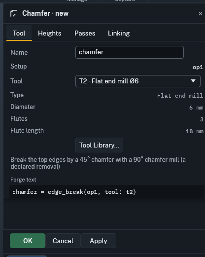

**cam/Manufacture/Engrave** · fix · score 28

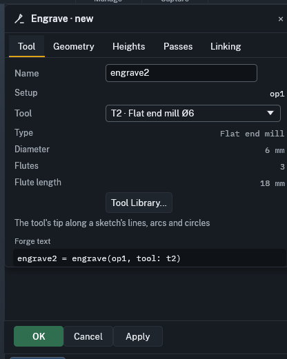

**cam/Manufacture/Adaptive** · fix · score 28

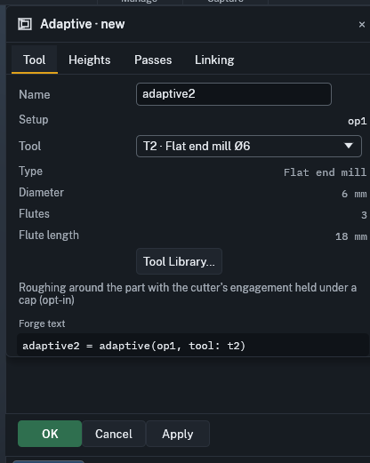

**cam/Manufacture/Drill** · fix · score 28

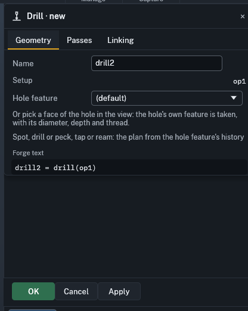

**cam/Manufacture/Bore** · fix · score 28

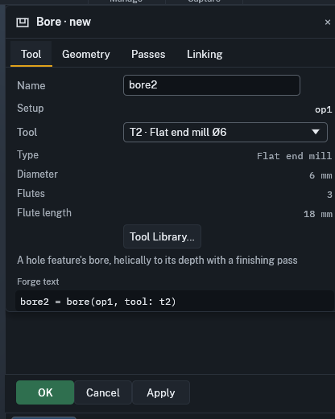

**cam/Manufacture/3D Rough** · fix · score 28

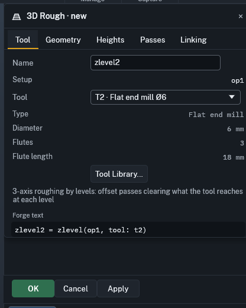

**cam/Manufacture/Parallel** · fix · score 28

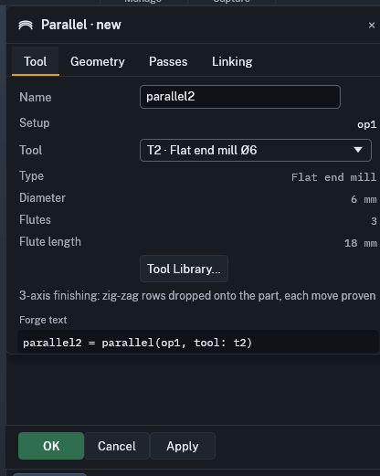

**cam/Manufacture/Waterline** · fix · score 28

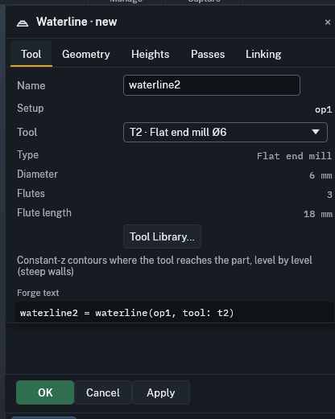

**cam/Manufacture/Pencil** · fix · score 28

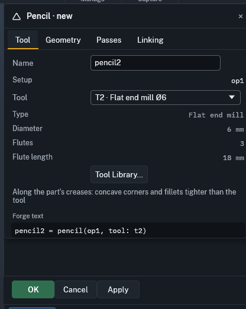

**cam/Manufacture/Scallop** · fix · score 28

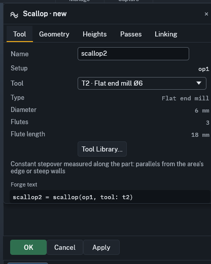

**cam/Manufacture/Rest Finish** · fix · score 28

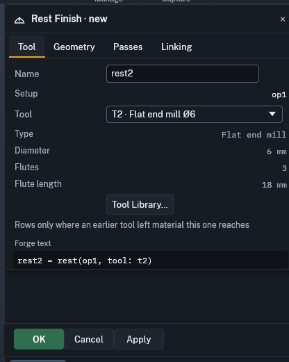

**start/Manage/Settings** · fix · score 22

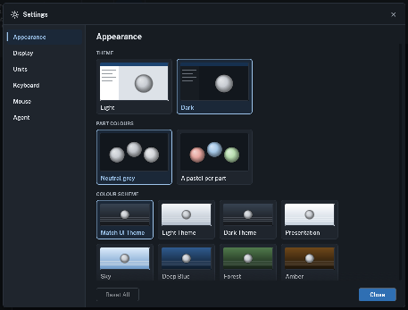

**plate/Inspect/Mass** · fix · score 22

**sketch/Inspect/Mass** · fix · score 22

**weld/menu Browser: end_cap row/edit** · fix · score 18

**assembly/Inspect/Materials** · fix · score 16

**plate/Thermoform: Thermoform/Capture Settings** · fix · score 14

**plate/Robot: Robot/Capture Settings** · fix · score 14

**plate/Render Studio: Render Studio/Capture Settings** · fix · score 14

**sheet/Flat Pattern: Flat Pattern/Capture Settings** · fix · score 14

**weld/Weldments/Cut List** · fix · score 14

**plate/Assemble/Joint** · fix · score 9

**plate/Assemble/Constrain** · fix · score 9

**sketch/Assemble/Joint** · fix · score 9

**sketch/Assemble/Constrain** · fix · score 9

**assembly/Assemble/Joint** · fix · score 9

**assembly/Assemble/Constrain** · fix · score 9

**assembly/Harness/Create Harness** · fix · score 9

**sheet/Sheet Metal/Sheet Metal Defaults** · fix · score 9

**sheet/Sheet Metal/Rules** · fix · score 9

**cam/menu File/New Drawing...** · fix · score 9

**cam/Manufacture/Document Text** · fix · score 9

**drawing/Annotate/Feature Control Frame** · fix · score 9

**drawing/Annotate/Surface** · fix · score 9

**plate/3D Model/Convert to Thermoform** · good · score 6

**plate/Assemble/Bill of Materials** · good · score 6

**plate/Assemble/Parameters** · good · score 6

**plate/Assemble/Explode** · good · score 6

**plate/Weldments/Cut List** · good · score 6

**plate/Inspect/Section** · good · score 6

**plate/Inspect/iProperties** · good · score 6

**plate/View/Capture Settings** · good · score 6

**plate/Manage/Parameters** · good · score 6

**plate/Manage/Create Version** · good · score 6

**plate/Manage/Release** · good · score 6

**plate/Manage/Settings** · good · score 6

**plate/Environments/Drawing** · good · score 6

**part/3D Model/Shell** · good · score 6

**part/3D Model/Convert to Thermoform** · good · score 6

**part/Environments/Drawing** · good · score 6

**sketch/3D Model/Convert to Thermoform** · good · score 6

**sketch/Assemble/Bill of Materials** · good · score 6

**sketch/Assemble/Parameters** · good · score 6

**sketch/Assemble/Explode** · good · score 6

**sketch/Weldments/Cut List** · good · score 6

**sketch/Inspect/Section** · good · score 6

**sketch/Inspect/iProperties** · good · score 6

**sketch/View/Capture Settings** · good · score 6

**sketch/Manage/Parameters** · good · score 6

**sketch/Manage/Create Version** · good · score 6

**sketch/Manage/Release** · good · score 6

**sketch/Manage/Settings** · good · score 6

**sketch/Environments/Drawing** · good · score 6

**assembly/3D Model/Shell** · good · score 6

**assembly/3D Model/Convert to Thermoform** · good · score 6

**assembly/Assemble/Parameters** · good · score 6

**assembly/Assemble/Explode** · good · score 6

**assembly/Weldments/Cut List** · good · score 6

**assembly/Inspect/Analyze Interference** · good · score 6

**assembly/Inspect/Mass** · good · score 6

**assembly/Inspect/Section** · good · score 6

**assembly/Inspect/iProperties** · good · score 6

**assembly/View/Explode** · good · score 6

**assembly/View/Capture Settings** · good · score 6

**assembly/Manage/Parameters** · good · score 6

**assembly/Manage/Create Version** · good · score 6

**assembly/Manage/Release** · good · score 6

**assembly/Manage/Settings** · good · score 6

**assembly/Environments/Drawing** · good · score 6

**sheet/menu Browser: sheet row/edit** · good · score 6

**sheet/Sheet Metal/Face** · good · score 6

**sheet/Sheet Metal/Contour Flange** · good · score 6

**sheet/Sheet Metal/Cut** · good · score 6

**sheet/Sheet Metal/Corner Round** · good · score 6

**sheet/Sheet Metal/Unfold** · good · score 6

**sheet/Sheet Metal/Check (DFM)** · good · score 6

**sheet/Environments/Drawing** · good · score 6

**sheet/Flat Pattern: Flat Pattern/Check (DFM)** · good · score 6

**sheet/Flat Pattern: Flat Pattern/Save Copy As DXF/DWG** · good · score 6

**sheet/Bend Simulation: Bend Simulation/Capture Settings** · good · score 6

**cam/Manufacture/Capture Settings** · good · score 6

**thermo/Environments/Drawing** · good · score 6

**drawing/Place Views/Base** · good · score 6

**drawing/Annotate/Datum Identifier** · good · score 6

**drawing/Annotate/Welding** · good · score 6

**plate/menu Browser: extrude row/edit** · good · score 3

**plate/3D Model/Loft** · good · score 3

**plate/3D Model/Sweep** · good · score 3

**plate/3D Model/Coil** · good · score 3

**plate/3D Model/Rib** · good · score 3

**plate/3D Model/Emboss** · good · score 3

**plate/3D Model/Import** · good · score 3

**plate/3D Model/Fillet** · good · score 3

**plate/3D Model/Chamfer** · good · score 3

**plate/3D Model/Shell** · good · score 3

**plate/3D Model/Split** · good · score 3

**plate/3D Model/Combine** · good · score 3

**plate/3D Model/Thicken** · good · score 3

**plate/3D Model/Direct** · good · score 3

**plate/3D Model/Delete Face** · good · score 3

**plate/3D Model/Replace** · good · score 3

**plate/3D Model/Plane** · good · score 3

**plate/3D Model/Axis** · good · score 3

**plate/3D Model/Point** · good · score 3

**plate/3D Model/UCS** · good · score 3

**plate/3D Model/Rectangular** · good · score 3

**plate/3D Model/Circular** · good · score 3

**plate/3D Model/Sketch** · good · score 3

**plate/3D Model/Mirror** · good · score 3

**plate/3D Model/Move** · good · score 3

**plate/3D Model/Copy** · good · score 3

**plate/Assemble/Place** · good · score 3

**plate/Assemble/Free Move** · good · score 3

**plate/Assemble/Free Rotate** · good · score 3

**plate/Weldments/Members** · good · score 3

**plate/Weldments/End Trim** · good · score 3

**plate/Weldments/End Cap** · good · score 3

**plate/Weldments/Corner Plate** · good · score 3

**plate/Inspect/Measure** · good · score 3

**plate/Inspect/Wall** · good · score 3

**part/menu Browser: extrude row/edit** · good · score 3

**part/menu Browser: hole row/edit** · good · score 3

**part/menu Browser: fillet row/edit** · good · score 3

**part/3D Model/Loft** · good · score 3

**part/3D Model/Sweep** · good · score 3

**part/3D Model/Coil** · good · score 3

**part/3D Model/Rib** · good · score 3

**part/3D Model/Emboss** · good · score 3

**part/3D Model/Import** · good · score 3

**part/3D Model/Fillet** · good · score 3

**part/3D Model/Chamfer** · good · score 3

**part/3D Model/Thicken** · good · score 3

**part/3D Model/Replace** · good · score 3

**part/3D Model/Plane** · good · score 3

**part/3D Model/Axis** · good · score 3

**part/3D Model/Point** · good · score 3

**part/3D Model/UCS** · good · score 3

**part/3D Model/Rectangular** · good · score 3

**part/3D Model/Circular** · good · score 3

**part/3D Model/Sketch** · good · score 3

**part/3D Model/Mirror** · good · score 3

**part/3D Model/Move** · good · score 3

**part/3D Model/Copy** · good · score 3

**sketch/menu Browser: extrude row/edit** · good · score 3

**sketch/3D Model/Loft** · good · score 3

**sketch/3D Model/Sweep** · good · score 3

**sketch/3D Model/Coil** · good · score 3

**sketch/3D Model/Rib** · good · score 3

**sketch/3D Model/Emboss** · good · score 3

**sketch/3D Model/Import** · good · score 3

**sketch/3D Model/Fillet** · good · score 3

**sketch/3D Model/Chamfer** · good · score 3

**sketch/3D Model/Shell** · good · score 3

**sketch/3D Model/Draft** · good · score 3

**sketch/3D Model/Split** · good · score 3

**sketch/3D Model/Combine** · good · score 3

**sketch/3D Model/Thicken** · good · score 3

**sketch/3D Model/Direct** · good · score 3

**sketch/3D Model/Delete Face** · good · score 3

**sketch/3D Model/Replace** · good · score 3

**sketch/3D Model/Plane** · good · score 3

**sketch/3D Model/Axis** · good · score 3

**sketch/3D Model/Point** · good · score 3

**sketch/3D Model/UCS** · good · score 3

**sketch/3D Model/Rectangular** · good · score 3

**sketch/3D Model/Circular** · good · score 3

**sketch/3D Model/Sketch** · good · score 3

**sketch/3D Model/Mirror** · good · score 3

**sketch/3D Model/Move** · good · score 3

**sketch/3D Model/Copy** · good · score 3

**sketch/Assemble/Place** · good · score 3

**sketch/Assemble/Free Move** · good · score 3

**sketch/Assemble/Free Rotate** · good · score 3

**sketch/Weldments/Members** · good · score 3

**sketch/Weldments/End Trim** · good · score 3

**sketch/Weldments/End Cap** · good · score 3

**sketch/Weldments/Corner Plate** · good · score 3

**sketch/Inspect/Measure** · good · score 3

**sketch/Inspect/Wall** · good · score 3

**assembly/3D Model/Extrude** · good · score 3

**assembly/3D Model/Revolve** · good · score 3

**assembly/3D Model/Loft** · good · score 3

**assembly/3D Model/Sweep** · good · score 3

**assembly/3D Model/Coil** · good · score 3

**assembly/3D Model/Rib** · good · score 3

**assembly/3D Model/Emboss** · good · score 3

**assembly/3D Model/Import** · good · score 3

**assembly/3D Model/Fillet** · good · score 3

**assembly/3D Model/Chamfer** · good · score 3

**assembly/3D Model/Draft** · good · score 3

**assembly/3D Model/Thread** · good · score 3

**assembly/3D Model/Split** · good · score 3

**assembly/3D Model/Thicken** · good · score 3

**assembly/3D Model/Direct** · good · score 3

**assembly/3D Model/Delete Face** · good · score 3

**assembly/3D Model/Replace** · good · score 3

**assembly/3D Model/Plane** · good · score 3

**assembly/3D Model/Axis** · good · score 3

**assembly/3D Model/Point** · good · score 3

**assembly/3D Model/UCS** · good · score 3

**assembly/3D Model/Rectangular** · good · score 3

**assembly/3D Model/Circular** · good · score 3

**assembly/3D Model/Sketch** · good · score 3

**assembly/3D Model/Mirror** · good · score 3

**assembly/3D Model/Move** · good · score 3

**assembly/3D Model/Copy** · good · score 3

**assembly/Assemble/Place** · good · score 3

**assembly/Assemble/Free Move** · good · score 3

**assembly/Assemble/Free Rotate** · good · score 3

**assembly/Weldments/Members** · good · score 3

**assembly/Weldments/End Trim** · good · score 3

**assembly/Weldments/End Cap** · good · score 3

**assembly/Weldments/Corner Plate** · good · score 3

**assembly/Inspect/Measure** · good · score 3

**assembly/Inspect/Wall** · good · score 3

**cam/Manufacture/Post Process** · good · score 3

**cam/Manufacture/NC Programs** · good · score 3

**cam/Manufacture/Quality** · good · score 3

**cam/Manufacture/Check Now** · good · score 3

**thermo/menu Browser: extrude row/edit** · good · score 3

**thermo/menu Browser: fillet row/edit** · good · score 3

**weld/Weldments/Members** · good · score 3

**weld/Weldments/End Trim** · good · score 3

**weld/Weldments/End Cap** · good · score 3

**weld/Weldments/Corner Plate** · good · score 3

**plate/menu Browser: sketch row/edit-sketch** · good · score 0

**plate/3D Model/Start Sketch** · good · score 0

**plate/3D Model/Extrude** · good · score 0

**plate/3D Model/Revolve** · good · score 0

**plate/Weldments/Start Sketch** · good · score 0

**plate/View/Photo** · good · score 0

**plate/View/Record Turntable** · good · score 0

**plate/Thermoform: Thermoform/Photo** · good · score 0

**plate/Thermoform: Thermoform/Record Turntable** · good · score 0

**plate/Robot: Robot/Photo** · good · score 0

**plate/Robot: Robot/Record Turntable** · good · score 0

**plate/Render Studio: Render Studio/Photo** · good · score 0

**plate/Render Studio: Render Studio/Record Turntable** · good · score 0

**part/menu Browser: sketch row/edit-sketch** · good · score 0

**part/3D Model/Start Sketch** · good · score 0

**part/3D Model/Extrude** · good · score 0

**part/3D Model/Revolve** · good · score 0

**sketch/3D Model/Start Sketch** · good · score 0

**sketch/3D Model/Extrude** · good · score 0

**sketch/3D Model/Revolve** · good · score 0

**sketch/Weldments/Start Sketch** · good · score 0

**sketch/View/Photo** · good · score 0

**sketch/View/Record Turntable** · good · score 0

**assembly/3D Model/Start Sketch** · good · score 0

**assembly/Weldments/Start Sketch** · good · score 0

**assembly/View/Photo** · good · score 0

**assembly/View/Record Turntable** · good · score 0

**sheet/menu Browser: sketch row/edit-sketch** · good · score 0

**sheet/Sheet Metal/Start 2D Sketch** · good · score 0

**sheet/Flat Pattern: Flat Pattern/Photo** · good · score 0

**sheet/Flat Pattern: Flat Pattern/Record Turntable** · good · score 0

**sheet/Bend Simulation: Bend Simulation/Photo** · good · score 0

**sheet/Bend Simulation: Bend Simulation/Record** · good · score 0

**cam/Manufacture/Photo** · good · score 0

**thermo/menu Browser: sketch row/edit-sketch** · good · score 0

**weld/menu Browser: sketch row/edit-sketch** · good · score 0

**weld/Weldments/Start Sketch** · good · score 0

**drawing/Place Views/Projected** · good · score 0

**drawing/Place Views/Auxiliary** · good · score 0

**drawing/Place Views/Section** · good · score 0

**drawing/Place Views/Detail** · good · score 0

**drawing/Place Views/Break** · good · score 0

**drawing/Place Views/Crop** · good · score 0

**drawing/Annotate/Dimension** · good · score 0

**drawing/Annotate/Baseline** · good · score 0

**drawing/Annotate/Ordinate** · good · score 0

**drawing/Annotate/Chain** · good · score 0

**drawing/Annotate/Hole and Thread** · good · score 0

**drawing/Annotate/Datum Target** · good · score 0

**drawing/Annotate/Edge** · good · score 0

**drawing/Annotate/Text** · good · score 0

**drawing/Annotate/Leader Text** · good · score 0

**drawing/Annotate/Automated Centerlines** · good · score 0

**drawing/Annotate/Center Mark** · good · score 0

**drawing/Annotate/Centerline** · good · score 0

**drawing/Annotate/Bisector** · good · score 0

**drawing/Annotate/Parts List** · good · score 0

**drawing/Annotate/Balloon** · good · score 0

**drawing/Annotate/Auto Balloon** · good · score 0

**drawing/Sketch/Text** · good · score 0

**drawing/Sketch/Leader Text** · good · score 0

